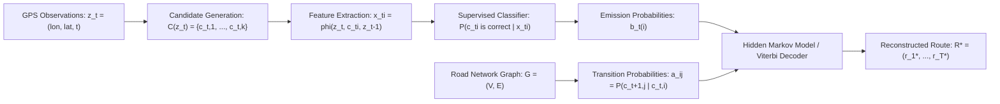

# 01. Problem Understanding & Mathematical Formulation

> **Document Context:** PathSnap: Distributed Map-Matching & Route Reconstruction  
> **Course / Hackathon:** UE24CS352A Machine Learning, PES University  
> **Primary Guidelines Cites:**  
> - `Main Guidelines.pdf`, pp. 1–2 (Challenge Overview & Two-Laptop Deployment)  
> - `Dataset Exploration.pdf`, pp. 1–4 (Problem Definition & File Schemas)  
> - `Models and Training Guidelines.pdf`, pp. 1–6 (Candidate Scoring & Sequential Reconstruction)  
> - `Problem Statement.mp4` (Visual Demonstration of Urban Canyon Noise & Map Matching)

---

## 1. Challenge Overview & Problem Decomposition

### 1.1 The Physical Reality of GPS Trajectories
In real-world vehicle tracking, Global Positioning System (GPS) receivers do not measure vehicle locations with pinpoint accuracy. As illustrated in `Problem Statement.mp4` and `Main Guidelines.pdf` (p. 1), real-world satellite measurements are corrupted by:
- **Urban Canyon Multipath Effects:** Satellite signals bounce off skyscrapers, concrete structures, and metallic surfaces before reaching the receiver, creating pseudo-range errors that displace the observed coordinate by tens of meters.
- **Atmospheric Noise & Measurement Drift:** Ionospheric and tropospheric delays generate continuous Gaussian and non-Gaussian positional jitter ($\sigma_{\text{GPS}} \approx 5 \text{ to } 25 \text{ meters}$).
- **GPS Dropouts & Missing Data:** Signal occlusion under bridges, tunnels, tree canopies, or during receiver re-acquisition causes temporal gaps where no observations are recorded ($\Delta t \gg 1\text{s}$).
- **Irregular Sampling Intervals & Low Sampling Rates:** While nominally sampled at $1\text{ Hz}$ (approx. 97% of intervals in our dataset), intermittent delays create non-uniform temporal intervals.
- **Topological Ambiguities:** In dense urban road grids, elevated freeways, or dual-carriageway boulevards, a noisy GPS point may fall closer to an adjacent parallel street or crossing overpass than to the actual traversed road segment.

Consequently, raw GPS trajectories plot across building rooftops, jump across parallel alleys, or describe physically impossible maneuvers (instantaneous 180-degree turns, infinite acceleration).

### 1.2 Core Objective of PathSnap
**PathSnap** is a distributed machine learning and sequential inference system designed to solve the **Map-Matching and Route Reconstruction** problem:
> Given a chronological sequence of noisy GPS observations $Z = (z_1, z_2, \dots, z_T)$ from a vehicle trip and a directed geographical road-network graph $G = (V, E)$, reconstruct the true physical sequence of road segments (arcs) $R^* = (r_1^*, r_2^*, \dots, r_T^*)$ or continuous route $P^* = (e_1, e_2, \dots, e_M)$ traversed by the vehicle.

---

## 2. Mathematical Formulation

The map-matching challenge cannot be solved effectively as either a pure static classification problem or a pure graph search algorithm. It is intrinsically a **hybrid sequential decision process**: local spatial-kinematic features identify plausible road segments, while global graph topology enforces kinematic continuity.

### 2.1 The Problem as Supervised Machine Learning
For each individual GPS observation $z_t = (\text{lon}_t, \text{lat}_t, \text{time}_t)$, spatial indexing extracts a set of $K$ candidate road segments from the road network:
$$C(z_t) = \{ c_{t, 1}, c_{t, 2}, \dots, c_{t, K} \} \subset E$$

For each candidate arc $c_{t, i} \in C(z_t)$, we extract a feature vector:
$$x_{t, i} = \phi(z_t, c_{t, i}, z_{t-1}, z_{t+1}) \in \mathbb{R}^D$$
encompassing spatial distance, bearing alignment, point-to-segment projection, speed plausibility, and local network topology.

The supervised learning task is formulated as **candidate scoring / binary classification**:
$$f_\theta: \mathbb{R}^D \to [0, 1], \quad \hat{p}_{t, i} = P(y_{t, i} = 1 \mid x_{t, i})$$
where $y_{t, i} = 1$ if candidate arc $c_{t, i}$ is the true road segment traversed by the vehicle at time $t$, and $y_{t, i} = 0$ otherwise.

**Limitation of Classifier-Only Prediction:**  
If we simply select $\hat{r}_t = \arg\max_{c_{t, i}} \hat{p}_{t, i}$ independently at each time step, sensor noise will inevitably cause $\hat{r}_t$ and $\hat{r}_{t+1}$ to jump across disconnected roads, producing an unrealistic, disjointed trajectory.

### 2.2 The Problem as Sequential Probabilistic Inference (Hidden Markov Model)
To enforce topological and kinematic realism, the trajectory is modeled as a discrete-time **Hidden Markov Model (HMM)**:
- **Hidden States ($S_t$):** The true road segment traversed by the vehicle at time step $t$, taking values in candidate set $C(z_t)$.
- **Observations ($O_t$):** The observed GPS point $z_t = (\text{lon}_t, \text{lat}_t, \text{time}_t)$.
- **Emission Probability ($b_t(i) = P(z_t \mid S_t = c_{t, i})$):** The likelihood that the vehicle being on candidate segment $c_{t, i}$ would produce observation $z_t$. This is derived directly from the calibrated probabilities of our supervised ML model:
  $$b_t(i) \propto P(y_{t, i} = 1 \mid x_{t, i})$$
  or a hybrid combination with the spatial Gaussian likelihood:
  $$P_{\text{spatial}}(z_t \mid c_{t, i}) = \frac{1}{\sqrt{2\pi}\sigma_z} \exp\left( - \frac{d(z_t, c_{t, i})^2}{2\sigma_z^2} \right)$$
- **Transition Probability ($a_{ij}(t) = P(S_{t+1} = c_{t+1, j} \mid S_t = c_{t, i})$):** The probability of moving from road segment $c_{t, i}$ to $c_{t+1, j}$ in time interval $\Delta t = t_{t+1} - t_t$. This is governed by network shortest-path reachability and vehicle kinematic displacement:
  $$a_{ij}(t) \propto \frac{1}{\beta} \exp\left( - \frac{|d_{\text{network}}(c_{t, i}, c_{t+1, j}) - d_{\text{Euclidean}}(z_t, z_{t+1})|}{\beta} \right)$$
  where $d_{\text{network}}(c_{t, i}, c_{t+1, j})$ is the shortest directed path distance in the road network graph between the projected positions on the two segments. If $c_{t+1, j}$ is topologically unreachable from $c_{t, i}$ within physically plausible travel limits, $a_{ij}(t) = 0$.

### 2.3 Optimal Route Decoding via the Viterbi Algorithm
The global joint likelihood of hidden state sequence $R = (r_1, r_2, \dots, r_T)$ given observations $Z = (z_1, z_2, \dots, z_T)$ is:
$$P(R \mid Z) \propto P(r_1) b_1(r_1) \prod_{t=1}^{T-1} a_{r_t, r_{t+1}}(t) \cdot b_{t+1}(r_{t+1})$$

The globally optimal sequence of road segments $R^*$ is recovered via dynamic programming (Viterbi Decoding) in logarithmic space to prevent numerical underflow:
$$V_1(i) = \ln \pi_i + \ln b_1(i)$$
$$V_{t}(j) = \max_{i \in C(z_{t-1})} \left[ V_{t-1}(i) + \ln a_{ij}(t-1) \right] + \ln b_t(j)$$
$$\text{Backpointer: } \psi_t(j) = \arg\max_{i \in C(z_{t-1})} \left[ V_{t-1}(i) + \ln a_{ij}(t-1) \right]$$

Termination and backtracking recover the globally optimal, topologically connected sequence of road segments $R^* = (r_1^*, \dots, r_T^*)$ in $O(T \cdot K^2)$ time.

---

## 3. Formal System Inputs and Outputs

### Inputs (Per Trip)
1. **GPS Observation Track (`.track`):**
   - Stream of $T$ chronological rows without headers.
   - Format: `longitude  latitude  timestamp_in_seconds`
   - Nominal sampling rate: $1\text{ Hz}$ (~97% of steps separated by $1\text{ s}$).
2. **Road-Network Nodes (`.nodes`):**
   - $N$ rows without headers.
   - Format: `longitude  latitude`
   - 0-based row index defines `node_id` $\in \{0, 1, \dots, N-1\}$.
3. **Road-Network Arcs (`.arcs`):**
   - $M$ rows without headers.
   - Format: `from_node_id  to_node_id`
   - 0-based row index defines `arc_id` $\in \{0, 1, \dots, M-1\}$.
   - Directed edges representing physical road segments.
4. **Reference Route (`.route`) [Training & Development Only]:**
   - Sequence of ground-truth `arc_id` values traversed chronologically by the vehicle.
   - *CRITICAL:* Not supplied to the inference pipeline during evaluator testing.

### Outputs
1. **Observation-Level Predictions:**
   - A predicted `arc_id` $\hat{r}_t \in \{0, \dots, M-1\}$ for every GPS observation $z_t \in \{1, \dots, T\}$.
2. **Continuous Reconstructed Route:**
   - The sequence of road segments describing a connected, kinematically valid path through road network $G$.
3. **API Response Payload:**
   - JSON payload returned by Laptop 1 to Laptop 2 containing the trip ID, predicted arc sequence, computed evaluation metrics against server-side reference data, and summary statistics.
4. **Interactive Folium Visualisation:**
   - Geographical web rendering displaying original GPS dots (blue), road network geometry (grey/black), reference route (green), and predicted route (red/dashed).

---

## 4. Challenge Requirements & Constraints Checklist

Based on an exhaustive review of all hackathon guidelines, the mandatory requirements are tabulated below:

| # | Requirement Category | Specific Rule / Deliverable | Document & Page Citation | Status in Our Strategy |
|---|---|---|---|---|
| **REQ-1** | **Model Comparison** | Must train and compare at least **FIVE distinct ML models** from different algorithm families before selecting the final model. | `Models and Training Guidelines.pdf`, p. 1; `Assessment and Plagiarism Policy.pdf`, p. 1 | Designed: Logistic Reg, Random Forest, Extra Trees, HistGradientBoosting, MLP |
| **REQ-2** | **Bayesian Optimisation** | Must perform Bayesian hyperparameter optimisation (e.g., Optuna) on the chosen model using group-aware CV; retain trial logs. | `Models and Training Guidelines.pdf`, p. 4; `Deliverables.pdf`, p. 5 | Designed: Optuna with Stratified Group K-Fold targeting Macro-F1 |
| **REQ-3** | **Sequential Decoding** | Must implement HMM + Viterbi decoding and experimentally compare **Classifier-Only vs. Classifier + HMM**. | `Models and Training Guidelines.pdf`, pp. 4–5; `Deliverables.pdf`, pp. 5–6 | Designed: Dynamic programming log-Viterbi with network transition penalty |
| **REQ-4** | **Deployment Architecture** | Two-laptop distributed deployment: Laptop 1 runs FastAPI backend; Laptop 2 runs Evaluator UI. | `Main Guidelines.pdf`, p. 2; `Deliverables.pdf`, pp. 1, 6 | Designed: FastAPI REST API + Streamlit/HTML5 Leaflet UI |
| **REQ-5** | **Data Leakage Restriction** | Evaluator-testing partition (10 trips) must remain untouched. Evaluator ground truth must NEVER enter the client UI or model inputs. | `Dataset Exploration.pdf`, p. 3; `Assessment and Plagiarism Policy.pdf`, p. 3 | Enforced: Evaluator data isolated on Laptop 1 server-side only |
| **REQ-6** | **Validation Strategy** | Must use trip-level separation (Group-Aware CV on 80 training trips). No GPS points from the same trip across train/val splits. | `Dataset Exploration.pdf`, p. 3; `Models and Training Guidelines.pdf`, p. 2 | Enforced: `GroupKFold` / `StratifiedGroupKFold` grouped strictly by `trip_id` |
| **REQ-7** | **Geodesic Calculations** | Ordinary Euclidean distance in lat/lon degrees is prohibited. Must use geodesic or projected coordinates. | `Dataset Exploration.pdf`, p. 2 | Enforced: Local Transverse Mercator metric projection (meters) |
| **REQ-8** | **Folium Visualisation** | Must generate interactive Folium maps comparing raw GPS, road network, reference route, and predicted route. | `Deliverables.pdf`, p. 6 | Designed: Multi-layer Folium maps with LayerControl and styled polylines |
| **REQ-9** | **Required Metrics** | Must report Top-1 Accuracy, Candidate Miss Rate, Macro F1, Precision, Recall, Log Loss, Route Continuity, Training/Inference Time. | `Models and Training Guidelines.pdf`, pp. 2–3 | Fully formulated with explicit mathematical definitions |
| **REQ-10**| **Academic Integrity** | No hardcoded outputs; code, weights, and results will be checked for plagiarism and cross-team similarity. | `Assessment and Plagiarism Policy.pdf`, pp. 1–3 | Guaranteed: 100% independent codebase, reproducible seeds, live API logging |
