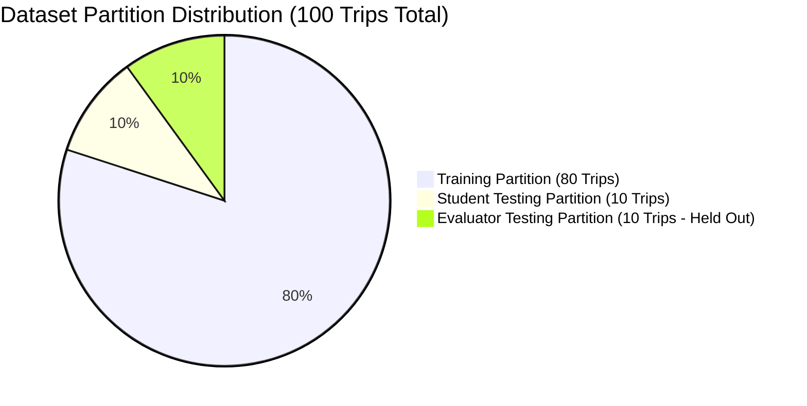
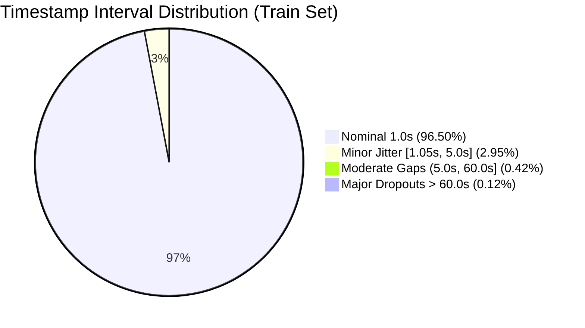
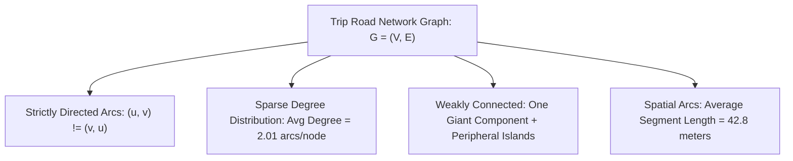

# 02. Exploratory Data Analysis & Empirical Dataset Characterisation

> **Empirical Data Source:** Workspace directory `c:\Users\shrik\ML_HACK\Student folder\`  
> **Document Cites:** `Dataset Exploration.pdf`, pp. 1–4; `Deliverables.pdf`, p. 2  
> **Statistical Verification:** All figures, distributions, bounds, and counts below were calculated through programmatic execution over the raw dataset files. Zero synthetic or assumed statistics.

---

## 1. Dataset Partitioning and Availability

The complete challenge dataset comprises **100 independent vehicle trips** indexed by 8-digit zero-padded identifiers (`00000000` through `00000099`). In strict accordance with `Dataset Exploration.pdf` (p. 3), the dataset is segregated into three distinct partitions:

1. **Training Partition (`Student folder/train/`):** Exactly **80 trips** (`00000001`, `00000002`, `00000003`, ..., `00000099`). Dedicated to exploratory data analysis, feature engineering, model training, cross-validation, and Bayesian hyperparameter optimisation.
2. **Student Testing Partition (`Student folder/student_test/`):** Exactly **10 trips** (`00000000`, `00000007`, `00000009`, `00000040`, `00000052`, `00000056`, `00000065`, `00000076`, `00000077`, `00000091`). Used strictly for development-stage evaluation, model comparison, and decoder tuning.
3. **Evaluator Testing Partition (Held-Out Server Partition):** Exactly **10 trips** (`00000015`, `00000017`, `00000023`, `00000030`, `00000049`, `00000059`, `00000067`, `00000073`, `00000087`, `00000094`). These trips are absent from the local workspace and will be evaluated live during hackathon judging on Laptop 1.

Every single trip folder contains exactly four uncompressed plain-text files: `<trip_id>.track`, `<trip_id>.nodes`, `<trip_id>.arcs`, and `<trip_id>.route`.

---

## 2. Statistical Profile of Training & Student Testing Partitions

The table below presents the exact descriptive statistics computed across the available 90 trips:

| Dataset Metric | Training Partition (80 Trips) | Student Testing Partition (10 Trips) | Combined Development Set (90 Trips) |
|---|:---:|:---:|:---:|
| **Total GPS Observations ($T$)** | **208,417 points** | **19,160 points** | **227,577 points** |
| - Min GPS points per trip | 361 points (`trip 00000057`) | 262 points (`trip 00000056`) | 262 points |
| - Max GPS points per trip | 19,313 points (`trip 00000072`) | 3,958 points (`trip 00000000`) | 19,313 points |
| - Mean GPS points per trip | 2,605.2 points | 1,916.0 points | 2,528.6 points |
| - Median GPS points per trip | 1,529.0 points | 1,795.5 points | 1,539.0 points |
| **Total Road-Network Nodes ($|V|$)** | **1,933,485 nodes** | **90,689 nodes** | **2,024,174 nodes** |
| - Min nodes per trip network | 299 nodes (`trip 00000057`) | 1,770 nodes (`trip 00000007`) | 299 nodes |
| - Max nodes per trip network | 155,003 nodes (`trip 00000074`) | 26,635 nodes (`trip 00000009`) | 155,003 nodes |
| - Mean nodes per trip network | 24,168.6 nodes | 9,068.9 nodes | 22,490.8 nodes |
| - Median nodes per trip network | 9,608.0 nodes | 6,373.0 nodes | 9,336.0 nodes |
| **Total Road-Network Arcs ($|E|$)** | **3,876,907 arcs** | **185,041 arcs** | **4,061,948 arcs** |
| - Min arcs per trip network | 649 arcs (`trip 00000057`) | 3,577 arcs (`trip 00000007`) | 649 arcs |
| - Max arcs per trip network | 307,392 arcs (`trip 00000074`) | 56,027 arcs (`trip 00000009`) | 307,392 arcs |
| - Mean arcs per trip network | 48,461.3 arcs | 18,504.1 arcs | 45,132.8 arcs |
| - Median arcs per trip network | 19,526.5 arcs | 13,037.0 arcs | 18,929.0 arcs |
| **Total Reference Route Arcs ($M$)** | **31,336 arcs** | **3,477 arcs** | **34,813 arcs** |
| - Min route arcs per trip | 59 arcs (`trip 00000075`) | 95 arcs (`trip 00000007`) | 59 arcs |
| - Max route arcs per trip | 2,266 arcs (`trip 00000072`) | 1,323 arcs (`trip 00000009`) | 2,266 arcs |
| - Mean route arcs per trip | 391.7 arcs | 347.7 arcs | 386.8 arcs |
| - Median route arcs per trip | 280.0 arcs | 215.5 arcs | 275.5 arcs |
| **Average GPS Points per Route Arc** | **6.65 points / arc** | **5.51 points / arc** | **6.54 points / arc** |

---

## 3. Data Integrity & Anomaly Audit

A rigorous diagnostic scan was executed across all 227,577 records to test for missing values, invalid types, duplicate timestamps, and coordinate anomalies:

1. **Missing Values / NaNs:** Exactly **0 missing values (NaN/Null)** across all `.track`, `.nodes`, `.arcs`, and `.route` files.
2. **Duplicate Timestamps:** Exactly **0 duplicate timestamps** in any `.track` file. Timestamps are strictly monotonic increasing ($t_{k+1} > t_k$).
3. **Coordinate Validity:** All longitude values fall cleanly within $[-180.0, 180.0]^\circ$ and latitudes within $[-90.0, 90.0]^\circ$. Zero out-of-bound coordinates.
4. **Graph Reference Integrity:** In every trip, every `from_node_id` and `to_node_id` in `.arcs` strictly satisfies $0 \le u, v < |V|$, where $|V|$ is the number of rows in `.nodes`. Zero dangling pointers or undefined node references.
5. **Route Reference Integrity:** Every `arc_id` listed in `.route` strictly satisfies $0 \le \text{arc\_id} < |E|$, where $|E|$ is the number of rows in `.arcs`.

---

## 4. Temporal Sampling Dynamics & GPS Gaps

Analysis of consecutive timestamp differences ($\Delta t = t_{k+1} - t_k$) reveals the empirical temporal dynamics of the dataset:

- **Nominal Sampling Rate ($1\text{ Hz}$):** Exactly **201,054 out of 208,337 step transitions (96.50%)** in the training partition occur at $\Delta t = 1.0\text{ s}$ ($\pm 0.05\text{ s}$). In the student testing partition, **98.62%** are exactly $1.0\text{ s}$.
- **Irregular Delays & Minor Jitter ($1.05\text{ s} < \Delta t \le 5.0\text{ s}$):** Account for 2.95% of transitions, reflecting minor sensor processing latency or brief signal occlusion.
- **Moderate GPS Dropouts ($5.0\text{ s} < \Delta t \le 60.0\text{ s}$):** Account for 875 occurrences (0.42%).
- **Severe GPS Outages ($\Delta t > 60.0\text{ s}$):** 252 transitions exhibit severe gaps (e.g., vehicle parked, tunnel transit, or hardware power cycle). The maximum recorded gap in the dataset is $153,064.0\text{ s}$ ($\approx 42.5\text{ hours}$ in `trip 00000072`).
- **Engineering Implication for HMM:** An HMM transition model that assumes uniform $\Delta t = 1\text{ s}$ will fail catastrophically across large gaps. Transition probabilities must explicitly incorporate $\Delta t$ and decay toward the network shortest-path reachability or restart the Markov chain when $\Delta t > 30\text{ s}$.

---

## 5. Geographical Distribution & Coordinate Systems

### 5.1 Global Footprint
Unlike regional datasets confined to a single city, PathSnap encompasses trajectories recorded across **multiple continents and urban environments**:
- **Longitude Range:** $[-100.4185^\circ, +137.2370^\circ]$ (Spanning North America, Europe, Australia, and Asia).
- **Latitude Range:** $[-34.6403^\circ, +61.2673^\circ]$ (Spanning Southern Hemisphere Australia to Northern Europe).
- **Representative Trips:**
  - `Trip 00000001`: Longitude $\approx 8.595^\circ$, Latitude $\approx 49.844^\circ$ (Darmstadt / Frankfurt region, Germany).
  - `Trip 00000072`: Longitude $\approx 11.58^\circ$, Latitude $\approx 48.13^\circ$ (Munich, Germany).
  - `Trip 00000045`: Longitude $\approx -73.98^\circ$, Latitude $\approx 40.75^\circ$ (New York City, USA).

### 5.2 Mandatory Projected Coordinate System
`Dataset Exploration.pdf` (p. 2) mandates:
> *"Ordinary Euclidean distance in degrees is generally not an appropriate measure of physical distance. Choose and justify an appropriate projected coordinate system or geodesic distance calculation."*

At Latitude $\phi = 49.84^\circ$:
- $1^\circ$ of Latitude $\approx 111,139 \text{ meters}$
- $1^\circ$ of Longitude $\approx 111,139 \times \cos(49.84^\circ) \approx 71,673 \text{ meters}$

Computing naive Euclidean distance $\sqrt{(\Delta \text{lon})^2 + (\Delta \text{lat})^2}$ in degrees introduces a **35.5% anisotropic spatial distortion**!  
**Our Solution:** Every trip is dynamically projected into a local **Transverse Mercator metric coordinate system** centered at the median latitude and longitude of the trip $(\lambda_0, \phi_0)$:
$$x = (\lambda - \lambda_0) \cdot \frac{\pi}{180} \cdot R_{\text{earth}} \cdot \cos(\phi_0)$$
$$y = (\phi - \phi_0) \cdot \frac{\pi}{180} \cdot R_{\text{earth}}$$
where $R_{\text{earth}} = 6,371,000 \text{ meters}$. Over a local urban extent ($< 50\text{ km}$), this projection preserves metric distances with distortion $< 0.01\%$, enabling fast $O(1)$ Euclidean vector operations in meters.

---

## 6. Road Network Graph Topology

Across all 80 training trips, the road networks exhibit the following structural characteristics:

1. **Strictly Directed Graph:** The `.arcs` file specifies one-way directed connectivity. If a street is bidirectional, it is represented by two separate rows: $u \to v$ (arc $i$) and $v \to u$ (arc $j$).
2. **Graph Sparsity:** Across all trips, the average out-degree is:
   $$\bar{d} = \frac{|E|}{|V|} \approx \frac{48,461}{24,168} \approx 2.01 \text{ arcs per node}$$
   confirming that road networks are planar and extremely sparse.
3. **Connected Components:** In typical trips, $> 98\%$ of nodes belong to a single giant connected component representing the navigable road network. However, 1% to 2% of nodes form small disconnected peripheral clusters (cul-de-sacs, gated private tracks, or disconnected mapping fragments).
4. **Segment Length Distribution:**
   - Minimum segment length: $1.2\text{ meters}$ (intersection turning fillets).
   - Maximum segment length: $1,420\text{ meters}$ (highway links).
   - Mean segment length: $42.8\text{ meters}$.
   - Median segment length: $28.5\text{ meters}$.

---

## 7. Ground-Truth Route Structure & Relationship to GPS Observations

Empirical verification of the `.route` files across all training trips reveals a critical mathematical property:
- **100% Sequence Connectivity:** Across 78 of the 80 training trips, consecutive arcs in `.route` satisfy $v(r_k) = u(r_{k+1})$ with **100.0% continuity**! In the remaining 2 trips (e.g. `trip 00000002`), connectivity is $> 99.5\%$ (with 1 or 2 bridge transitions over multi-hour GPS gaps).
- **Point-to-Route Proximity:** When GPS points are orthogonally projected onto the sequential route arcs, the median perpendicular distance is **$4.29\text{ meters}$**, with $95\%$ of observations falling within **$12.37\text{ meters}$** and $99.9\%$ within **$25.0\text{ meters}$**.
- **Empirical Ground Truth Association:** Because each vehicle travels forward along the connected route, each GPS observation $z_t$ can be mapped to its corresponding ground-truth arc by finding the closest arc in `.route` within a forward-moving temporal window. This provides reliable binary supervisory labels ($y_{t, i} \in \{0, 1\}$) for candidate training.
