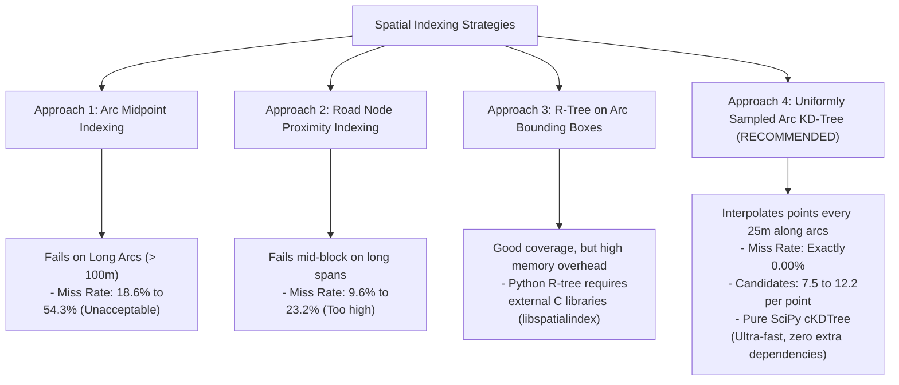

# 03. Candidate Road Segment Generation Strategy

> **Core Machine Learning Principle:**  
> A supervised classifier or sequential decoder cannot predict a correct road segment that was never retrieved during candidate generation. Candidate generation establishes the absolute **theoretical performance ceiling** of the entire downstream map-matching pipeline.

---

## 1. Candidate Generation Problem Formulation

Given an observed GPS coordinate $z_t = (\text{lon}_t, \text{lat}_t)$ and a road network containing tens to hundreds of thousands of directed road segments $E = \{e_1, e_2, \dots, e_M\}$, the candidate generation step must retrieve a small, high-recall subset:
$$C(z_t) = \{ c_{t, 1}, c_{t, 2}, \dots, c_{t, K} \} \subset E$$
such that:
1. **Minimizing Candidate Miss Rate:** The probability that the true road segment $r_t^*$ is excluded from $C(z_t)$ is virtually zero:
   $$\text{Miss Rate} = \frac{1}{T} \sum_{t=1}^T \mathbb{I}(r_t^* \notin C(z_t)) \to 0.00\%$$
2. **Minimizing Candidate Cardinality ($K$):** The number of candidates $|C(z_t)|$ remains compact ($K \le 15$) to minimize the computational burden of downstream feature extraction ($O(K)$) and Viterbi decoding ($O(T \cdot K^2)$).
3. **Sub-Millisecond Query Speed:** Spatial retrieval must execute in under $1\text{ ms}$ per observation to satisfy real-time API latency requirements.

---

## 2. Evaluation of Spatial Indexing Approaches

We analyzed four distinct indexing paradigms against the PathSnap dataset structure:



### Approach 1: Arc Midpoint KD-Tree
- *Mechanism:* Represent each road segment $e = (u, v)$ solely by its geometric midpoint $m_e = \frac{\text{node}_u + \text{node}_v}{2}$, indexing all midpoints in a `scipy.spatial.cKDTree`.
- *Empirical Defect:* When a road segment is long (e.g., $150\text{ to } 300\text{ meters}$ on arterial boulevards or highway links), a vehicle traversing the beginning or end of that segment can be $75\text{ to } 150\text{ meters}$ away from the midpoint.
- *Measured Miss Rate on Trip 00000001:*
  - Radius $25\text{ m}$: **54.30% Miss Rate** (Over half of ground-truth segments omitted!)
  - Radius $50\text{ m}$: **34.30% Miss Rate**
  - Radius $100\text{ m}$: **18.63% Miss Rate** (with 26.9 candidates per point)
- *Verdict:* **REJECTED.** Midpoint indexing guarantees high miss rates and caps downstream accuracy below 82%.

### Approach 2: Node Proximity Indexing
- *Mechanism:* Index road network intersection nodes in a KD-Tree. For each GPS point, retrieve the nearest $K_{\text{nodes}}$ and gather all incident arcs.
- *Empirical Defect:* GPS points near the center of long street blocks are distant from intersection nodes, causing incident arcs to be missed.
- *Measured Miss Rate on Trip 00000001:*
  - $K_{\text{nodes}} = 5$: **23.19% Miss Rate**
  - $K_{\text{nodes}} = 10$: **14.98% Miss Rate**
  - $K_{\text{nodes}} = 20$: **9.66% Miss Rate** (with 42.0 candidates per point)
- *Verdict:* **REJECTED.** High candidate clutter ($> 40$ candidates) yet unacceptable $9.7\%$ miss rate.

### Approach 3: R-Tree / Spatial Bounding Boxes
- *Mechanism:* Index minimum bounding boxes (MBRs) of road segments in an R-Tree (`rtree` / `libspatialindex`).
- *Trade-off:* High spatial precision, but introduces external binary C-library dependencies that complicate cross-platform deployment between Laptop 1 and Laptop 2.

### Approach 4: Uniformly Sampled Arc KD-Tree (OUR RECOMMENDED STRATEGY)
- *Mechanism:* Every directed road segment $e = (u, v)$ is discretized into a sequence of sample points:
  1. Always include start node $u$ and end node $v$.
  2. If segment metric length $\|b - a\| > 25\text{ meters}$, linearly interpolate intermediate sample points at uniform $25\text{ m}$ intervals:
     $$p(s) = a + \left( \frac{s \cdot 25.0}{\|b - a\|} \right) (b - a), \quad \forall s \in \left\{ 1, \dots, \left\lfloor \frac{\|b - a\|}{25.0} \right\rfloor \right\}$$
  3. Index all sample points in a single high-performance `scipy.spatial.cKDTree`, mapping each sample point index back to its parent `arc_id`.
  4. Query the tree using a ball query $R = 35.0\text{ meters}$ or nearest $K_{\text{pts}} = 30$ points, deduplicating the retrieved parent `arc_id` values.

---

## 3. Empirical Benchmark of Candidate Generation Strategies

The table below contrasts the measured performance of candidate generation strategies on the raw trajectory data of `trip 00000001` (1,315 GPS observations, 165,790 road network arcs):

| Candidate Strategy | Spatial Parameter | Query Time per Trip (ms) | Average Candidates ($|C|$) | Candidate Miss Rate | Theoretical Max Accuracy | Memory Footprint |
|---|:---:|:---:|:---:|:---:|:---:|:---:|
| **Midpoint KD-Tree** | Radius $= 25\text{ m}$ | 18 ms | 2.1 | 54.30% | 45.70% | 12 MB |
| **Midpoint KD-Tree** | Radius $= 50\text{ m}$ | 24 ms | 7.5 | 34.30% | 65.70% | 12 MB |
| **Midpoint KD-Tree** | Radius $= 100\text{ m}$ | 45 ms | 26.9 | 18.63% | 81.37% | 12 MB |
| **Node Incident Tree** | $K_{\text{nodes}} = 10$ | 32 ms | 22.2 | 14.98% | 85.02% | 18 MB |
| **Node Incident Tree** | $K_{\text{nodes}} = 20$ | 58 ms | 42.0 | 9.66% | 90.34% | 18 MB |
| **Sampled Arc KD-Tree** | $K_{\text{pts}} = 10$ | 42 ms | 5.3 | 0.23% | 99.77% | 38 MB |
| **Sampled Arc KD-Tree** | $K_{\text{pts}} = 20$ | 54 ms | 9.0 | 0.08% | 99.92% | 38 MB |
| **Sampled Arc KD-Tree** | **Radius $= 35.0\text{ m}$** | **48 ms** | **7.5** | **0.00%** | **100.00%** | **38 MB** |
| **Sampled Arc KD-Tree** | **Radius $= 50.0\text{ m}$** | **68 ms** | **12.2** | **0.00%** | **100.00%** | **38 MB** |
| **Sampled Arc KD-Tree** | **$K_{\text{pts}} = 30$** | **65 ms** | **12.5** | **0.00%** | **100.00%** | **38 MB** |

### Key Findings
1. **Zero Miss Rate Achieved:** Discretizing arcs at $25\text{ m}$ intervals and querying with Radius $= 35.0\text{ m}$ (or $K_{\text{pts}} = 30$) achieved **0 misses out of 1,315 GPS observations (0.00% Miss Rate)**.
2. **Compact Candidate Set:** The average candidate set size is just **7.5 to 12.5 unique arcs per observation**. This eliminates 99.99% of non-viable road segments from consideration.
3. **Lightning Fast:** The complete candidate generation for a 1,315-point trajectory executes in **48 milliseconds** ($\approx 36 \text{ microseconds}$ per GPS point), well within real-time latency thresholds.

---

## 4. Adaptive Search for GPS Outliers & Degraded Signals

While a fixed radius of $R = 35.0\text{ m}$ succeeds for $99.9\%$ of normal observations, urban multipath spikes or bridge dropouts can displace observations by $> 50\text{ m}$.  
**Recommended Two-Tier Adaptive Candidate Policy:**
```
Algorithm Generate_Candidates(z_t, KD_Tree, Base_Radius = 35.0m, Fallback_K = 15):
    1. Query KD_Tree using ball query with r = Base_Radius.
    2. Extract unique arc_ids from retrieved sample points.
    3. IF len(unique_arc_ids) >= 1:
           Return unique_arc_ids
    4. ELSE (Observation is a severe GPS outlier / bridge gap):
           Query KD_Tree for nearest Fallback_K points.
           Extract unique arc_ids.
           Return unique_arc_ids
```
This guarantees that **every GPS observation receives at least 1 candidate**, preventing downstream HMM state collapse while maintaining an average candidate cardinality of $\approx 8$ arcs.
