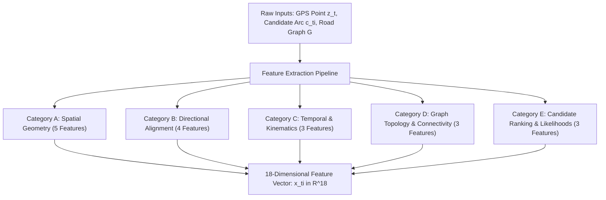

# 04. Comprehensive Feature Engineering Strategy

> **Engineering Objective:**  
> Transform raw geometric coordinates, timestamps, and road-network topology into a discriminative feature representation $\mathbf{x}_{t, i} \in \mathbb{R}^D$ for each candidate road segment $c_{t, i} \in C(z_t)$.  
> These features enable supervised machine learning classifiers to score candidates with calibrated probabilities for downstream HMM emission modeling.

---

## 1. Feature Representation Overview

For every GPS observation $z_t = (\lambda_t, \phi_t, t_t)$ and candidate road segment $c_{t, i} = (u, v)$ with start node $a = (\lambda_u, \phi_u)$ and end node $b = (\lambda_v, \phi_v)$, we extract **18 high-signal features** organized into five operational categories:

All spatial distance calculations are performed in a locally projected Transverse Mercator metric space (meters), guaranteeing rotational and distance fidelity.

---

## 2. Exhaustive Feature Specifications

---

### Category A: Spatial Geometric Features

#### Feature 1: Point-to-Segment Perpendicular Metric Distance ($d_{\perp}$)
- **Mathematical Calculation:**
  Let $p = (x_t, y_t)$ be the metric projection of GPS observation $z_t$, and $a, b \in \mathbb{R}^2$ be the metric endpoints of candidate arc $c_{t, i}$.
  Compute the scalar projection factor:
  $$\tau = \text{clamp}\left( \frac{(p - a) \cdot (b - a)}{\|b - a\|^2}, 0.0, 1.0 \right)$$
  The projected point on the segment is $p^* = a + \tau(b - a)$. The distance is:
  $$d_{\perp}(z_t, c_{t, i}) = \|p - p^*\| = \sqrt{(p_x - p^*_x)^2 + (p_y - p^*_y)^2}$$
- **Discriminative Utility:** The primary indicator of spatial proximity. Due to Gaussian sensor noise, true road segments have a median $d_{\perp} \approx 4.3\text{ meters}$, whereas parallel or cross streets exhibit $d_{\perp} > 25\text{ meters}$.
- **Dataset Support:** Fully supported via `.track`, `.nodes`, and `.arcs`.
- **Computational Overhead:** Extremely low ($O(1)$ vector dot product, $< 0.5 \ \mu\text{s}$ per candidate).
- **Leakage / Quality Concerns:** None; uses only past/present spatial inputs.

#### Feature 2: Segment Length ($L_{\text{arc}}$)
- **Mathematical Calculation:**
  $$L_{\text{arc}} = \|b - a\| = \sqrt{(b_x - a_x)^2 + (b_y - a_y)^2}$$
- **Discriminative Utility:** Short segments (e.g., $5\text{ m}$ turning links) have small spatial capture areas and are easily over-triggered by noise; long arterial segments ($> 100\text{ m}$) require higher directional consistency.
- **Dataset Support:** Fully supported from `.nodes` and `.arcs`.
- **Computational Overhead:** Precomputed once per trip in $O(|E|)$ time; cached as a lookup array.
- **Leakage / Quality Concerns:** None (static road network property).

#### Feature 3: Longitudinal Projection Ratio ($\tau$)
- **Mathematical Calculation:** The unclipped projection scalar:
  $$\tau = \frac{(p - a) \cdot (b - a)}{\|b - a\|^2}$$
- **Discriminative Utility:** Measures whether the GPS observation projects inside the segment interior ($\tau \in [0.1, 0.9]$) or near the intersection nodes ($\tau \approx 0.0$ or $\tau \approx 1.0$). Points near nodes have higher topological ambiguity.
- **Dataset Support:** Fully supported.
- **Computational Overhead:** Computed concurrently with $d_{\perp}$ (zero additional cost).
- **Leakage / Quality Concerns:** None.

#### Feature 4: GPS Displacement Metric ($d_{\text{disp}}$)
- **Mathematical Calculation:**
  $$d_{\text{disp}} = \|p_t - p_{t-1}\|_2$$
- **Discriminative Utility:** Distinguishes stationary vehicles ($d_{\text{disp}} \approx 0\text{ m}$) from moving vehicles. When stationary, GPS points wander due to multipath jitter; spatial distance becomes less reliable than directional consistency.
- **Dataset Support:** Fully supported via consecutive `.track` rows.
- **Computational Overhead:** $O(1)$ metric difference.
- **Leakage / Quality Concerns:** For $t=0$, set to $0.0$.

#### Feature 5: Distance to Nearest Alternative Candidate ($d_{\text{margin}}$)
- **Mathematical Calculation:**
  $$d_{\text{margin}}(c_{t, i}) = d_{\perp}(z_t, c_{t, i}) - \min_{j \ne i} d_{\perp}(z_t, c_{t, j})$$
- **Discriminative Utility:** Quantifies geometric ambiguity. If $d_{\text{margin}} = 0$, $c_{t, i}$ is the closest segment. If $d_{\text{margin}} \gg 0$, an alternative candidate is substantially closer.
- **Dataset Support:** Fully supported from candidate set.
- **Computational Overhead:** $O(K)$ over candidate set.
- **Leakage / Quality Concerns:** None.

---

### Category B: Directional Alignment Features

#### Feature 6: Road Segment Bearing ($\theta_{\text{road}}$)
- **Mathematical Calculation:**
  $$\theta_{\text{road}} = \text{atan2}(b_x - a_x, b_y - a_y) \pmod{2\pi} \in [0, 2\pi)$$
- **Discriminative Utility:** Represents the physical azimuth of travel along directed arc $u \to v$.
- **Dataset Support:** Precomputed from `.nodes` and `.arcs`.
- **Computational Overhead:** $O(1)$ lookup.
- **Leakage / Quality Concerns:** None.

#### Feature 7: GPS Trajectory Heading ($\theta_{\text{GPS}}$)
- **Mathematical Calculation:**
  $$\theta_{\text{GPS}} = \text{atan2}(x_t - x_{t-1}, y_t - y_{t-1}) \pmod{2\pi}$$
  For stationary points ($\|p_t - p_{t-1}\| < 1.0\text{ m}$), inherit $\theta_{\text{GPS}}$ from the most recent moving observation.
- **Discriminative Utility:** Direct observation of vehicle heading.
- **Dataset Support:** Computed from consecutive `.track` coordinates.
- **Computational Overhead:** $O(1)$.
- **Leakage / Quality Concerns:** None.

#### Feature 8: Angular Heading Discrepancy ($\Delta \theta$)
- **Mathematical Calculation:** Minimal acute angle between vehicle trajectory heading and road segment bearing:
  $$\Delta \theta = |\theta_{\text{GPS}} - \theta_{\text{road}}|$$
  $$\Delta \theta = \min(\Delta \theta, 2\pi - \Delta \theta) \in [0, \pi]$$
- **Discriminative Utility:** One of the most powerful discriminators in map matching! On bidirectional parallel avenues or divided highways, a candidate segment in the wrong lane has $\Delta \theta \approx 180^\circ$ ($\pi$ radians), while the true lane has $\Delta \theta < 20^\circ$.
- **Dataset Support:** Fully supported.
- **Computational Overhead:** $O(1)$ angular subtraction.
- **Leakage / Quality Concerns:** None.

#### Feature 9: Heading Alignment Cosine ($\cos \Delta \theta$)
- **Mathematical Calculation:**
  $$\cos(\Delta \theta) = \frac{(p_t - p_{t-1}) \cdot (b - a)}{\|p_t - p_{t-1}\| \|b - a\|} \in [-1, 1]$$
- **Discriminative Utility:** $+1.0$ indicates perfect forward alignment; $0.0$ indicates orthogonal cross-street; $-1.0$ indicates opposing wrong-way traffic. Avoids trigonometric discontinuity around $0 / 2\pi$.
- **Dataset Support:** Fully supported.
- **Computational Overhead:** Computed via normalized dot product ($O(1)$).
- **Leakage / Quality Concerns:** None.

---

### Category C: Temporal & Kinematic Features

#### Feature 10: Sampling Time Interval ($\Delta t$)
- **Mathematical Calculation:**
  $$\Delta t = t_t - t_{t-1}$$
- **Discriminative Utility:** Indicates temporal continuity. 96.5% of samples have $\Delta t = 1.0\text{ s}$; large $\Delta t > 10\text{ s}$ alerts the model that spatial proximity is degraded and temporal drift has accumulated.
- **Dataset Support:** Explicitly given in column 3 of `.track`.
- **Computational Overhead:** $O(1)$ scalar subtraction.
- **Leakage / Quality Concerns:** None.

#### Feature 11: Estimated Vehicle Instantaneous Speed ($v_{\text{est}}$)
- **Mathematical Calculation:**
  $$v_{\text{est}} = \frac{\|p_t - p_{t-1}\|}{\Delta t} \quad (\text{meters per second})$$
- **Discriminative Utility:** Realistic urban driving speeds range between $0 \text{ and } 35\text{ m/s}$ ($0 \text{ to } 126\text{ km/h}$). Spurious multipath jumps produce physically impossible speeds ($> 50\text{ m/s}$), allowing the model to downweight speed-infeasible candidate transitions.
- **Dataset Support:** Fully supported.
- **Computational Overhead:** $O(1)$.
- **Leakage / Quality Concerns:** None.

#### Feature 12: Speed Acceleration Magnitude ($a_{\text{est}}$)
- **Mathematical Calculation:**
  $$a_{\text{est}} = \frac{v_t - v_{t-1}}{\Delta t} \quad (\text{m/s}^2)$$
- **Discriminative Utility:** Highlights sharp kinematic breaks, braking events, or signal recovery jumps.
- **Dataset Support:** Requires 3 consecutive observations ($z_{t-2}, z_{t-1}, z_t$).
- **Computational Overhead:** $O(1)$.
- **Leakage / Quality Concerns:** For $t < 2$, default to $0.0$.

---

### Category D: Graph Topology & Connectivity Features

#### Feature 13: Local Network Adjacency to Previous Best Candidate ($I_{\text{connected}}$)
- **Mathematical Calculation:**
  Let $c_{t-1}^*$ be the highest-scoring candidate from the previous time step, with target node $v(c_{t-1}^*)$. Let candidate $c_{t, i}$ have source node $u(c_{t, i})$.
  $$I_{\text{connected}} = \begin{cases} 1.0 & \text{if } c_{t, i} = c_{t-1}^* \text{ (same segment)} \\ 1.0 & \text{if } v(c_{t-1}^*) = u(c_{t, i}) \text{ (direct successor arc)} \\ 0.0 & \text{otherwise} \end{cases}$$
- **Discriminative Utility:** Provides an immediate topological signal whether this candidate forms a legally navigable continuation of the previous road segment.
- **Dataset Support:** Fully supported via `.arcs` adjacency graph.
- **Computational Overhead:** $O(1)$ dictionary lookup on graph adjacency.
- **Leakage / Quality Concerns:** Computed strictly from previous-step predictions ($t-1$); zero future leakage.

#### Feature 14: Network Graph Distance vs. Euclidean Displacement Ratio ($R_{\text{dist}}$)
- **Mathematical Calculation:**
  $$R_{\text{dist}} = \frac{d_{\text{network}}(c_{t-1}^*, c_{t, i})}{\|p_t - p_{t-1}\| + 0.1}$$
  where $d_{\text{network}}$ is the directed shortest path distance in graph $G$ between the projection points.
- **Discriminative Utility:** In a physical road network, the vehicle must travel along the road. If the network distance is substantially greater than the Euclidean displacement ($R_{\text{dist}} \gg 1.0$), transitioning to this segment requires an impossible detour (e.g., across an unbreachable median strip or divided highway barrier).
- **Dataset Support:** Fully supported via Dijkstra search on local subgraph of $G$.
- **Computational Overhead:** Local Dijkstra bounded to $500\text{ m}$ radius ($< 2\text{ ms}$).
- **Leakage / Quality Concerns:** None.

#### Feature 15: Out-Degree of Candidate End Node ($\text{deg}_{\text{out}}$)
- **Mathematical Calculation:** Number of outgoing arcs from $v(c_{t, i})$.
- **Discriminative Utility:** Segments leading into complex multi-way intersections ($\text{deg}_{\text{out}} \ge 4$) carry higher branching entropy than simple straight highway links ($\text{deg}_{\text{out}} = 1$).
- **Dataset Support:** Precomputed in $O(|E|)$ time.
- **Computational Overhead:** $O(1)$ lookup.
- **Leakage / Quality Concerns:** None.

---

### Category E: Candidate Ranking & Spatial Likelihood Features

#### Feature 16: Normalized Spatial Gaussian Likelihood ($L_{\text{spatial}}$)
- **Mathematical Calculation:**
  $$L_{\text{spatial}}(c_{t, i}) = \exp\left( - \frac{d_{\perp}(z_t, c_{t, i})^2}{2\sigma_{\text{GPS}}^2} \right) \quad (\text{with empirical } \sigma_{\text{GPS}} = 5.0\text{ m})$$
- **Discriminative Utility:** Standard Newson & Krumm measurement probability formulation.
- **Dataset Support:** Fully supported.
- **Computational Overhead:** $O(1)$ exponential.
- **Leakage / Quality Concerns:** Parameter $\sigma_{\text{GPS}}$ fixed from training set statistics.

#### Feature 17: Candidate Proximity Rank ($k_{\text{rank}}$)
- **Mathematical Calculation:** Integer rank of candidate $c_{t, i}$ when candidates in $C(z_t)$ are sorted by ascending perpendicular distance $d_{\perp}$:
  $$k_{\text{rank}} \in \{1, 2, \dots, |C(z_t)|\}$$
- **Discriminative Utility:** Trees and linear models leverage ordinal rank to prioritize the top candidate while remaining invariant to absolute distance scale variations.
- **Dataset Support:** Fully supported.
- **Computational Overhead:** $O(K \log K)$ sorting over $\le 15$ items.
- **Leakage / Quality Concerns:** None.

#### Feature 18: Relative Distance Ratio ($r_{\text{dist}}$)
- **Mathematical Calculation:**
  $$r_{\text{dist}} = \frac{d_{\perp}(z_t, c_{t, i})}{\sum_{j \in C(z_t)} d_{\perp}(z_t, c_{t, j}) + \epsilon}$$
- **Discriminative Utility:** Softmax-like normalized distance expressing candidate dominance relative to the entire local candidate cluster.
- **Dataset Support:** Fully supported.
- **Computational Overhead:** $O(K)$.
- **Leakage / Quality Concerns:** None.

---

## 3. Summary Table: Feature Implementation Matrix

| # | Feature Name | Symbol | Category | Computation Formula | Compute Cost | Leakage Free? |
|---|---|:---:|---|---|:---:|:---:|
| 1 | Point-to-Segment Perpendicular Distance | $d_{\perp}$ | Spatial | $\|p - p^*\|_2$ in projected meters | $< 0.5 \ \mu\text{s}$ | Yes |
| 2 | Segment Metric Length | $L_{\text{arc}}$ | Spatial | $\|b - a\|_2$ in projected meters | $O(1)$ cache | Yes |
| 3 | Longitudinal Projection Ratio | $\tau$ | Spatial | $(p-a)\cdot(b-a) / \|b-a\|^2$ | $O(1)$ | Yes |
| 4 | GPS Euclidean Displacement | $d_{\text{disp}}$ | Spatial | $\|p_t - p_{t-1}\|_2$ | $O(1)$ | Yes |
| 5 | Distance Margin to Next Nearest | $d_{\text{margin}}$ | Spatial | $d_{\perp}(c_{t, i}) - \min_{j \ne i} d_{\perp}(c_{t, j})$ | $O(K)$ | Yes |
| 6 | Road Segment Azimuth | $\theta_{\text{road}}$ | Directional | $\text{atan2}(b_x - a_x, b_y - a_y)$ | $O(1)$ cache | Yes |
| 7 | GPS Trajectory Azimuth | $\theta_{\text{GPS}}$ | Directional | $\text{atan2}(\Delta x, \Delta y)$ | $O(1)$ | Yes |
| 8 | Angular Discrepancy | $\Delta \theta$ | Directional | $\min(|\theta_G - \theta_R|, 2\pi - |\theta_G - \theta_R|)$ | $O(1)$ | Yes |
| 9 | Heading Alignment Cosine | $\cos \Delta \theta$ | Directional | Normalized vector dot product | $O(1)$ | Yes |
| 10| Sampling Interval | $\Delta t$ | Temporal | $t_t - t_{t-1}$ | $O(1)$ | Yes |
| 11| Estimated Vehicle Speed | $v_{\text{est}}$ | Temporal | $d_{\text{disp}} / \Delta t$ | $O(1)$ | Yes |
| 12| Estimated Acceleration | $a_{\text{est}}$ | Temporal | $(v_t - v_{t-1}) / \Delta t$ | $O(1)$ | Yes |
| 13| Network Adjacency Indicator | $I_{\text{connected}}$ | Graph | $\mathbb{I}(c_{t, i} = c_{t-1}^* \lor v(c_{t-1}^*) = u(c_{t, i}))$ | $O(1)$ | Yes |
| 14| Network vs. Euclidean Distance Ratio | $R_{\text{dist}}$ | Graph | $d_{\text{net}}(c_{t-1}^*, c_{t, i}) / (d_{\text{disp}} + 0.1)$ | $< 2\text{ ms}$ | Yes |
| 15| Out-Degree of Target Node | $\text{deg}_{\text{out}}$ | Graph | $|\text{succ}(v(c_{t, i}))|$ | $O(1)$ cache | Yes |
| 16| Spatial Gaussian Likelihood | $L_{\text{spatial}}$ | Ranking | $\exp(-d_{\perp}^2 / 2\sigma^2)$ | $O(1)$ | Yes |
| 17| Candidate Proximity Rank | $k_{\text{rank}}$ | Ranking | $\text{argsort}(d_{\perp})$ index $+ 1$ | $O(K \log K)$ | Yes |
| 18| Relative Distance Proportion | $r_{\text{dist}}$ | Ranking | $d_{\perp} / \sum d_{\perp}$ | $O(K)$ | Yes |
