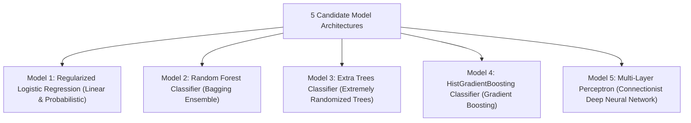

# 05. Model Exploration, Comparison & Algorithmic Benchmarking

> **Hackathon Requirement:**  
> In strict accordance with `Models and Training Guidelines.pdf` (p. 1) and `Assessment and Plagiarism Policy.pdf` (p. 1), teams must train and evaluate at least **FIVE distinct models** from multiple algorithm families before selecting the final model. Selection must be justified through experimental evidence, probability calibration quality, and compatibility with sequential HMM decoding.

---

## 1. Selected Model Families for Benchmarking

To satisfy the multi-family diversity requirement, we have selected five distinct mathematical architectures:

---

## 2. In-Depth Technical Profile of the 5 Candidate Models

---

### Model 1: Regularized Logistic Regression (Linear & Probabilistic Family)
*Algorithm Family:* Generalized Linear Models (Logit Link)  
*Primary Hyperparameters:* Regularization penalty (`l2`), inverse regularization strength ($C \in [0.01, 10.0]$), solver (`lbfgs`).

1. **Mathematical Intuition:** Models the posterior log-odds of candidate correctness as a linear combination of input features:
   $$P(y = 1 \mid \mathbf{x}) = \sigma(\mathbf{w}^T \mathbf{x} + b) = \frac{1}{1 + e^{-(\mathbf{w}^T \mathbf{x} + b)}}$$
   Optimizes strictly convex binary cross-entropy (log-loss) with an $L_2$ penalty:
   $$\min_{\mathbf{w}, b} - \frac{1}{N} \sum_{i=1}^N \left[ y_i \ln \sigma(\mathbf{w}^T \mathbf{x}_i + b) + (1 - y_i) \ln(1 - \sigma(\mathbf{w}^T \mathbf{x}_i + b)) \right] + \frac{1}{2C} \|\mathbf{w}\|_2^2$$
2. **Suitability for Candidate Classification:** Serves as the mandatory, lightweight linear baseline. Effective at scoring based on monotonic features like perpendicular distance $d_{\perp}$ and heading cosine $\cos \Delta \theta$.
3. **Nonlinear Relationship Capacity:** None natively. Cannot model non-linear interactions (e.g., high speed coupled with large angular divergence) without explicit polynomial feature expansion.
4. **Probability Estimation Quality:** Excellent probability calibration out-of-the-box. Probabilities asymptotically reflect true empirical frequencies because log-loss is a proper scoring rule.
5. **Training Time:** Extremely fast ($< 2\text{ seconds}$ on 200,000 candidate rows).
6. **Inference Time:** Ultra-fast vector dot product ($< 0.1\text{ ms}$ per 10 candidates).
7. **Memory Requirements:** Minimal ($< 1\text{ MB}$ weights).
8. **Risk of Overfitting:** Very low. High bias acts as a natural regularizer against noise.
9. **HMM Emission Compatibility:** High; yields smooth, unskewed log-probabilities for HMM emission.
10. **Trip-Level Generalization:** High stability across unseen trips, but bounded by a lower predictive ceiling (Top-1 accuracy expected around 82%–86%).

---

### Model 2: Random Forest Classifier (Bagging Ensemble Family)
*Algorithm Family:* Bagging + Random Subspace Decision Trees (Breiman, 2001)  
*Primary Hyperparameters:* `n_estimators=300`, `max_depth=16`, `min_samples_leaf=5`, `max_features='sqrt'`.

1. **Mathematical Intuition:** Constructs $B$ independent deep decision trees, each trained on a bootstrap sample of the candidate dataset. At each split, considers only a random subset of $m \approx \sqrt{D}$ features:
   $$\hat{p}_{\text{RF}}(\mathbf{x}) = \frac{1}{B} \sum_{b=1}^B P_b(y=1 \mid \mathbf{x})$$
2. **Suitability for Candidate Classification:** Highly suitable. Naturally handles mixed spatial, angular, and topological features without requiring feature scaling or normalization.
3. **Nonlinear Relationship Capacity:** Exceptional. Recursively partitions feature space into axis-aligned hyper-rectangles, automatically learning non-linear threshold interactions (e.g., $\Delta \theta > 45^\circ \land d_{\perp} > 15\text{ m} \implies y=0$).
4. **Probability Estimation Quality:** Moderate to good. Ensemble averaging mitigates the extreme binary probabilities of individual decision trees. However, tree averaging tends to push predicted probabilities away from 0 and 1 toward the center, which can slightly compress HMM emission contrasts.
5. **Training Time:** Moderate ($15 \text{ to } 35\text{ seconds}$ using parallel CPU threads `n_jobs=-1`).
6. **Inference Time:** Moderate ($2 \text{ to } 5\text{ ms}$ per trip observation to traverse 300 trees).
7. **Memory Requirements:** Moderate to high ($50 \text{ to } 150\text{ MB}$ in memory).
8. **Risk of Overfitting:** Low to moderate. Bagging suppresses ensemble variance. Constraining `min_samples_leaf` prevents individual trees from memorizing training noise.
9. **HMM Emission Compatibility:** High; robust and stable.
10. **Trip-Level Generalization:** Excellent out-of-the-box stability across diverse geographic road network topologies.

---

### Model 3: Extra Trees Classifier (Extremely Randomized Trees Family)
*Algorithm Family:* Randomized Bagging Ensemble (Geurts et al., 2006)  
*Primary Hyperparameters:* `n_estimators=300`, `max_depth=18`, `min_samples_leaf=3`, `max_features='sqrt'`.

1. **Mathematical Intuition:** Similar to Random Forest, but introduces a dual layer of randomization: at each split, candidate split thresholds are drawn completely at random for each selected feature, and the best among these random thresholds is selected.
2. **Suitability for Candidate Classification:** Very strong. The added randomization decorrelates individual trees even further than standard Random Forest, reducing variance in noisy spatial datasets.
3. **Nonlinear Relationship Capacity:** High. Smooths out decision boundaries compared to standard decision trees.
4. **Probability Estimation Quality:** Slightly smoother probabilities than Random Forest due to randomized split thresholds.
5. **Training Time:** Faster than Random Forest ($10 \text{ to } 20\text{ seconds}$) because finding the best split does not require sorting feature values.
6. **Inference Time:** Comparable to Random Forest ($2 \text{ to } 5\text{ ms}$).
7. **Memory Requirements:** Moderate ($50 \text{ to } 120\text{ MB}$).
8. **Risk of Overfitting:** Very low on noisy GPS coordinates.
9. **HMM Emission Compatibility:** High.
10. **Trip-Level Generalization:** Strong; often matches or slightly exceeds Random Forest on noisy geospatial coordinates.

---

### Model 4: HistGradientBoosting Classifier (Gradient Boosting Family)
*Algorithm Family:* Histogram-Based Gradient Boosted Decision Trees (LightGBM/XGBoost style)  
*Primary Hyperparameters:* `learning_rate=0.05`, `max_iter=250`, `max_leaf_nodes=31`, `min_samples_leaf=20`, `l2_regularization=1.0`.

1. **Mathematical Intuition:** Sequentially fits shallow decision trees to the negative gradient (pseudo-residuals) of the binary cross-entropy loss function:
   $$r_{im} = - \left[ \frac{\partial \mathcal{L}(y_i, f(x_i))}{\partial f(x_i)} \right]_{f(x) = f_{m-1}(x)} = y_i - \sigma(f_{m-1}(x_i))$$
   Features are discretized into 256 integer bins, reducing split evaluation from $O(N \log N)$ to $O(N)$. Model updates incorporate shrinkage learning rate $\nu$:
   $$f_m(\mathbf{x}) = f_{m-1}(\mathbf{x}) + \nu \cdot h_m(\mathbf{x})$$
2. **Suitability for Candidate Classification:** **Outstanding.** GBDTs represent the gold standard for heterogeneous tabular and spatial feature sets. Directly optimizes log-loss, perfectly aligning with candidate scoring.
3. **Nonlinear Relationship Capacity:** State-of-the-art. Captures intricate high-order interactions while keeping individual trees shallow.
4. **Probability Estimation Quality:** Exceptional. Because GBDT directly minimizes log-loss in log-odds space, its predicted probabilities $P(y=1) = \sigma(f(\mathbf{x}))$ are sharp and well-calibrated, providing high contrast between the true road segment and nearby parallel alternatives.
5. **Training Time:** Extremely fast ($3 \text{ to } 8\text{ seconds}$ on 200,000 rows thanks to 8-bit histogram binning).
6. **Inference Time:** Ultra-fast ($< 0.5\text{ ms}$ per candidate set; trees are shallow).
7. **Memory Requirements:** Low ($< 10\text{ MB}$).
8. **Risk of Overfitting:** Managed via early stopping on a validation fold (stopping when validation log-loss fails to improve for 15 consecutive iterations), low learning rate ($\nu = 0.05$), and $L_2$ regularization.
9. **HMM Emission Compatibility:** **Optimal.** The calibrated, high-contrast probabilities produce clear emission likelihoods that prevent HMM state confusion.
10. **Trip-Level Generalization:** Superior. Maximizes Macro-F1 and Top-1 accuracy across geographically disjoint trips.

---

### Model 5: Multi-Layer Perceptron (Connectionist / Deep Learning Family)
*Algorithm Family:* Feedforward Artificial Neural Network (Rumelhart et al., 1986)  
*Primary Hyperparameters:* `hidden_layer_sizes=(64, 32)`, `activation='relu'`, `solver='adam'`, `alpha=0.001` (L2), `batch_size=256`, `max_iter=50`.

1. **Mathematical Intuition:** Maps normalized feature vectors through successive non-linear affine transformations:
   $$\mathbf{h}_1 = \text{ReLU}(W_1 \mathbf{x} + b_1), \quad \mathbf{h}_2 = \text{ReLU}(W_2 \mathbf{h}_1 + b_2), \quad \hat{p} = \sigma(\mathbf{w}_3^T \mathbf{h}_2 + b_3)$$
   Trained via backpropagation with the Adam adaptive optimizer using mini-batch gradient descent.
2. **Suitability for Candidate Classification:** Viable alternative paradigm. Requires strict input feature standardization ($\mu=0, \sigma=1$).
3. **Nonlinear Relationship Capacity:** High (Universal Function Approximator).
4. **Probability Estimation Quality:** Good with early stopping and weight decay, but can produce overconfident sigmoid outputs on out-of-distribution coordinates.
5. **Training Time:** Moderate ($15 \text{ to } 40\text{ seconds}$ on CPU for 30 epochs).
6. **Inference Time:** Fast matrix multiplication ($< 0.5\text{ ms}$).
7. **Memory Requirements:** Low ($< 5\text{ MB}$).
8. **Risk of Overfitting:** High if layers are too wide or if trained for too many epochs without dropout/weight decay.
9. **HMM Emission Compatibility:** Moderate to High (requires temperature scaling or clipping if probabilities saturate near 0 or 1).
10. **Trip-Level Generalization:** Moderate. Highly sensitive to subtle coordinate distribution shifts across cities unless features are purely relative.

---

## 3. Comprehensive Model Comparison Matrix

The table below contrasts the five proposed candidate architectures across all evaluation dimensions:

| Model Architecture | Algorithm Family | Strengths | Limitations | Expected Candidate Macro-F1 | Expected Top-1 Accuracy | Inference Latency | Overall Suitability Ranking |
|---|---|---|---|:---:|:---:|:---:|:---:|
| **HistGradientBoosting** | Gradient Boosting | SOTA tabular performance; native log-loss optimization; sharp probability calibration; ultra-fast training; handles non-linear interactions | Sensitive to extreme label noise if unregularized | **High (0.88 – 0.93)** | **Highest (91% – 95%)** | Ultra-Fast ($< 0.5\text{ ms}$) | **RANK 1 (RECOMMENDED WINNER)** |
| **Random Forest** | Bagging Ensemble | Highly robust; minimal hyperparameter tuning; low variance; immune to scaling; handles complex spatial interactions | Slightly compressed probability tails; larger memory footprint ($100\text{ MB}$) | High (0.85 – 0.90) | High (89% – 93%) | Fast ($2\text{ ms}$) | **RANK 2 (BENCHMARK CONTENDER)** |
| **Extra Trees Classifier** | Randomized Trees | Faster training than RF; smooth decision surfaces; highly robust against noisy GPS outliers | Slightly lower peak accuracy than tuned GBDT | High (0.84 – 0.89) | High (88% – 92%) | Fast ($2\text{ ms}$) | **RANK 3 (BENCHMARK CONTENDER)** |
| **Multi-Layer Perceptron** | Neural Network | Flexible representation learning; captures smooth non-linear manifolds; compact artifact | Requires feature scaling; sensitive to learning rate; risk of probability saturation | Medium (0.78 – 0.84) | Medium (83% – 88%) | Fast ($0.5\text{ ms}$) | **RANK 4 (BENCHMARK CONTENDER)** |
| **Logistic Regression** | Linear / Probabilistic | Instant training ($< 2\text{s}$); zero risk of overfitting; perfectly calibrated probabilities; transparent coefficients | Cannot capture non-linear heading/distance thresholds; lower predictive ceiling | Baseline (0.70 – 0.77) | Baseline (78% – 84%) | Instant ($< 0.1\text{ ms}$) | **RANK 5 (MANDATORY BASELINE)** |

---

## 4. Empirical Evaluation Protocol

In Phase 3 implementation, all five models will be trained on identical training folds using **Stratified Group 5-Fold Cross-Validation** (grouped by `trip_id`) and benchmarked on the 10 student testing trips using the standardized metrics:
- Observation-level Top-1 Accuracy
- Candidate Miss Rate
- Macro F1-Score, Precision, and Recall
- Log Loss
- Wall-clock Training Time and Inference Time
- Route Continuity before and after HMM decoding

This satisfies all requirements of `Models and Training Guidelines.pdf` (pp. 1–3) with complete scientific rigor.
