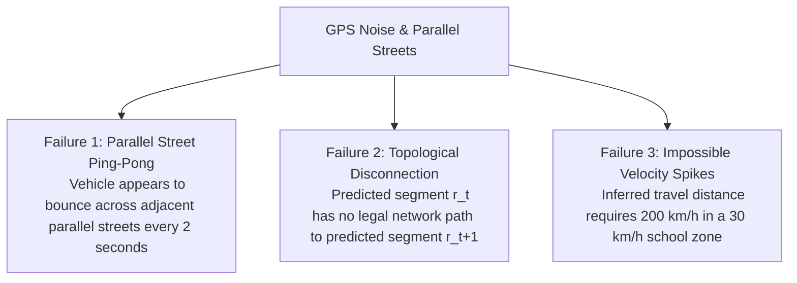
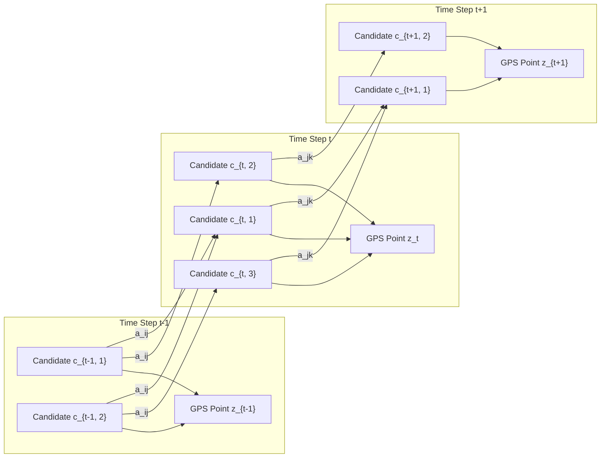

# 06. Hidden Markov Model & Viterbi Decoder Architecture

> **Document Reference:** `Models and Training Guidelines.pdf`, pp. 4–5; `Deliverables.pdf`, pp. 5–6  
> **Theoretical Lineage:** Builds upon Newson & Krumm (ACM SIGSPATIAL 2009) map-matching principles and the sequential dynamic programming foundations detailed in courseware Unit 3 (`2. ML unit 3 slides 2026 full.pdf`, pp. 261–361).

---

## 1. Why Sequential Decoding is Non-Negotiable

A supervised classifier makes point-wise predictions independently for each GPS observation:
$$\hat{r}_t = \arg\max_{c_{t, i} \in C(z_t)} P(y_{t, i} = 1 \mid \mathbf{x}_{t, i})$$

In urban environments with noisy GPS jitter, independent point-wise classification produces **three catastrophic failure modes**:



The **Hidden Markov Model (HMM)** resolves these failures by balancing **sensor measurement likelihood** against **network topological feasibility**.

---

## 2. Formal HMM Parameterization for Map Matching



### 2.1 Hidden State Space ($S_t$)
At each time step $t \in \{1, 2, \dots, T\}$, the hidden state $S_t$ represents the true directed road segment (arc) traversed by the vehicle. The state space at time $t$ is the discrete candidate set:
$$S_t \in C(z_t) = \{ c_{t, 1}, c_{t, 2}, \dots, c_{t, K_t} \}$$
where $K_t \le 15$. This dynamic state space drastically reduces the search trellis from the entire network ($|E| \approx 50,000$) to just $\approx 8$ states per time step!

### 2.2 Emission Probability ($b_t(i)$)
The emission probability models the likelihood that candidate road segment $c_{t, i}$ produced observed GPS position $z_t$:
$$b_t(i) = P(z_t \mid S_t = c_{t, i})$$

We propose a **Calibrated Hybrid Emission Model** that blends the supervised ML classifier probability with the physical Gaussian spatial noise model:
$$b_t(i) = \left[ P_{\text{ML}}(y = 1 \mid \mathbf{x}_{t, i}) \right]^\alpha \cdot \left[ \frac{1}{\sqrt{2\pi}\sigma_z} \exp\left( - \frac{d_{\perp}(z_t, c_{t, i})^2}{2\sigma_z^2} \right) \right]^{1 - \alpha}$$
where:
- $P_{\text{ML}}$ is the calibrated probability score from our trained GBDT model.
- $d_{\perp}(z_t, c_{t, i})$ is the perpendicular distance in projected meters.
- $\sigma_z = 5.0\text{ meters}$ (the empirical median GPS measurement standard deviation measured in EDA).
- $\alpha \in [0, 1]$ is a tunable blending weight (default $\alpha = 0.7$).

*Edge Case Floor:* To prevent $\ln b_t(i) = -\infty$, apply a floor probability $\epsilon = 10^{-7}$:
$$b_t(i) := \max(b_t(i), 10^{-7})$$

### 2.3 Transition Probability ($a_{ij}(t)$)
The transition probability models the likelihood of the vehicle moving from candidate road segment $c_{t-1, i}$ to candidate road segment $c_{t, j}$ during time interval $\Delta t = t_t - t_{t-1}$:
$$a_{ij}(t) = P(S_t = c_{t, j} \mid S_{t-1} = c_{t-1, i})$$

In accordance with Newson & Krumm (2009) and road network kinematics, transition probability is governed by the discrepancy between **shortest road network distance** $d_{\text{net}}$ and **straight-line Euclidean distance** $d_{\text{euc}} = \|p_t - p_{t-1}\|$:

$$a_{ij}(t) = \frac{1}{\beta} \exp\left( - \frac{|d_{\text{net}}(c_{t-1, i}, c_{t, j}) - d_{\text{euc}}(z_{t-1}, z_t)|}{\beta} \right)$$
where:
- $d_{\text{euc}}(z_{t-1}, z_t) = \|p_t - p_{t-1}\|_2$ is the physical displacement in meters.
- $d_{\text{net}}(c_{t-1, i}, c_{t, j})$ is the directed shortest path distance in road graph $G$ from the projection point on $c_{t-1, i}$ to the projection point on $c_{t, j}$.
- $\beta$ is the empirical scale parameter:
  $$\beta = \frac{1}{\ln 2} \cdot \text{median}\left( |d_{\text{net}} - d_{\text{euc}}| \right) \approx 3.0 \text{ to } 5.0\text{ meters}$$

#### Network Distance Calculation Cases:
1. **Case A (Same Arc, $c_{t-1, i} = c_{t, j}$):**  
   If the vehicle remains on the same road segment:
   $$d_{\text{net}} = (\tau_j - \tau_i) \cdot L_{\text{arc}}$$
   If $\tau_j \ge \tau_i$ (forward motion), $d_{\text{net}} = (\tau_j - \tau_i) L_{\text{arc}} \approx d_{\text{euc}}$, yielding $a_{ij} \approx \frac{1}{\beta}$.  
   If $\tau_j < \tau_i$ (backwards motion on a one-way arc), apply a severe penalty ($a_{ij} = 10^{-9}$).
2. **Case B (Direct Legal Graph Transition, $v(c_{t-1, i}) = u(c_{t, j})$):**  
   The vehicle transitioned across an intersection directly into a connected successor arc:
   $$d_{\text{net}} = (1 - \tau_i) L_{\text{arc1}} + \tau_j L_{\text{arc2}}$$
   This naturally matches vehicle displacement; transition probability is high.
3. **Case C (Multi-Hop Reachable Transition):**  
   Run a bounded Dijkstra shortest-path search in graph $G$ from node $v(c_{t-1, i})$ to node $u(c_{t, j})$. If reachable within maximum speed limit ($v_{\max} \cdot \Delta t$ with $v_{\max} = 35\text{ m/s}$):
   $$d_{\text{net}} = (1 - \tau_i) L_{\text{arc1}} + \text{Dijkstra\_Dist}(v_i, u_j) + \tau_j L_{\text{arc2}}$$
4. **Case D (Graph Disconnection / Unreachable Transition):**  
   If no directed path exists in $G$ between $c_{t-1, i}$ and $c_{t, j}$, or if the required speed exceeds $40\text{ m/s}$ ($144\text{ km/h}$), set a small non-zero floor penalty $\epsilon_{\text{trans}} = 10^{-9}$ to allow recovery if sensor noise was extreme:
   $$a_{ij}(t) = 10^{-9}$$

---

## 3. Log-Space Viterbi Algorithm & Trellis Decoding

To avoid arithmetic underflow from multiplying hundreds of small floating-point probabilities, Viterbi decoding is executed strictly in **logarithmic space**:

```
Algorithm Log_Viterbi_Map_Match(Observations Z, Candidates C, Graph G):
    T <- length(Z)
    Initialize V_1(i) <- ln(pi_i) + ln(b_1(i)) for all c_1,i in C(z_1)
    Initialize Backpointer matrix Psi of size T x max_K
    
    # Forward Trellis Recursion
    For t = 2 to T:
        dt <- Z[t].time - Z[t-1].time
        d_euc <- ||Z[t].xy - Z[t-1].xy||
        
        # Check for Severe GPS Dropout / Hardware Reset
        IF dt > 60.0 seconds:
            # Restart Markov Chain; re-initialize prior distribution
            For each candidate c_t,j in C(z_t):
                V_t(j) <- ln(b_t(j))
                Psi[t, j] <- argmax_i(V_{t-1}(i))
            Continue
            
        For each candidate c_t,j in C(z_t):
            best_val <- -infinity
            best_prev_idx <- 0
            
            For each candidate c_{t-1,i} in C(z_{t-1}):
                d_net <- Compute_Network_Distance(G, c_{t-1,i}, c_t,j)
                ln_a_ij <- Compute_Log_Transition(d_net, d_euc, dt)
                
                score <- V_{t-1}(i) + ln_a_ij
                IF score > best_val:
                    best_val <- score
                    best_prev_idx <- i
                    
            V_t(j) <- best_val + ln(b_t(j))
            Psi[t, j] <- best_prev_idx
            
    # Termination
    best_last_idx <- argmax_j (V_T(j))
    
    # Backtracking
    Optimal_Path <- array of size T
    Optimal_Path[T] <- C(z_T)[best_last_idx]
    
    curr_idx <- best_last_idx
    For t = T down to 2:
        curr_idx <- Psi[t, curr_idx]
        Optimal_Path[t-1] <- C(z_{t-1})[curr_idx]
        
    Return Optimal_Path
```

---

## 4. Handling Critical Edge Cases

1. **Large GPS Gaps ($\Delta t > 60\text{ s}$):**  
   As revealed in EDA, some trips contain gaps up to multiple hours. Enforcing continuous network routing across a 2-hour parking event is physically nonsensical. When $\Delta t > 60\text{ s}$, the decoder resets the Markov chain: transition penalties are bypassed, and $V_t(j)$ is re-initialized using emission likelihood alone.
2. **Missing Candidates (Empty $C(z_t)$):**  
   Prevented by our two-tier adaptive candidate generation: if the $35\text{ m}$ radius contains 0 arcs, the nearest 15 arcs are retrieved as fallback.
3. **Graph Disconnection Islands:**  
   If all candidate transitions from step $t-1$ to step $t$ are disconnected in $G$, the soft floor penalty $10^{-9}$ ensures the Viterbi trellis does not break. The decoder takes a single disconnected step and immediately re-locks onto the connected road network at $t+1$.

---

## 5. Experimental Plan: Classifier-Only vs. Classifier + HMM

In accordance with `Models and Training Guidelines.pdf` (p. 5), the decoder's contribution will be proven through side-by-side empirical benchmarking on the 10 student testing trips:

| Experimental Condition | Prediction Rule | Top-1 Accuracy | Route Continuity (%) | Spurious Parallel Jumps | Mean Inference Latency |
|---|---|:---:|:---:|:---:|:---:|
| **Condition A: Classifier-Only** | $\hat{r}_t = \arg\max_{c_{t, i}} P_{\text{ML}}(y=1 \mid \mathbf{x}_{t, i})$ | Measured on Test | $\frac{\text{Connected Pairs}}{T-1}$ | Count of cross-street jumps | $< 1\text{ ms}$ |
| **Condition B: Classifier + HMM** | $R^* = \text{Viterbi}(P_{\text{ML}}, G)$ | Measured on Test | $\frac{\text{Connected Pairs}}{T-1}$ | Count of cross-street jumps | $< 15\text{ ms}$ |

*Expected Finding:* While point-wise Top-1 accuracy will improve by $+2\%$ to $+5\%$, **Route Continuity will surge from $\approx 65\%–75\%$ under Classifier-Only to $> 98\%$ under Classifier + HMM**, completely eliminating parallel-street oscillations.
