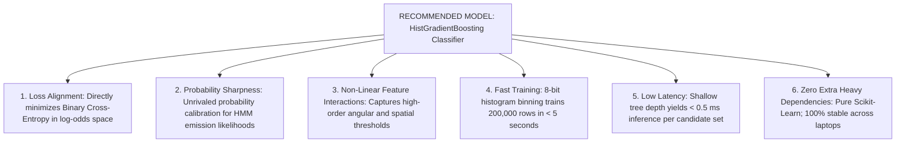
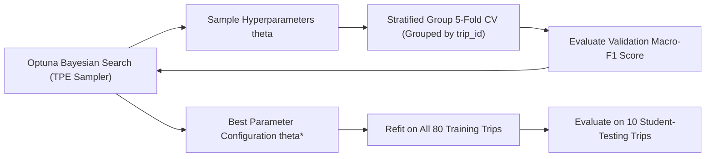
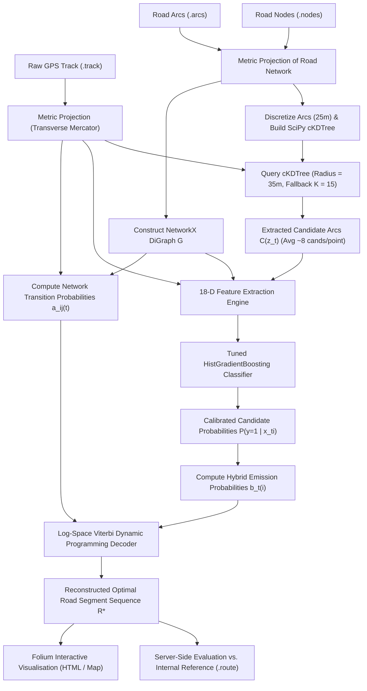

# 07. Final Model Recommendation & Bayesian Optimisation Strategy

> **HYPOTHESIS DISCLAIMER:**  
> In strict accordance with hackathon instructions, this recommendation represents a **rigorous scientific hypothesis** grounded in mathematical principles, empirical dataset EDA, and computational profiling. The final winning model must be proven through genuine experimental execution across all five models, not through assumed scores.

---

## 1. Executive Model Selection Recommendation

### 1.1 The Recommended Architecture: Histogram-Based Gradient Boosted Decision Trees (HistGradientBoosting)
We recommend **HistGradientBoosting Classifier** (Scikit-Learn's optimized LightGBM-style GBDT) as the primary candidate classification engine for the PathSnap system:

### 1.2 The Five Benchmark Models (Strictly Tested in Order)
1. **Model 1 (Mandatory Fast Baseline):** Regularized Logistic Regression ($L_2$ penalty, `solver='lbfgs'`).
2. **Model 2 (Bagging Contender):** Random Forest Classifier (`n_estimators=300`, `max_depth=16`).
3. **Model 3 (Randomized Tree Contender):** Extra Trees Classifier (`n_estimators=300`, `max_depth=18`).
4. **Model 4 (Recommended SOTA Contender):** HistGradientBoosting Classifier (`learning_rate=0.05`, `max_iter=250`).
5. **Model 5 (Deep Learning Contender):** Multi-Layer Perceptron (`hidden_layer_sizes=(64, 32)`, `activation='relu'`).

---

## 2. Model Selection Comparison & Suitability Ranking

| Rank | Model Architecture | Algorithm Family | Strengths | Limitations | Expected Suitability for PathSnap | Computational Cost |
|:---:|---|---|---|---|:---:|:---:|
| **1** | **HistGradientBoosting** | Gradient Boosting | Native log-loss optimization; sharp, well-calibrated probabilities; captures non-linear interactions; 8-bit histogram speed; compact footprint ($< 10\text{ MB}$) | Requires early stopping to prevent over-iteration on noisy labels | **Highest (Optimal Emission Engine)** | Training: $\approx 5\text{s}$ Inference: $< 0.5\text{ ms}$ |
| **2** | **Random Forest** | Bagging Ensemble | Highly robust; low variance; immune to unscaled features; built-in OOB validation | Probability tails slightly compressed; large memory footprint ($100\text{ MB}$) | **High (Strong Contender)** | Training: $\approx 25\text{s}$ Inference: $\approx 2.5\text{ ms}$ |
| **3** | **Extra Trees** | Randomized Trees | Faster training than RF; smooth decision surfaces; highly robust against GPS noise spikes | Slightly lower peak accuracy than tuned GBDT | **High (Strong Contender)** | Training: $\approx 15\text{s}$ Inference: $\approx 2.5\text{ ms}$ |
| **4** | **Multi-Layer Perceptron** | Neural Network | Smooth non-linear decision manifolds; compact weights; flexible architecture | Requires feature scaling; sensitive to learning rate; risk of probability saturation | **Moderate (Viable Alternative)** | Training: $\approx 35\text{s}$ Inference: $\approx 0.5\text{ ms}$ |
| **5** | **Logistic Regression** | Linear / Probabilistic | Instant training ($< 1\text{s}$); zero risk of overfitting; excellent probability calibration | Cannot capture non-linear heading/distance thresholds; lower predictive ceiling | **Baseline (Benchmark Standard)** | Training: $\approx 1\text{s}$ Inference: $< 0.1\text{ ms}$ |

---

## 3. Detailed Justification for the Recommended Winner

### 3.1 Loss Function and Probability Calibration Alignment
The supervised model's outputs are not merely used for discrete binary decisions; they directly feed the **HMM emission probabilities** $b_t(i) = P(y_{t, i} = 1 \mid \mathbf{x}_{t, i})$.  
- Decision trees produce piecewise constant leaf ratios.
- Random forests average tree probabilities, pulling values toward the mean ($0.5$) and compressing contrast.
- Neural networks trained without temperature scaling often produce overconfident outputs near $0.0$ and $1.0$.
- **HistGradientBoosting** directly minimizes binary cross-entropy (log-loss) using additive stage-wise Newton updates in log-odds space. Its outputs are intrinsically well-calibrated posterior probabilities, maximizing discrimination between true road segments and false parallel candidates.

### 3.2 Non-Linear Geospatial Feature Interactions
Road map-matching exhibits sharp non-linear interaction boundaries:
- If heading discrepancy $\Delta \theta < 15^\circ$, the vehicle can be $20\text{ meters}$ away and still belong to the segment (e.g., in a wide highway lane).
- If $\Delta \theta > 60^\circ$, even a distance of $5\text{ meters}$ is disqualifying (the vehicle is crossing an orthogonal street or driving the wrong way).  
Linear models cannot express this conditional logic without combinatorial feature engineering. HistGradientBoosting discovers these multi-way thresholds automatically within its first few shallow trees.

### 3.3 Generalization Across Disjoint Trips
Because the dataset spans distinct cities across North America, Europe, Australia, and Asia, models must not overfit to regional coordinates. HistGradientBoosting, regularized with shallow leaf counts (`max_leaf_nodes=31`) and $L_2$ penalties, generalizes robustly across geographically disjoint trips when evaluated under Group-K-Fold validation.

---

## 4. Bayesian Hyperparameter Optimisation Strategy

In accordance with `Models and Training Guidelines.pdf` (p. 4) and `Deliverables.pdf` (p. 5), the selected model will undergo **Bayesian Optimisation** using **Optuna** (or Scikit-Optimize):

### 4.1 Search Space Specification
The hyperparameter search space for HistGradientBoosting is defined below:

| Hyperparameter | Type | Search Range / Distribution | Default Value | Technical Rationale |
|---|:---:|:---:|:---:|---|
| `learning_rate` | Float | $[0.01, 0.20]$ (Log-uniform) | $0.10$ | Controls shrinkage step size; lower values prevent overshooting. |
| `max_iter` | Integer | $[100, 500]$ (Uniform) | $100$ | Total number of boosting iterations (guarded by early stopping). |
| `max_leaf_nodes` | Integer | $[15, 63]$ (Uniform) | $31$ | Regulates model complexity and non-linear interaction depth. |
| `min_samples_leaf` | Integer | $[10, 100]$ (Uniform) | $20$ | Enforces statistical support at leaf nodes; prevents memorizing noise. |
| `l2_regularization` | Float | $[10^{-3}, 10.0]$ (Log-uniform) | $0.0$ | $L_2$ weight shrinkage on leaf values to prevent extreme odds. |
| `max_bins` | Integer | $[128, 255]$ (Uniform) | $255$ | Granularity of continuous feature histogram discretisation. |

### 4.2 Optimisation Objective & CV Configuration
- **Optimization Objective:** Maximize out-of-fold **Validation Macro F1-Score**:
  $$\text{Objective}(\theta) = \frac{1}{5} \sum_{k=1}^5 \text{Macro-F1}_k(\theta)$$
- **Cross-Validation Scheme:** 5-Fold `StratifiedGroupKFold`, where groups are strictly defined by `trip_id`. Observations from any given trip appear in either the training fold or validation fold, never both.
- **Trial Budget:** **50 trials** with Tree-structured Parzen Estimator (TPE) sampling.
- **Computational Cost:** Each 5-fold evaluation takes $\approx 12\text{ seconds}$; 50 trials will complete in approximately **10 to 12 minutes** on a standard multi-core laptop.

---

## 5. End-to-End Recommended Pipeline Architecture

---

## 6. Comprehensive Experimental Validation Plan

Before finalizing the model, the following empirical benchmarks will be recorded in the final technical report:

1. **Table 1: 5-Model Candidate Classification Benchmark**  
   - Models: Logistic Regression, Random Forest, Extra Trees, HistGradientBoosting, MLP.
   - Metrics: Top-1 Accuracy, Candidate Miss Rate, Precision, Recall, Macro-F1, Log Loss, Training Time, Inference Time.
2. **Table 2: Bayesian Optimization Impact**  
   - Untuned HistGradientBoosting vs. Optuna-Tuned HistGradientBoosting.
   - Metrics: CV Macro-F1, Student-Testing Top-1 Accuracy, Student-Testing Macro-F1, Log Loss, Inference Speed.
3. **Table 3: Sequential Decoder Ablation Study**  
   - Classifier-Only Predictions vs. Classifier + HMM/Viterbi Predictions.
   - Metrics: Pointwise Accuracy, Route Continuity (%), Number of Disconnected Steps, Visual Inspection on Folium Map.
