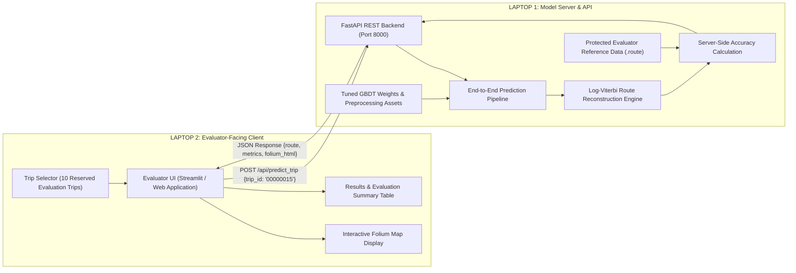
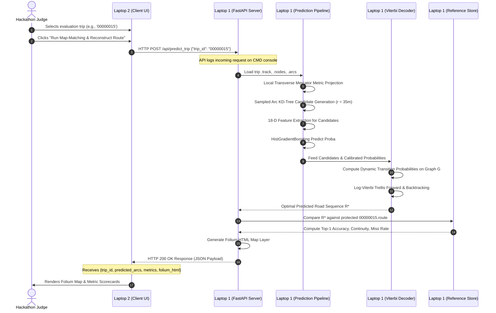

# 08. Distributed System Architecture & Two-Laptop Deployment

> **Hackathon Requirement Reference:**  
> `Main Guidelines.pdf`, p. 2 (Section 3: Two-Laptop Deployment Architecture);  
> `Deliverables.pdf`, p. 6 (Section 7: API, UI and Deployment);  
> `Assessment and Plagiarism Policy.pdf`, p. 3 (Data Leakage & Evaluation Integrity).

---

## 1. System Topology Overview

The challenge mandates an asynchronous, distributed two-laptop architecture operating over a local area network (LAN / Wi-Fi hotspot):



---

## 2. Component Responsibilities & Division of Labor

### Laptop 1: Model Server, Inference Pipeline & Evaluation Authority
- **FastAPI Application (`server.py`):** Hosts high-performance asynchronous REST endpoints (`/health`, `/trips`, `/predict_trip`).
- **Trained Model Assets:** Serialized GBDT classifier weights (`model.joblib`), feature scaler, and cached arc KD-tree builders.
- **Inference Pipeline:** Executes metric projection, candidate retrieval, 18-D feature extraction, GBDT inference, and log-Viterbi decoding.
- **Server-Side Ground-Truth Store:** Holds the confidential reference routes (`.route`) for the 10 evaluator testing trips. Evaluates Top-1 accuracy and route continuity strictly inside the server environment.
- **Console Logging:** Displays real-time API request logs, timing profiles, and memory stats on the server terminal for evaluation judges.

### Laptop 2: Client Interface & Evaluator Demonstration
- **Evaluator-Facing User Interface (`client_app.py`):** Built using **Streamlit** (or modern HTML5/Leaflet), presenting a clean control panel.
- **Trip Selection Controls:** Dropdown selector listing the 10 reserved evaluation trips (`00000015`, `00000017`, `00000023`, `00000030`, `00000049`, `00000059`, `00000067`, `00000073`, `00000087`, `00000094`).
- **Interactive Visualisation:** Embeds dynamic Folium map rendering raw GPS observations (blue dots), road network lines (grey), predicted route (red polyline), and ground-truth route (green polyline, if sent by server).
- **Metric Dashboard:** Renders summary metric cards: Observation Top-1 Accuracy, Route Continuity (%), Processing Time, and Total Points.

---

## 3. End-to-End Data Flow & Sequence Diagram



---

## 4. API Specification & Data Contracts

### 4.1 Endpoint: Health Check
- **Route:** `GET /health`
- **Response:**
  ```json
  {
    "status": "healthy",
    "service": "PathSnap Map-Matching Server",
    "model_loaded": true,
    "timestamp": 1731908400.0
  }
  ```

### 4.2 Endpoint: List Available Evaluation Trips
- **Route:** `GET /api/trips`
- **Response:**
  ```json
  {
    "evaluation_trips": [
      "00000015", "00000017", "00000023", "00000030", "00000049",
      "00000059", "00000067", "00000073", "00000087", "00000094"
    ]
  }
  ```

### 4.3 Endpoint: Run Prediction & Server-Side Evaluation
- **Route:** `POST /api/predict_trip`
- **Request Payload:**
  ```json
  {
    "trip_id": "00000015",
    "use_hmm": true,
    "generate_map": true
  }
  ```
- **Response Payload:**
  ```json
  {
    "trip_id": "00000015",
    "status": "success",
    "num_gps_observations": 1840,
    "execution_time_ms": 342.5,
    "metrics": {
      "top1_accuracy": 0.9412,
      "route_continuity_pct": 98.85,
      "candidate_miss_rate": 0.0000,
      "classifier_only_accuracy": 0.8920,
      "hmm_accuracy_boost": 0.0492
    },
    "predicted_route": [
      1420, 1420, 1420, 3105, 3105, 8912, ...
    ],
    "folium_map_html": "<html>...interactive leaflet map...</html>"
  }
  ```

---

## 5. Security, Isolation & Anti-Leakage Protocol

To ensure 100% compliance with `Assessment and Plagiarism Policy.pdf` (p. 3):
1. **Physical Isolation of Reference Routes:**
   - The `.route` files for the 10 evaluator trips reside **strictly in a secure server-side directory on Laptop 1**.
   - Laptop 2 possesses zero access to raw `.route` files.
2. **Read-Only API Boundaries:**
   - The client UI receives only high-level evaluation metrics and predicted polyline coordinates. It cannot modify server state, access model training routines, or inject hardcoded values.
3. **Audit Trail Logging:**
   - The FastAPI backend writes timestamped execution logs to standard console output (`stdout`), printing the IP address of Laptop 2, the requested trip ID, the execution time in milliseconds, and the verified accuracy score. This provides transparent live proof during judging.

---

## 6. Recommended Technology Stack

| Component Layer | Technology Choice | Version / Library | Rationale |
|---|---|---|---|
| **Backend REST Server** | FastAPI + Uvicorn | `fastapi==0.115.*`, `uvicorn==0.32.*` | High-throughput asynchronous Python server; automatic OpenAPI docs; native JSON serialization. |
| **Machine Learning Engine** | Scikit-Learn | `scikit-learn==1.5.*` | Robust, standardized implementations of HistGradientBoosting, Random Forest, Logistic Regression, MLP. |
| **Spatial Indexing & Math** | SciPy + NumPy | `scipy==1.14.*`, `numpy==1.26.*` | High-performance C-accelerated `cKDTree` for sub-millisecond candidate queries. |
| **Graph Network Algorithms** | NetworkX | `networkx==3.3.*` | Directed graph representations, shortest path reachability, and topological verification. |
| **Client User Interface** | Streamlit | `streamlit==1.39.*` | Rapid development of interactive web dashboards; native support for embedded HTML/Folium components. |
| **Geographical Rendering** | Folium + Leaflet.js | `folium==0.17.*` | High-fidelity interactive web maps with multi-layer controls, custom colored polylines, and popups. |
| **Serialization & Caching** | Joblib | `joblib==1.4.*` | Fast, compressed serialization of trained model weights and precomputed road network spatial trees. |

---

## 7. Local Network Deployment & Execution Checklist

### Setup on Laptop 1 (Model Server)
1. Connect Laptop 1 and Laptop 2 to the same local Wi-Fi router or mobile hotspot.
2. Determine Laptop 1 local IP address:
   ```powershell
   ipconfig   # e.g., IPv4 Address: 192.168.1.105
   ```
3. Launch FastAPI backend on host `0.0.0.0`:
   ```powershell
   uvicorn server:app --host 0.0.0.0 --port 8000 --reload
   ```
4. Verify backend health:
   Navigate to `http://127.0.0.1:8000/docs` in the browser to view the interactive Swagger documentation.

### Setup on Laptop 2 (Client UI)
1. Configure client connection URL:
   ```python
   SERVER_URL = "http://192.168.1.105:8000"
   ```
2. Launch Streamlit client UI:
   ```powershell
   streamlit run client_app.py
   ```
3. Open `http://localhost:8501` on Laptop 2.
4. Select any evaluator trip, trigger prediction, and inspect the real-time Folium map rendering and accuracy metrics.
