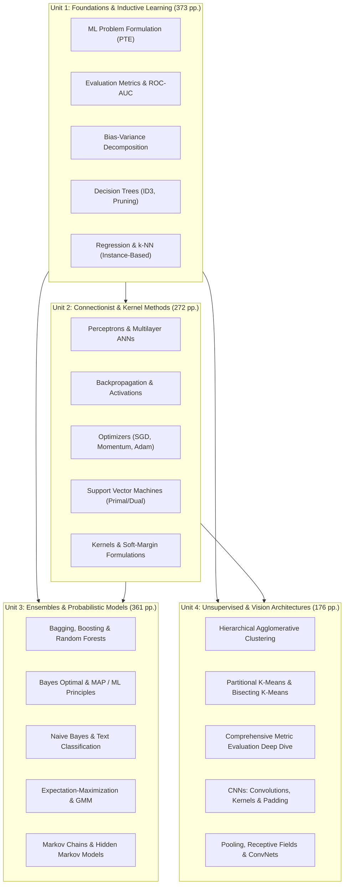

# Document Inventory: Reference Materials Analysis

> **CRITICAL ARCHITECTURAL CONTEXT & DISCLAIMER**  
> The documents inventoried in this repository represent **foundational machine learning reference materials and educational slide decks** (Course Code: `UE24CS352A: Machine Learning`, PES University).  
> **These documents are strictly knowledge sources.** They do NOT represent the hackathon problem statement, dataset specification, project constraints, or evaluation rubrics. They serve as an algorithmic and theoretical toolbox to draw from once the true problem statement is provided in Phase 2.

---

## 1. Executive Summary & Inventory Table

The reference collection comprises four comprehensive slide deck units covering the end-to-end spectrum of classical and modern Machine Learning, spanning mathematical foundations, classical supervised learning, deep neural representations, kernel methods, ensemble architectures, probabilistic modeling, sequential/hidden state inference, unsupervised clustering, and computer vision / convolutional neural networks.

| # | Filename | Formal Title / Scope | Author / Institution | Page Count | File Size | Primary Research & Technical Areas |
|---|----------|----------------------|----------------------|------------|-----------|-------------------------------------|
| **1** | `2. ML unit 1 slides 2026 full.pdf` | **Unit 1: Machine Learning Foundations, Evaluation, Decision Trees & Instance-Based Learning** | Dr. Shylaja S S (Prof., Dept. of CSE, PES University); Dr. Rajanikanth K (Advisor); Arya Rajiv Chaloli (TA) | 373 pages | 14.57 MB | ML Foundations, Problem Well-Posedness (PTE), Concept Learning (Find-S, Version Space), Performance Metrics (Confusion Matrix, Multi-Class, ROC-AUC), Bias-Variance Decomposition, Decision Trees (ID3, Entropy, Information Gain, Pruning), Linear/Logistic Regression, Instance-Based Learning (k-NN, Curse of Dimensionality) |
| **2** | `2. ML unit 2 slides 2026 full.pdf` | **Unit 2: Artificial Neural Networks & Support Vector Machines** | Dr. Shylaja S S (Prof., Dept. of CSE, PES University); Dr. Rajanikanth K (Advisor) | 272 pages | 14.65 MB | Neural Foundations (MP Neuron, Rosenblatt Perceptron, Sigmoid Neuron), Multi-Layer Perceptrons (MLP), Backpropagation Derivation (Chain Rule, Taylor Series), Activation Functions (Sigmoid, Tanh, ReLU, Softmax), Optimizers (BGD, SGD, Mini-batch, Momentum, RMSprop, Adam), Regularization (Dropout), Support Vector Machines (Maximal Margin, Primal/Dual Formulation, KKT Conditions, Kernel Trick: Linear/Poly/RBF, Soft-Margin SVM & Slack Variables) |
| **3** | `2. ML unit 3 slides 2026 full.pdf` | **Unit 3: Ensemble Learning, Bayesian Learning, Expectation-Maximization & Markov Models** | Dr. Shylaja S S (Prof., Dept. of CSE, PES University); Dr. Rajanikanth K (Advisor); Arya Rajiv Chaloli (TA) | 361 pages | 13.44 MB | Ensemble Architectures (Weak vs. Strong Learners, Bagging, Out-Of-Bag Error, Boosting, Gradient Boost, Random Forests), Bayesian Learning (Bayes Optimal Classifier, Gibbs Algorithm, ML vs. MAP, Least Squares derivation), Naive Bayes Classifiers (Laplace Smoothing, m-estimate, Numerical Underflow / Log-probs, Text Bag-of-Words), Latent Variable Models (Expectation-Maximization, Gaussian Mixture Models), Sequential Models (Markov Chains, Hidden Markov Models: Likelihood/Forward-Backward, Decoding/Viterbi, Parameter Learning/Baum-Welch) |
| **4** | `2. ML unit 4 slides 2026 full.pdf` | **Unit 4: Unsupervised Clustering, Metric Evaluation In-Depth & Convolutional Neural Networks** | Dr. Shylaja S S (Prof., Dept. of CSE, PES University); Arya Rajiv Chaloli, Divija L, Divya K (TAs); External acknowledgements to Dr. Andrew Ng (Stanford / DeepLearning.AI) & Stanford CS231n | 176 pages | 9.83 MB | Unsupervised Clustering (Distance Metrics, Agglomerative Hierarchical / AGNES, Dendrograms, Partitional K-Means, Bisecting K-Means, Elbow Method, Silhouette), Classification Metrics Deep Dive (Accuracy Paradox, Precision, Recall, F1 Harmonic Mean, ROC Curves, AUC Interpretation), Computer Vision & CNNs (Failure of Dense Networks, Convolutions in 2D/3D, Filters, Edge Detection, Padding: Valid/Same, Stride, Receptive Fields, Pooling: Max/Average, ConvNet Architectures) |
| **Total** | **4 Documents** | **Comprehensive Machine Learning Courseware** | **PES University CSE & International Curriculum Sources** | **1,182 Pages** | **52.49 MB** | **Foundations, Supervised, Unsupervised, Ensembles, Probabilistic, Deep Learning & Vision** |

---

## 2. Document Classification and Nature of Material

All four PDF documents are **advanced academic courseware lecture presentations** prepared for the upper-division Machine Learning course (`UE24CS352A`) at PES University, Department of Computer Science & Engineering, Bengaluru, India.

### Pedagogical and Content Architecture
Unlike purely academic research papers that focus on a single novel contribution or dataset, these slide decks are structured as **instructional, theoretical, and practical engineering modules**. They exhibit the following pedagogical characteristics:
1. **Formal Mathematical Foundations:** Rigorous mathematical formulations are provided for nearly every algorithm (e.g., information theory for ID3, constrained quadratic programming and Karush-Kuhn-Tucker conditions for SVM, Taylor series expansions for gradient descent, dynamic programming equations for Forward-Backward and Viterbi algorithms, and convolution spatial arithmetic).
2. **Step-by-Step Numerical Walkthroughs:** The decks feature end-to-end worked numerical examples for every core algorithm:
   - ID3 tree construction with entropy and gain tables (Unit 1, pp. 204–233).
   - Backpropagation weight updates computed by hand across input, hidden, and output layers (Unit 2, pp. 56–99).
   - SVM hyperplane derivation via Lagrange multipliers for 2D separable and non-separable points (Unit 2, pp. 231–256).
   - Naive Bayes manual probability calculation and Laplace smoothing (Unit 3, pp. 188–216).
   - GMM parameter updates via EM (Unit 3, pp. 239–256).
   - Forward, Backward, and Viterbi matrix computations for weather/symptom sequences (Unit 3, pp. 313–350).
   - Agglomerative clustering proximity matrix updates (Unit 4, pp. 19–26) and K-means centroid recalculations (Unit 4, pp. 55–60).
   - Convolutional feature map dimension and parameter calculations (Unit 4, pp. 153–175).
3. **Engineering Trade-offs & Practical Failure Modes:** The slides explicitly articulate the limitations, failure modes, computational complexities, and hyperparameter sensitivities of each approach (e.g., the curse of dimensionality in k-NN, vanishing gradients with sigmoid activations, zero-frequency and underflow in Naive Bayes, K-means sensitivity to initial centroids and non-convex geometries, dense network memory explosion on vision tasks).
4. **Curated Best Practices from Elite Research Labs:** Content explicitly incorporates canonical instructional frameworks from Stanford University (CS231n Convolutional Neural Networks for Visual Recognition by Fei-Fei Li, Andrej Karpathy, Justin Johnson) and DeepLearning.AI (Dr. Andrew Ng).

---

## 3. Extraction Methodology and Integrity Assessment

### Digital Ingestion Verification
Text extraction and structural analysis were conducted using the high-performance `PyMuPDF` (fitz) engine in Python.

- **Text Layer Quality:** All 4 documents possess native digital vector text layers. No optical character recognition (OCR) was required. Characters, mathematical symbols, subscripts, superscripts, and code listings were cleanly extracted.
- **Visual Artifacts & Diagrams:** The presentations contain rich conceptual diagrams, scatter plots, 2D decision boundary charts, neural computational graphs, dendrograms, and confusion matrices.
- **Slide Segmentation:** Each document consists of individual slide canvases (typically 16:9 or 4:3 presentation ratio). While presentation slides omit continuous prose, the conceptual density is exceptionally high due to summarized definitions, algorithmic pseudocode, formula callouts, and step-by-step calculation tables.
- **Extraction Quirks / Font Glyphs:** A small number of presentation bullet markers and ligatures were rendered with internal glyph encodings (e.g., `●`, `■`, `•`, and occasional ligature replacements like `fi` or `<erence` for `difference` on specific slide templates in Unit 4). These minor font mappings do not impede technical understanding and have been normalized during synthesis.
- **Missing Pages or Corrupted Streams:** No corrupted streams, missing pages, or unreadable pages were detected. All 1,182 pages across the 4 PDFs were successfully parsed, indexed, and analyzed.

---

## 4. Cross-Reference Mapping Across the 4 Units

The four units naturally partition the machine learning lifecycle and algorithmic taxonomies into four interlocking pillars:

This structural inventory establishes the foundation for deep technical extraction in subsequent files.
