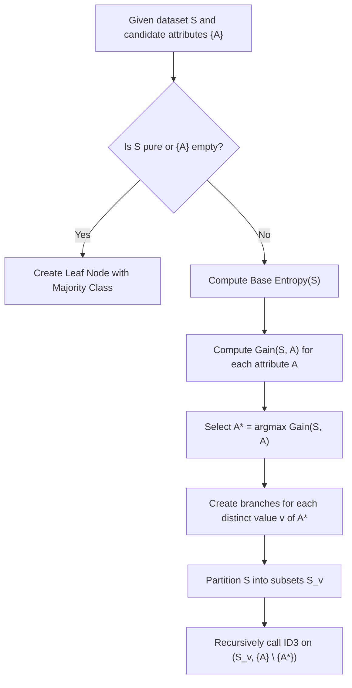
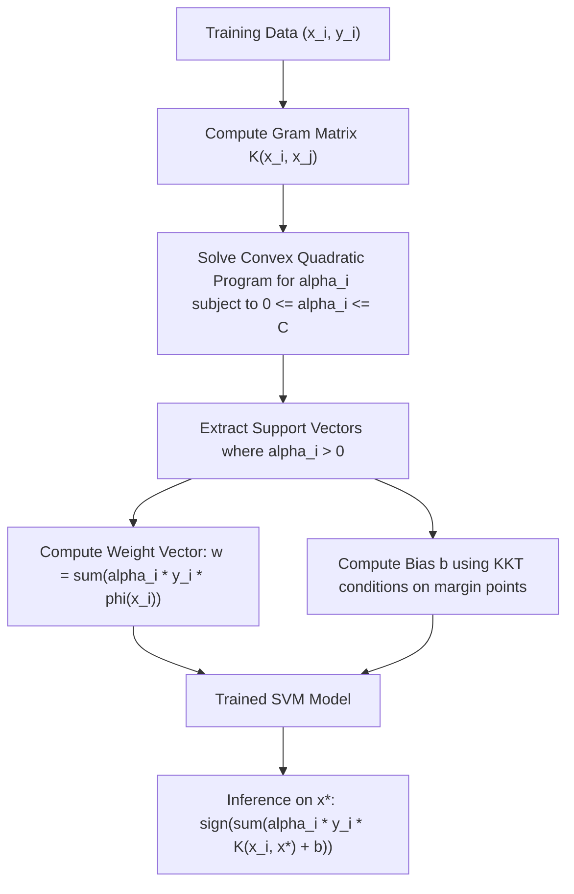
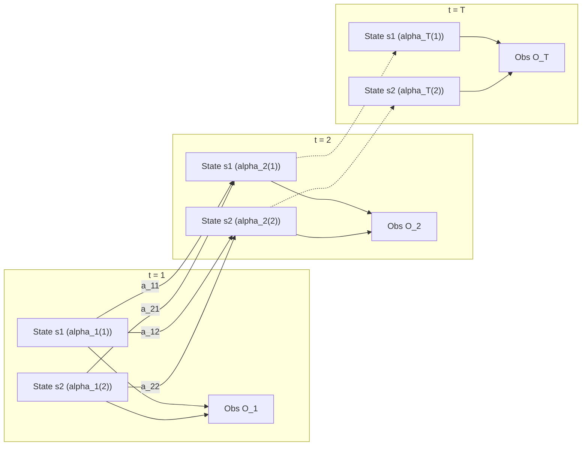

# Individual Document Technical Analysis

> **IMPORTANT NOTICE:**  
> The problem statements, toy datasets, and examples discussed below are extracted purely from the instructional courseware for technical illustration. They do **not** define our actual hackathon challenge, which will be provided separately.

---

# Document 1: Machine Learning Foundations, Evaluation, Decision Trees & Instance-Based Learning
*Source File:* `2. ML unit 1 slides 2026 full.pdf` (373 pages)  
*Authors / Affiliation:* Dr. Shylaja S S, Dr. Rajanikanth K, Arya Rajiv Chaloli (PES University)

---

### 1. Research Area and Central Concepts
- **Taxonomy of Machine Learning:** Formal definition by Tom Mitchell (Slide 5): "A computer program is said to learn from experience $E$ with respect to some class of tasks $T$ and performance measure $P$, if its performance at tasks in $T$, as measured by $P$, improves with experience $E$."
- **Problem Formulation:** Formalizing ML tasks into $\langle P, T, E \rangle$ tuples across medical diagnosis, checkers, autonomous driving, speech recognition, and hand-written character recognition (Slides 6–12).
- **Learning Paradigms:** Supervised (classification, regression), Unsupervised (clustering, association, density estimation), and Reinforcement Learning (Agent, Environment, State, Action, Reward, Policy) (Slides 14–42).
- **Model Categories:** Generative models ($P(X, Y) = P(X|Y)P(Y)$) vs. Discriminative models ($P(Y|X)$) (Slides 43–50).
- **Hypothesis and Version Spaces:** Concept learning, General-to-Specific ordering, Version Space representation, Boundary sets (Specific boundary $S$, General boundary $G$) (Slides 61–72).
- **Inductive Bias:** Fundamental necessity of prior assumptions in learning; without inductive bias, a learner cannot generalize beyond observed training instances (Slides 66–69, 238–239, 306).
- **Information Theory:** Shannon Entropy, Information Gain, Mutual Information (Slides 199–203).
- **Statistical Learning Theory:** Bias-Variance decomposition of generalization error (Slides 163–189).

---

### 2. Problems Addressed (for Contextual Illustration)
The document addresses core foundational challenges in building learning systems:
- How to represent hypotheses and learn target concepts from positive and negative instances (Concept Learning, Find-S) (Slides 73–84).
- How to select features greedily to partition heterogeneous datasets into pure homogeneous subsets (Decision Tree induction) (Slides 191–235).
- How to manage continuous-valued features and missing attribute values in tree learners (Slides 259–265).
- How to evaluate model predictions rigorously across balanced and severely imbalanced class distributions (Slides 96–160).
- How to perform non-parametric instance-based inference without training an explicit parametric model (k-NN classification and regression) (Slides 299–373).

---

### 3. ML/DL Algorithms and Underlying Principles

#### A. Find-S Algorithm (Slides 74–84)
- **Principle:** Maximally specific concept learning. Starts with the most specific hypothesis $h = \langle \emptyset, \emptyset, \dots, \emptyset \rangle$ and generalizes attribute constraints only when encountering positive training instances. Negative instances are ignored.
- **Hypothesis Representation:** Vector of conjunctions of attribute constraints: specific value ($a$), wildcard/don't care ($?$), or no value allowed ($\emptyset$).
- **Limitations:** Cannot detect inconsistent training data/noise; fails to identify whether multiple hypotheses match the data; cannot represent disjunctive concepts.

#### B. Decision Tree Induction: ID3 (Iterative Dichotomiser 3) (Slides 198–239)
- **Principle:** Greedy, top-down recursive divide-and-conquer search through the hypothesis space of decision trees.
- **Splitting Criterion (Shannon Entropy):**
  $$\text{Entropy}(S) = - \sum_{i=1}^{c} p_i \log_2(p_i)$$
  Where $p_i$ is the proportion of samples in $S$ belonging to class $i$. For binary classification ($p_+ + p_- = 1$):
  $$\text{Entropy}(S) = - p_+ \log_2(p_+) - p_- \log_2(p_-)$$
  $\text{Entropy} = 0$ when the node is completely pure; $\text{Entropy} = 1$ when classes are evenly split ($0.5 / 0.5$).
- **Information Gain:** Expected reduction in entropy caused by partitioning $S$ according to attribute $A$:
  $$\text{Gain}(S, A) = \text{Entropy}(S) - \sum_{v \in \text{Values}(A)} \frac{|S_v|}{|S|} \text{Entropy}(S_v)$$
- **Inductive Bias of ID3:** Prefers shorter trees over deeper trees (Occam's Razor); prefers trees that place high information gain attributes close to the root (Slide 238).

#### C. k-Nearest Neighbors (k-NN) (Slides 299–373)
- **Principle:** Instance-based, non-parametric, lazy learning. Stores training instances without constructing an explicit mathematical model. Postpones computation until inference time.
- **Decision Rule (Classification):**
  $$\hat{y} = \text{mode}\left(\{y_i : x_i \in N_k(x)\}\right)$$
- **Decision Rule (Regression):**
  $$\hat{y} = \frac{1}{k} \sum_{x_i \in N_k(x)} y_i$$
- **Distance-Weighted k-NN:** Closer neighbors receive higher voting weight to diminish the impact of noisy distant neighbors (Slides 348–351):
  $$w_i = \frac{1}{d(x, x_i)^2} \quad \text{or} \quad w_i = \frac{1}{d(x, x_i)}$$
  $$\hat{y}_{\text{reg}} = \frac{\sum_{i=1}^k w_i y_i}{\sum_{i=1}^k w_i}, \quad \hat{y}_{\text{class}} = \arg\max_{c \in C} \sum_{i \in N_k(x), y_i = c} w_i$$

---

### 4. Model Architectures and Technical Workflows

#### ID3 Tree Construction Workflow (Slides 204–233)

#### k-NN Pipeline Workflow (Slides 338–347)
1. **Offline Phase:** Store all normalized training instances $\mathcal{D}_{\text{train}} = \{(x_i, y_i)\}_{i=1}^N$. Zero training time ($O(1)$).
2. **Online Query Phase:**
   - Compute pairwise distance between query point $x_q$ and all $N$ stored instances.
   - Sort distances in ascending order ($O(N \log N)$ or $O(N \log k)$ with a max-heap).
   - Extract top $k$ nearest instances $N_k(x_q)$.
   - Aggregate labels using majority voting (classification) or mean/weighted average (regression).

---

### 5. Dataset Characteristics and Preprocessing Techniques
- **Discrete & Categorical Attributes:** Handling non-ordinal features (e.g., Outlook: Sunny, Overcast, Rain) natively via multi-way branch splitting in ID3 (Slide 204).
- **Continuous Numerical Attributes in Trees:** Dynamically sorting feature values, identifying candidate threshold split points midway between adjacent values with differing class labels, and computing Information Gain for each binary split $A \le c$ vs. $A > c$ (Slides 259–263).
- **Missing Value Imputation in Trees:**
  - Assigning the most common attribute value among all samples at node $n$ (Slide 264).
  - Assigning the most common attribute value among samples at node $n$ that share the same target class label (Slide 264).
  - Fractional sample assignment (probabilistic weighting across split branches) (Slide 265).
- **Feature Scaling for Distance Metrics:** In k-NN, features with larger numerical ranges dominate Euclidean distance calculations. Slide 355 demonstrates that failing to normalize gives arbitrary dominance to high-magnitude features (e.g., Income in thousands vs. Age in tens).
  - **Min-Max Normalization:**
    $$x_{\text{norm}} = \frac{x - x_{\min}}{x_{\max} - x_{\min}} \in [0, 1]$$
  - **Z-Score Standardization:**
    $$x_{\text{std}} = \frac{x - \mu}{\sigma}$$
- **Categorical Feature Encoding for Distance Models:** One-Hot Encoding or Hamming distance for discrete attributes in distance-based models (Slides 364–367).

---

### 6. Feature Engineering and Representation Learning
- **Version Space Representation:** Representing concept boundaries through dual boundary sets: $S$ (most specific hypotheses) and $G$ (most general hypotheses) (Slides 70–72).
- **Feature Space Geometries:** Geometric intuition of linear decision surfaces vs. axis-aligned orthogonal hyperplanes in Decision Trees (Slides 61–64, 191).
- **Curse of Dimensionality:** In high-dimensional spaces, data points become exponentially equidistant from one another. The volume of the feature space grows exponentially ($d$-dimensions $\implies 2^d$ corners of a hypercube), leaving training samples sparse and rendering distance metrics ineffective (Slides 359–363).

---

### 7. Loss Functions, Optimizers, and Training Strategies
- **Linear & Logistic Regression Foundations:**
  - Cost Function for Linear Regression (Mean Squared Error):
    $$J(\theta) = \frac{1}{2m} \sum_{i=1}^m \left(h_\theta(x^{(i)}) - y^{(i)}\right)^2$$
  - Cost Function for Logistic Regression (Log-Loss / Binary Cross-Entropy) (Slide 281):
    $$J(\theta) = - \frac{1}{m} \sum_{i=1}^m \left[ y^{(i)} \log(h_\theta(x^{(i)})) + (1 - y^{(i)}) \log(1 - h_\theta(x^{(i)})) \right]$$
    *Explanation:* The quadratic MSE loss function is non-convex when combined with the sigmoid activation, resulting in local minima; log-loss ensures strict convexity, guaranteeing convergence to the global minimum.
  - Parameter Update via Batch Gradient Descent:
    $$\theta_j := \theta_j - \alpha \frac{\partial J(\theta)}{\partial \theta_j} = \theta_j - \alpha \frac{1}{m} \sum_{i=1}^m \left(h_\theta(x^{(i)}) - y^{(i)}\right) x_j^{(i)}$$
- **Bias-Variance Decomposition:** Total Expected Generalization Error decomposes into three distinct components (Slides 178–188):
  $$\mathbb{E}[(y - \hat{f}(x))^2] = \text{Bias}[\hat{f}(x)]^2 + \text{Var}[\hat{f}(x)] + \sigma_{\epsilon}^2$$
  - $\text{Bias}^2$: Underfitting; model makes erroneous structural assumptions (e.g., fitting linear model to quadratic data). High training error and high validation error.
  - $\text{Variance}$: Overfitting; model is overly sensitive to random fluctuations/noise in training data. Low training error but high validation error.
  - $\sigma_{\epsilon}^2$: Irreducible error inherent in the noisy data generation process.
- **Tree Pruning Strategies to Combat Overfitting:**
  - **Pre-Pruning (Early Stopping):** Halt tree expansion early if node sample size falls below threshold or information gain drops below $\epsilon$ (Slide 246).
  - **Post-Pruning I: Reduced Error Pruning (Slides 248–254):** Split data into Train and Validation sets. Evaluate baseline validation accuracy on the full tree. Iteratively convert non-leaf subtrees into majority leaves; if the pruned tree performs equal or better on validation data, retain the pruning.
  - **Post-Pruning II: Rule Post-Pruning (Slides 255–257):** Translate full tree into an equivalent set of IF-THEN rules (one per root-to-leaf path). Prune individual antecedent conditions from each rule independently if accuracy does not drop. Re-order pruned rules by estimated accuracy.

---

### 8. Evaluation Metrics and Their Interpretation (Slides 96–160)
- **Binary Confusion Matrix:**
  $$\begin{pmatrix} \text{TP} & \text{FN} \\ \text{FP} & \text{TN} \end{pmatrix}$$
- **Primary Classification Metrics:**
  - **Accuracy:** $\frac{\text{TP} + \text{TN}}{\text{TP} + \text{TN} + \text{FP} + \text{FN}}$. Deceptive on imbalanced datasets.
  - **Precision (Positive Predictive Value):** $\frac{\text{TP}}{\text{TP} + \text{FP}}$. Fraction of predicted positives that are truly positive. Critical when False Positives carry high cost (e.g., spam filter, fraud alert).
  - **Recall / Sensitivity / TPR (True Positive Rate):** $\frac{\text{TP}}{\text{TP} + \text{FN}}$. Fraction of actual positives detected. Critical when False Negatives are unacceptable (e.g., cancer diagnosis, safety defects).
  - **Specificity / TNR (True Negative Rate):** $\frac{\text{TN}}{\text{TN} + \text{FP}}$.
  - **False Positive Rate (FPR):** $\frac{\text{FP}}{\text{TN} + \text{FP}} = 1 - \text{Specificity}$.
  - **F1-Score:** Harmonic mean of Precision and Recall (Slide 111):
    $$F_1 = 2 \cdot \frac{\text{Precision} \cdot \text{Recall}}{\text{Precision} + \text{Recall}} = \frac{2\text{TP}}{2\text{TP} + \text{FP} + \text{FN}}$$
- **Multi-Class Evaluation (Slides 115–124):**
  - Evaluated on an $N \times N$ matrix via One-vs-Rest decomposition.
  - For class $C_i$: $\text{TP}_i = M_{ii}$, $\text{FP}_i = \sum_{j \ne i} M_{ji}$ (column sum excluding diagonal), $\text{FN}_i = \sum_{j \ne i} M_{ij}$ (row sum excluding diagonal), $\text{TN}_i = \text{Total} - (\text{TP}_i + \text{FP}_i + \text{FN}_i)$.
- **Receiver Operating Characteristic (ROC) & AUC (Slides 128–146):**
  - Plots True Positive Rate (Sensitivity) on $y$-axis vs. False Positive Rate ($1 - \text{Specificity}$) on $x$-axis across all possible decision thresholds $\tau \in [0, 1]$.
  - Diagonal line $(0,0) \to (1,1)$ represents random guessing ($\text{AUC} = 0.5$).
  - Point $(0, 1)$ represents the ideal classifier ($\text{TPR} = 1.0, \text{FPR} = 0.0, \text{AUC} = 1.0$).
  - **AUC Interpretation:** Probability that the model ranks a randomly chosen positive instance higher than a randomly chosen negative instance.

---

### 9. Experimental Findings and Reported Performance
- **ID3 Weather Dataset Benchmark (Slides 204–216):**
  - Dataset: 14 instances, 4 attributes (`Outlook`, `Temperature`, `Humidity`, `Wind`).
  - Total Entropy: $\text{Entropy}(S) = - \frac{9}{14}\log_2\frac{9}{14} - \frac{5}{14}\log_2\frac{5}{14} = 0.940$.
  - Information Gains: $\text{Gain}(S, \text{Outlook}) = 0.246$, $\text{Gain}(S, \text{Humidity}) = 0.151$, $\text{Gain}(S, \text{Wind}) = 0.048$, $\text{Gain}(S, \text{Temperature}) = 0.029$.
  - `Outlook` selected as root node. Downstream subsets resolved into pure leaves with 100% training accuracy.
- **k-NN Sensitivity to $k$ (Slides 328–337):**
  - $k=1$: Zero training error, highly complex decision boundaries, extreme variance, severe susceptibility to noise and outliers.
  - Large $k$: Very smooth decision boundaries, low variance, high bias (tends toward dominant majority class).

---

### 10. Limitations, Trade-offs, and Possible Improvements
- **Decision Trees:**
  - *Limitation:* Highly sensitive to small variations in training data (high variance); greedy local splits do not guarantee global optimality; biased toward multi-valued categorical features.
  - *Improvement:* Information Gain Ratio (C4.5), tree ensembling (Random Forests, Gradient Boosting), post-pruning.
- **k-NN:**
  - *Limitation:* High inference latency and memory complexity ($O(Nd)$ per query); highly sensitive to irrelevant and unscaled features; suffers severely from curse of dimensionality.
  - *Improvement:* Dimensionality reduction (PCA), indexing data structures (KD-Trees, Ball-Trees), distance-weighted voting, feature selection.

---
---

# Document 2: Artificial Neural Networks & Support Vector Machines
*Source File:* `2. ML unit 2 slides 2026 full.pdf` (272 pages)  
*Authors / Affiliation:* Dr. Shylaja S S, Dr. Rajanikanth K (PES University)

---

### 1. Research Area and Central Concepts
- **Connectionist Machine Learning:** Biological neuron morphology (dendrites, soma, axon, synapses) mapped to artificial computational graphs (Slides 2–7).
- **Threshold Logic & Early Neurons:** McCulloch-Pitts (MP) Neuron (binary thresholding, inhibitory/excitatory inputs) and Rosenblatt Perceptron (real-valued weights, linear separator) (Slides 8–26).
- **Linear Separability & Representation Limits:** The XOR dilemma; Minsky and Papert's proof of single-layer perceptron limitations (Slides 27–38).
- **Differentiable Computational Graphs:** Multi-Layer Perceptrons (MLPs), Sigmoid Neurons, and the Backpropagation algorithm derived via multivariate calculus (Slides 41–99).
- **Optimization Landscapes:** Gradient Descent variations, momentum methods, exponentially weighted moving averages (EWMA), and adaptive learning rate optimizers (Slides 129–152).
- **Kernel Methods and Convex Optimization:** Vapnik's Support Vector Machines (SVM), Maximum Margin classification, Constrained Optimization, Karush-Kuhn-Tucker (KKT) conditions, Lagrangian Dual formulation, and the Kernel Trick (Slides 153–272).

---

### 2. Problems Addressed (for Contextual Illustration)
- How to overcome the non-linear classification barrier of single-layer perceptrons (Slides 27–38).
- How to efficiently calculate gradients of an arbitrary loss function with respect to every weight in a deep multi-layer network (Backpropagation derivation) (Slides 56–99).
- How to escape pathological ravines and navigate ill-conditioned loss surfaces during gradient-based optimization (Momentum, RMSprop, Adam) (Slides 136–147).
- How to find a globally optimal, mathematically unique separating hyperplane that maximizes the generalization margin between two classes (Support Vector Machines) (Slides 156–172).
- How to perform linear separation in infinite-dimensional Hilbert spaces without explicitly computing high-dimensional coordinates (Kernel Trick) (Slides 208–229).
- How to handle noisy, overlapping, and non-separable training distributions using soft margins and slack variables (Slides 264–272).

---

### 3. ML/DL Algorithms and Underlying Principles

#### A. McCulloch-Pitts (MP) Neuron & Rosenblatt Perceptron (Slides 8–26)
- **MP Neuron:** Inputs $x_i \in \{0, 1\}$, weights $w_i \in \{1\}$ (fixed unit weights), threshold $\theta \in \mathbb{Z}^+$:
  $$y = \begin{cases} 1 & \text{if } \sum_{i=1}^n x_i \ge \theta \\ 0 & \text{otherwise} \end{cases}$$
- **Perceptron Model:** Inputs $x_i \in \mathbb{R}$, learnable weights $w_i \in \mathbb{R}$, bias $b \in \mathbb{R}$:
  $$y = f(z) = f\left(\sum_{i=1}^n w_i x_i + b\right) = \begin{cases} 1 & \text{if } w^T x + b \ge 0 \\ 0 & \text{otherwise} \end{cases}$$
- **Perceptron Learning Rule (Slides 20–23):**
  For each misclassified training sample $(x_i, y_i)$ with target $y_i \in \{0, 1\}$ and prediction $\hat{y}_i$:
  $$w := w + \eta (y_i - \hat{y}_i) x_i$$
  $$b := b + \eta (y_i - \hat{y}_i)$$
  *Perceptron Convergence Theorem:* If the training data is linearly separable, the perceptron learning algorithm is guaranteed to converge to a separating hyperplane in a finite number of steps. If the data is non-linearly separable (e.g., XOR), the algorithm oscillates indefinitely.

#### B. Artificial Neural Networks & Backpropagation (Slides 45–99)
- **Forward Propagation:**
  $$z^{[l]} = W^{[l]} a^{[l-1]} + b^{[l]}, \quad a^{[l]} = g^{[l]}(z^{[l]})$$
- **Loss Function:** Mean Squared Error (or Cross-Entropy):
  $$E_{\text{total}} = \frac{1}{2} \sum_{k \in \text{outputs}} (t_k - y_k)^2$$
- **Backpropagation Derivation (Slides 78–99):**
  By applying the multivariate Chain Rule:
  - For output layer weight $w_{jk}$:
    $$\frac{\partial E}{\partial w_{jk}} = \frac{\partial E}{\partial y_k} \cdot \frac{\partial y_k}{\partial z_k} \cdot \frac{\partial z_k}{\partial w_{jk}} = -(t_k - y_k) \cdot y_k(1 - y_k) \cdot h_j = \delta_k h_j$$
    Where $\delta_k = -(t_k - y_k) y_k(1 - y_k)$ is the error term for output neuron $k$.
  - For hidden layer weight $w_{ij}$:
    $$\frac{\partial E}{\partial w_{ij}} = \left(\sum_k \frac{\partial E}{\partial z_k} \frac{\partial z_k}{\partial h_j}\right) \frac{\partial h_j}{\partial z_j} \frac{\partial z_j}{\partial w_{ij}} = \left(\sum_k \delta_k w_{jk}\right) h_j(1 - h_j) x_i = \delta_j x_i$$
  - Weight update with learning rate $\eta$:
    $$w_{ij} := w_{ij} - \eta \frac{\partial E}{\partial w_{ij}}$$

#### C. Support Vector Machines (SVM) (Slides 153–272)
- **Geometry of Hyperplane:** $w^T x + b = 0$. Decision boundary separating $+1$ and $-1$.
- **Margin Width:** Points on the canonical margins satisfy $w^T x + b = +1$ and $w^T x + b = -1$.
  The geometric distance (margin width) between the two bounding planes is:
  $$\text{Margin Width} = \frac{2}{\|w\|}$$
- **Primal Optimization Problem (Hard Margin) (Slide 171):**
  Maximize $\frac{2}{\|w\|}$, which is equivalent to:
  $$\min_{w, b} \frac{1}{2} \|w\|^2 \quad \text{subject to } y_i(w^T x_i + b) \ge 1, \quad \forall i=1, \dots, N$$
- **Lagrangian Formulation (Slides 173–195):**
  Introducing Lagrange multipliers $\alpha_i \ge 0$:
  $$\mathcal{L}(w, b, \alpha) = \frac{1}{2} \|w\|^2 - \sum_{i=1}^N \alpha_i \left[ y_i(w^T x_i + b) - 1 \right]$$
  Setting partial derivatives to zero:
  $$\frac{\partial \mathcal{L}}{\partial w} = 0 \implies w = \sum_{i=1}^N \alpha_i y_i x_i$$
  $$\frac{\partial \mathcal{L}}{\partial b} = 0 \implies \sum_{i=1}^N \alpha_i y_i = 0$$
- **Lagrangian Dual Problem (Slides 196–207):**
  Substitute $w$ and $b$ back into $\mathcal{L}$:
  $$\max_{\alpha} \sum_{i=1}^N \alpha_i - \frac{1}{2} \sum_{i=1}^N \sum_{j=1}^N \alpha_i \alpha_j y_i y_j (x_i^T x_j)$$
  $$\text{subject to } \alpha_i \ge 0 \quad \text{and} \quad \sum_{i=1}^N \alpha_i y_i = 0$$
  *Key Insight:* The dual problem depends solely on inner products $(x_i^T x_j)$ between data samples.
- **Karush-Kuhn-Tucker (KKT) Complementary Slackness (Slide 206):**
  $$\alpha_i \left[ y_i(w^T x_i + b) - 1 \right] = 0$$
  - If $y_i(w^T x_i + b) > 1$ (point lies outside margin), then $\alpha_i = 0$.
  - If $\alpha_i > 0$, then $y_i(w^T x_i + b) = 1$. These points are the **Support Vectors**; only support vectors determine $w$ and $b$!
- **Soft Margin SVM Formulation (Slides 264–272):**
  To handle non-separable data and outliers, introduce slack variables $\xi_i \ge 0$:
  $$\min_{w, b, \xi} \frac{1}{2} \|w\|^2 + C \sum_{i=1}^N \xi_i \quad \text{subject to } y_i(w^T x_i + b) \ge 1 - \xi_i, \quad \xi_i \ge 0$$
  - $C > 0$ is the regularization parameter governing the trade-off:
    - High $C$: Strict penalty on errors; narrower margin; risks overfitting.
    - Low $C$: Tolerates margin violations; wider margin; risks underfitting.
  - Soft Margin Dual: Identical to Hard Margin Dual, except $\alpha_i$ is boxed: $0 \le \alpha_i \le C$.

---

### 4. Model Architectures and Technical Workflows

#### SVM Dual Formulation & Inference Pipeline (Slides 196–229)

#### Neural Network Optimization Zoo (Slides 129–147)
- **Batch Gradient Descent (BGD):** Computes gradient over entire dataset. Guaranteed convergence to global minimum for convex problems, but slow and memory intensive for large $N$.
- **Stochastic Gradient Descent (SGD):** Updates parameters after every single training sample. High variance updates; oscillates significantly; computationally fast.
- **Mini-Batch Gradient Descent:** Updates parameters over batches of size $B$ (typically 32 to 512). Combines vectorization efficiency of BGD with stochastic regularization of SGD.
- **Momentum (EWMA):** Accelerates gradient vectors in the right directions, dampening oscillations:
  $$v_t = \beta v_{t-1} + (1 - \beta) \nabla_\theta J(\theta), \quad \theta := \theta - \alpha v_t$$
- **RMSprop:** Divides the gradient by a running average of its recent magnitude:
  $$s_t = \beta s_{t-1} + (1 - \beta) (\nabla_\theta J(\theta))^2, \quad \theta := \theta - \frac{\alpha}{\sqrt{s_t} + \epsilon} \nabla_\theta J(\theta)$$
- **Adam (Adaptive Moment Estimation):** Combines Momentum (1st moment $m_t$) and RMSprop (2nd uncentered moment $v_t$) with bias correction:
  $$m_t = \beta_1 m_{t-1} + (1 - \beta_1) g_t, \quad v_t = \beta_2 v_{t-1} + (1 - \beta_2) g_t^2$$
  $$\hat{m}_t = \frac{m_t}{1 - \beta_1^t}, \quad \hat{v}_t = \frac{v_t}{1 - \beta_2^t}$$
  $$\theta := \theta - \frac{\alpha}{\sqrt{\hat{v}_t} + \epsilon} \hat{m}_t$$
  Default hyperparameters: $\alpha = 0.001$, $\beta_1 = 0.9$, $\beta_2 = 0.999$, $\epsilon = 10^{-8}$.

---

### 5. Dataset Characteristics and Preprocessing Techniques
- **Linear Separability Testing:** Analyzing whether convex hulls of binary classes intersect.
- **Feature Standardization for SVM and Neural Networks:**
  SVM margin maximization assumes features are scaled to commensurate ranges; unscaled features cause the margin to be dominated by the dimension with the largest variance. Neural networks suffer from saturated activations (vanishing gradients) if input features are unscaled. Z-score normalization ($\mu = 0, \sigma = 1$) is required prior to training.

---

### 6. Feature Engineering and Representation Learning

#### The Kernel Trick (Slides 208–229)
The kernel trick maps low-dimensional, non-linearly separable input vectors $x \in \mathbb{R}^d$ into a higher-dimensional Hilbert space $\mathcal{H}$ via a mapping $\phi(x)$, such that the data becomes linearly separable in $\mathcal{H}$.
Crucially, any algorithm whose formulation depends solely on inner products $(x_i^T x_j)$ can evaluate the inner product in $\mathcal{H}$ directly via a Mercer kernel function without computing $\phi(x)$ explicitly:
$$K(x_i, x_j) = \langle \phi(x_i), \phi(x_j) \rangle$$

- **Linear Kernel:** $K(x, z) = x^T z + c$
- **Polynomial Kernel:** $K(x, z) = (x^T z + c)^d$
- **Radial Basis Function (RBF) / Gaussian Kernel:**
  $$K(x, z) = \exp\left(-\frac{\|x - z\|^2}{2\sigma^2}\right) = \exp\left(-\gamma \|x - z\|^2\right)$$
  *Mathematical Note:* The RBF kernel corresponds to an inner product in an infinite-dimensional feature space (via Taylor expansion of the exponential function). Hyperparameter $\gamma = \frac{1}{2\sigma^2}$ controls decision boundary curvature:
  - High $\gamma$: High variance, complex wiggly boundary around individual points (overfitting).
  - Low $\gamma$: High bias, smooth, nearly linear boundary (underfitting).

---

### 7. Loss Functions, Optimizers, and Training Strategies
- **Activation Functions (Slides 111–128):**
  - **Sigmoid:** $\sigma(z) = \frac{1}{1 + e^{-z}} \in (0, 1)$. Derivative $\sigma'(z) = \sigma(z)(1 - \sigma(z))$. Saturated outputs cause vanishing gradients when $|z| > 4$. Non-zero-centered.
  - **Tanh:** $\tanh(z) = \frac{e^z - e^{-z}}{e^z + e^{-z}} \in (-1, 1)$. Zero-centered. Still suffers from saturation and vanishing gradients at extremes.
  - **ReLU (Rectified Linear Unit):** $f(z) = \max(0, z)$. Derivative is $1$ for $z > 0$, $0$ for $z < 0$. Eliminates vanishing gradient for positive activations; computationally fast; induces sparse representations. Suffers from "Dying ReLU" if neurons receive large negative updates.
  - **Leaky ReLU:** $f(z) = \max(\alpha z, z)$ with $\alpha \approx 0.01$. Prevents dead neurons by providing a small gradient for $z \le 0$.
  - **Softmax:** Multi-class output layer normalizing logits into a valid probability distribution: $P(y=k|z) = \frac{e^{z_k}}{\sum_j e^{z_j}}$.
- **Regularization Strategies in NNs (Slide 101):**
  - **Dropout:** Randomly deactivates a fraction $p$ of neurons during each training step. Prevents co-adaptation of features; forces the network to learn redundant, robust internal representations. At test time, all neurons are active with weights scaled by $(1 - p)$.
  - **Weight Decay (L2 Regularization):** Adds penalty $\frac{1}{2}\lambda \|W\|^2$ to loss function; shrinks weights toward zero.

---

### 8. Evaluation Metrics and Interpretation
- **Convex Duality Gap:** In SVM optimization, duality gap $\mathcal{L}_{\text{primal}} - \mathcal{L}_{\text{dual}} \to 0$ monitors optimizer convergence.
- **Margin Health & Number of Support Vectors:** A high ratio of support vectors to total training samples ($\frac{N_{\text{sv}}}{N} \to 1$) indicates high model complexity and potential overfitting.

---

### 9. Experimental Findings and Reported Performance
- **SVM Analytical Solution Walkthrough (Slides 231–256):**
  - Problem: 2D binary classification with points $x_1 = (1, 1)^T [y=+1]$, $x_2 = (2, 0)^T [y=+1]$, $x_3 = (2, 3)^T [y=-1]$, $x_4 = (3, 2)^T [y=-1]$.
  - Solved analytically using both primal geometric margin equations and dual Lagrange multipliers:
  - Support vectors identified on the margins; non-support vectors receive $\alpha_i = 0$.
  - Exact hyperplane derived: $w_1 = -1$, $w_2 = 1$, $b = 1$, resulting in decision rule $-x_1 + x_2 + 1 = 0$.

---

### 10. Limitations, Trade-offs, and Possible Improvements
- **Artificial Neural Networks:**
  - *Limitation:* Non-convex loss landscape with numerous local minima and saddle points; requires extensive hyperparameter tuning; susceptible to vanishing/exploding gradients; black-box lack of interpretability.
  - *Improvement:* Modern initializations (He/Xavier), Batch Normalization, residual connections, adaptive optimizers (AdamW).
- **Support Vector Machines:**
  - *Limitation:* Training quadratic programming scales between $O(N^2)$ and $O(N^3)$, making pure SVMs prohibitively slow for datasets with $N > 100,000$; sensitive to noise/outliers (requires soft-margin tuning); does not provide calibrated posterior probabilities out-of-the-box (requires Platt scaling).
  - *Improvement:* Linear SVM approximations (LibLinear), Sequential Minimal Optimization (SMO), stochastic sub-gradient descent.

---
---

# Document 3: Ensemble Learning, Bayesian Learning, Expectation-Maximization & Markov Models
*Source File:* `2. ML unit 3 slides 2026 full.pdf` (361 pages)  
*Authors / Affiliation:* Dr. Shylaja S S, Dr. Rajanikanth K, Arya Rajiv Chaloli (PES University)

---

### 1. Research Area and Central Concepts
- **Ensemble Methodologies:** Theoretical underpinnings of combining multiple weak learners into a single strong predictor (Condorcet's Jury Theorem) (Slides 2–8).
- **Variance Reduction (Bagging):** Bootstrap Aggregation, Out-of-Bag (OOB) error estimation (Slides 9–14).
- **Bias Reduction (Boosting):** Sequential re-weighting, AdaBoost principles, Gradient Boosting on loss function residuals (Slides 15–36).
- **Feature Bagging:** Random Forest architectures, random subspace method, tree decorrelation (Slides 37–65).
- **Bayesian Probability and Decision Theory:** Prior probability $P(h)$, Likelihood $P(D|h)$, Marginal Evidence $P(D)$, and Posterior probability $P(h|D)$ (Slides 66–92).
- **Optimal Decision Rules:** Maximum A Posteriori (MAP), Maximum Likelihood (ML), Bayes Optimal Classifier, and Gibbs sampling approximation (Slides 93–147).
- **Probabilistic Classification:** Naive Bayes conditional independence assumption, generative text modeling, Laplace smoothing, $m$-estimate of probability, and numerical underflow prevention (Slides 148–228).
- **Latent Variable Modeling:** Incomplete data, hidden states, Expectation-Maximization (EM) algorithm, Gaussian Mixture Models (GMM) (Slides 229–260).
- **Sequential and Temporal Modeling:** Markov Chains, first-order Markov assumption, Hidden Markov Models (HMM), and dynamic programming solutions (Forward, Backward, Viterbi, Baum-Welch) (Slides 261–361).

---

### 2. Problems Addressed (for Contextual Illustration)
- How to construct highly accurate, low-variance models from unstable base learners without overfitting (Ensemble Learning) (Slides 2–65).
- How to evaluate model generalization performance during training without a dedicated validation split (Out-of-Bag error) (Slides 12–14).
- How to make statistically optimal predictions when multiple hypotheses explain the data (Bayes Optimal Classifier) (Slides 93–102).
- How to classify high-dimensional sparse text data efficiently while avoiding zero-frequency penalties and floating-point arithmetic underflow (Naive Bayes) (Slides 148–228).
- How to fit multimodal probability densities when data cluster assignments are unobserved latent variables (EM and GMM) (Slides 229–260).
- How to perform sequence likelihood evaluation, hidden state decoding, and unsupervised parameter learning for sequential temporal processes (HMM Three Problems) (Slides 286–361).

---

### 3. ML/DL Algorithms and Underlying Principles

#### A. Bagging (Bootstrap Aggregation) & Random Forest (Slides 9–14, 37–65)
- **Bootstrap Sampling:** Given dataset $\mathcal{D}$ of size $N$, generate $B$ bootstrap samples $\mathcal{D}_b$ by sampling $N$ instances **uniformly with replacement**.
  The probability that any given instance is omitted from a bootstrap sample is:
  $$\lim_{N \to \infty} \left(1 - \frac{1}{N}\right)^N = \frac{1}{e} \approx 0.368 \quad (36.8\%)$$
  Thus, $\approx 63.2\%$ of unique samples appear in each bootstrap sample, while $\approx 36.8\%$ form the **Out-of-Bag (OOB)** set.
- **Aggregation:**
  $$\hat{y}_{\text{bagging}} = \frac{1}{B} \sum_{b=1}^B f_b(x) \quad \text{(Regression)}, \quad \hat{y}_{\text{bagging}} = \text{mode}\left(\{f_b(x)\}_{b=1}^B\right) \quad \text{(Classification)}$$
- **Random Forest Decorrelation:** Bagging decision trees alone suffers if there is a dominant strong predictor, causing all bootstrap trees to split on that same feature first, resulting in correlated predictions. Random Forest introduces **Feature Bagging**: at each split, only a random subset of $m \approx \sqrt{p}$ features (for classification) or $m \approx p/3$ features (for regression) is considered. This decorrelates the individual trees, dramatically lowering the variance of the ensemble average:
  $$\text{Var}(\bar{X}) = \rho \sigma^2 + \frac{1 - \rho}{B} \sigma^2 \xrightarrow{B \to \infty} \rho \sigma^2$$
  Decreasing pairwise correlation $\rho$ directly decreases the ensemble variance floor!

#### B. Gradient Boosting (Slides 21–36)
- **Principle:** Fits base learners sequentially to the **pseudo-residuals** (negative gradient of the loss function) of the previous ensemble:
  $$r_{im} = - \left[ \frac{\partial L(y_i, f(x_i))}{\partial f(x_i)} \right]_{f(x) = f_{m-1}(x)}$$
  For squared error loss $L(y, f(x)) = \frac{1}{2}(y - f(x))^2$, the negative gradient is simply the residual: $r_{im} = y_i - f_{m-1}(x_i)$.
- **Update with Shrinkage (Learning Rate $\nu \in (0, 1]$):**
  $$f_m(x) = f_{m-1}(x) + \nu \cdot \gamma_m h_m(x)$$

#### C. Bayesian Learning & Naive Bayes (Slides 87–228)
- **Bayes' Theorem:**
  $$P(h|D) = \frac{P(D|h) P(h)}{P(D)}$$
- **Hypothesis Selection:**
  - **Maximum A Posteriori (MAP):**
    $$h_{\text{MAP}} = \arg\max_{h \in H} P(D|h) P(h)$$
  - **Maximum Likelihood (ML):** Assuming uniform prior $P(h_i) = P(h_j)$:
    $$h_{\text{ML}} = \arg\max_{h \in H} P(D|h)$$
- **Derivation of Least Squares Error from Maximum Likelihood (Slides 104–109):**
  Assuming training data labels are corrupted by independent additive Gaussian noise $e_i \sim \mathcal{N}(0, \sigma^2)$, maximizing data likelihood $P(D|h)$ mathematically reduces to minimizing the sum of squared errors $\sum (y_i - h(x_i))^2$.
- **Naive Bayes Classifier (Slides 148–179):**
  Assuming features $x_1, \dots, x_d$ are conditionally independent given class $y$:
  $$P(y|x_1, \dots, x_d) \propto P(y) \prod_{j=1}^d P(x_j|y)$$
  $$\hat{y} = \arg\max_{c \in C} P(y=c) \prod_{j=1}^d P(x_j|y=c)$$
- **Zero Frequency & Laplace Smoothing (Slides 172–179):**
  If a feature value does not appear in class $c$, $P(x_j|c) = 0$, causing the entire product to collapse to zero.
  - **Laplace (Add-1) Estimator:**
    $$P(x_j = v | y = c) = \frac{N_{jc} + 1}{N_c + K}$$
    Where $N_{jc}$ is count of $x_j=v$ in class $c$, $N_c$ is total count of class $c$, and $K$ is number of possible values of $x_j$.
  - **m-Estimate of Probability (Slide 176):**
    $$P(x_j | y = c) = \frac{n_k + m \cdot p}{n + m}$$
    Where $p$ is prior estimate and $m$ is equivalent sample size.
- **Numerical Underflow & Log-Transformation (Slides 180–183):**
  Multiplying hundreds of small probabilities results in floating-point underflow. Always compute in log-space:
  $$\hat{y} = \arg\max_{c \in C} \left[ \ln P(y=c) + \sum_{j=1}^d \ln P(x_j|y=c) \right]$$

#### D. Expectation-Maximization (EM) & Gaussian Mixture Models (Slides 229–260)
- **Gaussian Mixture Model (GMM):** Data generated from a mixture of $K$ Gaussians with parameters $\theta = \{(\pi_k, \mu_k, \Sigma_k)\}_{k=1}^K$:
  $$p(x) = \sum_{k=1}^K \pi_k \mathcal{N}(x | \mu_k, \Sigma_k), \quad \sum_{k=1}^K \pi_k = 1$$
- **EM Iteration:**
  - **E-Step (Expectation):** Calculate responsibility / posterior probability that component $k$ generated sample $x_i$:
    $$\gamma_{ik} = P(z_i = k | x_i, \theta) = \frac{\pi_k \mathcal{N}(x_i | \mu_k, \Sigma_k)}{\sum_{j=1}^K \pi_j \mathcal{N}(x_i | \mu_j, \Sigma_j)}$$
  - **M-Step (Maximization):** Update parameters using the responsibilities:
    $$N_k = \sum_{i=1}^N \gamma_{ik}, \quad \pi_k^{\text{new}} = \frac{N_k}{N}, \quad \mu_k^{\text{new}} = \frac{1}{N_k} \sum_{i=1}^N \gamma_{ik} x_i$$
    $$\Sigma_k^{\text{new}} = \frac{1}{N_k} \sum_{i=1}^N \gamma_{ik} (x_i - \mu_k^{\text{new}})(x_i - \mu_k^{\text{new}})^T$$

#### E. Hidden Markov Models (HMM) (Slides 261–361)
- **HMM Parameterization:** $\lambda = (A, B, \pi)$
  - Hidden states $S = \{s_1, \dots, s_N\}$, Observations $V = \{v_1, \dots, v_M\}$.
  - State Transition Matrix $A = [a_{ij}]$, where $a_{ij} = P(q_{t+1} = s_j | q_t = s_i)$.
  - Emission Probability Matrix $B = [b_j(k)]$, where $b_j(k) = P(O_t = v_k | q_t = s_j)$.
  - Initial State Distribution $\pi = [\pi_i]$, where $\pi_i = P(q_1 = s_i)$.
- **The Three Canonical HMM Problems & Solutions:**
  1. **Evaluation / Likelihood Problem:** Compute $P(O|\lambda)$ for observation sequence $O = (O_1, \dots, O_T)$.
     - *Algorithm:* **Forward Algorithm** (Slides 303–315). Dynamic programming variable $\alpha_t(i) = P(O_1, \dots, O_t, q_t = s_i | \lambda)$:
       $$\alpha_1(i) = \pi_i b_i(O_1)$$
       $$\alpha_{t+1}(j) = \left[ \sum_{i=1}^N \alpha_t(i) a_{ij} \right] b_j(O_{t+1})$$
       $$P(O|\lambda) = \sum_{i=1}^N \alpha_T(i)$$
       Reduces complexity from brute-force $O(N^T)$ to $O(N^2 T)$.
     - Dual: **Backward Algorithm** $\beta_t(i) = P(O_{t+1}, \dots, O_T | q_t = s_i, \lambda)$ (Slides 316–333).
  2. **Decoding Problem:** Find optimal hidden state sequence $Q^* = (q_1^*, \dots, q_T^*)$ maximizing $P(Q|O, \lambda)$.
     - *Algorithm:* **Viterbi Algorithm** (Slides 334–350). Dynamic programming tracking maximum probability path $\delta_t(i)$ and backtrack pointers $\psi_t(i)$:
       $$\delta_1(i) = \pi_i b_i(O_1), \quad \psi_1(i) = 0$$
       $$\delta_t(j) = \max_{1 \le i \le N} [\delta_{t-1}(i) a_{ij}] \cdot b_j(O_t)$$
       $$\psi_t(j) = \arg\max_{1 \le i \le N} [\delta_{t-1}(i) a_{ij}]$$
       Termination: $P^* = \max_i \delta_T(i)$, $q_T^* = \arg\max_i \delta_T(i)$. Backtrack: $q_t^* = \psi_{t+1}(q_{t+1}^*)$.
  3. **Learning Problem:** Estimate $\lambda = (A, B, \pi)$ from observation sequence $O$ without labeled states.
     - *Algorithm:* **Baum-Welch Algorithm** (EM for HMMs) (Slides 351–361). Iteratively calculates expected state occupations $\gamma_t(i)$ and transitions $\xi_t(i, j)$ using forward $\alpha$ and backward $\beta$ variables, updating $a_{ij}$ and $b_j(k)$ until convergence.

---

### 4. Model Architectures and Technical Workflows

#### HMM Architecture & Forward Trellis Workflow (Slides 278–315)

---

### 5. Dataset Characteristics and Preprocessing Techniques
- **Text Preprocessing for Bag-of-Words (Slides 184–216):**
  - Tokenization, lowercasing, punctuation stripping, stop-word removal.
  - Vocabulary construction: mapping unique tokens to distinct column indices.
  - Frequency counting: constructing document-term matrix $X \in \mathbb{Z}^{M \times V}$.
- **Temporal and Sequential Alignment:** Formatting sequential data into time-series observation matrices with consistent discrete emission alphabets.

---

### 6. Feature Engineering and Representation Learning
- **Out-of-Bag (OOB) Feature Evaluation:** Feature importance estimation via random permutation of OOB sample attributes in Random Forests (Slide 42).
- **Latent Representations in GMM:** Soft posterior probabilities $\gamma_{ik}$ serve as rich, continuous density embeddings for downstream classifiers.

---

### 7. Loss Functions, Optimizers, and Training Strategies
- **Ensemble Voting Strategies:**
  - Hard Voting: Simple majority mode across base model predictions.
  - Soft Voting: Weighted average of predicted class probabilities; superior when base models produce well-calibrated confidence scores.
- **Log-Likelihood Maximization in EM:**
  Monotonically increases the incomplete data log-likelihood $\ln P(X|\theta)$ at every iteration until reaching a local stationary point:
  $$\ln P(X|\theta) = \sum_{i=1}^N \ln \left( \sum_{k=1}^K \pi_k \mathcal{N}(x_i | \mu_k, \Sigma_k) \right)$$

---

### 8. Evaluation Metrics and Interpretation
- **Out-of-Bag (OOB) Error (Slides 12–14):**
  For each sample $x_i$, predict using only the subset of trees for which $x_i$ was out-of-bag. OOB error serves as an unbiased proxy for cross-validation error without requiring a separate holdout set.
- **Sequence Log-Likelihood:** Evaluates model fit in HMMs: $\ln P(O|\lambda)$.

---

### 9. Experimental Findings and Reported Performance
- **Bayesian Concept Learning (Slides 133–142):**
  Demonstration that as sample size $N$ increases, posterior probability mass concentrates entirely on the true target concept, proving statistical consistency.
- **Naive Bayes Text Classification Walkthrough (Slides 188–216):**
  Complete numerical calculation on text document categorization. Demonstrates that applying Laplace smoothing resolves the zero-frequency failure and yields stable classification probabilities.

---

### 10. Limitations, Trade-offs, and Possible Improvements
- **Random Forest:**
  - *Limitation:* Can be slow at inference time with hundreds of deep trees; cannot extrapolate beyond the range of training feature values in regression.
  - *Improvement:* Tree pruning, limiting `max_depth`, quantile regression forests.
- **Naive Bayes:**
  - *Limitation:* The conditional independence assumption is almost universally violated in real-world data (e.g., correlated words in text); probability outputs are notoriously overconfident and poorly calibrated.
  - *Improvement:* Complement Naive Bayes, Bayesian Networks (relaxing independence via directed acyclic graphs).
- **HMM:**
  - *Limitation:* First-order Markov assumption limits memory of past states; discrete emissions require careful quantization; Baum-Welch can get trapped in local optima.
  - *Improvement:* Higher-order Markov models, continuous density HMMs, Recurrent Neural Networks (LSTMs/GRUs), Transformers.

---
---

# Document 4: Unsupervised Clustering, Metric Evaluation In-Depth & Convolutional Neural Networks
*Source File:* `2. ML unit 4 slides 2026 full.pdf` (176 pages)  
*Authors / Affiliation:* Dr. Shylaja S S, Arya Rajiv Chaloli, Divija L, Divya K (PES University); External acknowledgements to Dr. Andrew Ng (Stanford / DeepLearning.AI) and Stanford CS231n

---

### 1. Research Area and Central Concepts
- **Unsupervised Partitioning:** Grouping unlabeled data points into clusters based on geometric similarity (Slides 2–10).
- **Hierarchical Clustering:** Agglomerative Nesting (AGNES - bottom-up) and Divisive Analysis (DIANA - top-down), Dendrogram tree representations (Slides 14–36).
- **Partitional Clustering:** Lloyd's algorithm for K-Means, objective function optimization, Within-Cluster Sum of Squares (WCSS / Inertia), centroid updates, and Bisecting K-Means (Slides 37–74).
- **Rigorous Evaluation Paradigms:** Confusion matrix anatomy, the Accuracy Paradox on skewed data, Precision-Recall trade-offs, and ROC-AUC curve mathematics (Slides 75–127).
- **Computer Vision & Representation Learning:** Breakdown of dense fully connected networks on spatial data, translational invariance, local receptive fields, parameter sharing, and Convolutional Neural Networks (CNNs) (Slides 128–176).

---

### 2. Problems Addressed (for Contextual Illustration)
- How to segment customer or document data without ground truth class labels (Slides 4–10).
- How to discover hierarchical sub-cluster taxonomies without pre-specifying the number of clusters $K$ (Agglomerative Hierarchical Clustering) (Slides 14–36).
- How to overcome K-Means sensitivity to initial centroid locations and uneven cluster dispersions (Bisecting K-Means) (Slides 65–74).
- Why standard accuracy fails catastrophically on rare-event detection tasks (e.g., 99% accuracy by predicting all negatives) and how to select metrics that reflect true operational utility (Slides 77–127).
- Why fully connected neural networks fail on high-resolution image data (parameter explosion: a $1000 \times 1000 \times 3$ image produces 3 million inputs, requiring trillions of weights in dense layers) and how convolutional weight sharing solves this (Slides 129–147).

---

### 3. ML/DL Algorithms and Underlying Principles

#### A. Hierarchical Agglomerative Clustering: AGNES (Slides 14–36)
- **Principle:** Bottom-up clustering. Begins with each sample $x_i$ as a singleton cluster $C_i = \{x_i\}$. At each iteration, finds the two most proximate clusters $(C_a, C_b)$ according to an inter-cluster distance metric, merges them into a single cluster, and updates the proximity matrix until only one root cluster remains.
- **Inter-Cluster Linkage Metrics (Slides 12–13):**
  - **Single Linkage (Minimum Distance):**
    $$d_{\text{single}}(A, B) = \min_{x \in A, y \in B} d(x, y)$$
    *Behavior:* Can handle non-elliptical shapes; prone to "chaining" (strung-out clusters linked by noisy single points).
  - **Complete Linkage (Maximum Distance):**
    $$d_{\text{complete}}(A, B) = \max_{x \in A, y \in B} d(x, y)$$
    *Behavior:* Produces compact, spherical clusters; sensitive to outliers.
  - **Average Linkage:**
    $$d_{\text{average}}(A, B) = \frac{1}{|A||B|} \sum_{x \in A} \sum_{y \in B} d(x, y)$$
    *Behavior:* Robust balance between single and complete linkage; less sensitive to outliers.
  - **Centroid Linkage:**
    $$d_{\text{centroid}}(A, B) = d(\mu_A, \mu_B)$$
- **Complexity:** Time complexity is $O(N^3)$ (or $O(N^2 \log N)$ with priority queues); Space complexity is $O(N^2)$ to store the pairwise distance matrix. Prohibitive for large datasets ($N > 10,000$).

#### B. K-Means & Bisecting K-Means (Slides 37–74)
- **K-Means Objective Function (Within-Cluster Sum of Squares / Inertia) (Slide 47):**
  $$J = \sum_{k=1}^K \sum_{x_i \in C_k} \|x_i - \mu_k\|^2$$
- **Standard K-Means (Lloyd's Algorithm) (Slides 48–52):**
  1. Initialize $K$ cluster centroids $\{\mu_1, \dots, \mu_K\}$ randomly.
  2. **Assignment Step (E-Step):** Assign each sample to the nearest centroid:
     $$C_k = \{x_i : \|x_i - \mu_k\|^2 \le \|x_i - \mu_j\|^2, \forall j \ne k\}$$
  3. **Update Step (M-Step):** Recompute centroids as the mean of assigned samples:
     $$\mu_k = \frac{1}{|C_k|} \sum_{x_i \in C_k} x_i$$
  4. Repeat until centroids do not change ($\|\mu_k^{(t+1)} - \mu_k^{(t)}\| < \epsilon$).
- **Selecting Optimal $K$ (Slide 53):**
  - **Elbow Method:** Plot $J$ vs. $K$; choose the point of diminishing returns ("elbow").
  - **Silhouette Coefficient:** Evaluates intra-cluster tightness $a(i)$ vs. nearest-cluster separation $b(i)$:
    $$s(i) = \frac{b(i) - a(i)}{\max(a(i), b(i))} \in [-1, 1]$$
- **Bisecting K-Means Algorithm (Slides 65–72):**
  A divisive hierarchical variant that resolves K-Means initialization instability:
  1. Initialize list of clusters containing all data points as a single cluster.
  2. Select the cluster with the highest sum of squared errors (SSE) / dispersion.
  3. Run standard 2-Means ($K=2$) multiple times on this cluster and choose the split with the lowest total SSE.
  4. Add the two resulting sub-clusters back to the cluster list.
  5. Repeat until $K$ clusters are obtained.
  *Advantages:* Less sensitive to random initial seed selection; produces balanced cluster hierarchies.

#### C. Convolutional Neural Networks (CNN) (Slides 128–176)
- **Spatial Convolutions:**
  For an input image $I$ and filter/kernel $K$ of size $f \times f$:
  $$(I * K)(i, j) = \sum_{m} \sum_{n} I(i-m, j-n) K(m, n)$$
- **Core Hyperparameters (Slides 153–156):**
  - **Filter Size ($F \times F$):** Typically $3 \times 3$ or $5 \times 5$.
  - **Padding ($P$):**
    - *Valid Convolutions ($P = 0$):* No padding. Output shrinks: $(N - F + 1) \times (N - F + 1)$.
    - *Same Convolutions:* Pad input with zeros around borders so that output spatial dimensions equal input dimensions:
      $$P = \frac{F - 1}{2} \quad (\text{for odd } F \text{ and stride } S = 1)$$
  - **Stride ($S$):** Step size of filter movement across the spatial grid.
- **Output Spatial Dimension Formula (Slide 156):**
  For input dimension $N \times N$, filter size $F$, padding $P$, and stride $S$:
  $$\text{Output Dimension } O = \left\lfloor \frac{N - F + 2P}{S} \right\rfloor + 1$$
- **Parameter Calculation (Slides 157, 174):**
  For a convolutional layer with $K$ filters of size $F \times F$, operating on an input tensor with $C_{\text{in}}$ channels:
  $$\text{Parameters per Filter} = (F \times F \times C_{\text{in}}) + 1 \quad (\text{including bias } b)$$
  $$\text{Total Layer Parameters} = K \times \left[ (F \times F \times C_{\text{in}}) + 1 \right]$$
  *Notice:* The parameter count is completely independent of the input spatial resolution $N \times N$! This is the essence of **weight sharing**.
- **Pooling Operations (Slides 162–168):**
  - **Max Pooling:** Extracts the maximum value in each $f \times f$ window. Provides spatial translation invariance and sharp feature extraction.
  - **Average Pooling:** Computes average value in window. Smoothes features.
  - *Crucial Engineering Fact:* Pooling layers have **zero learnable parameters**! They simply apply a fixed deterministic downsampling operation.

---

### 4. Model Architectures and Technical Workflows

#### Canonical ConvNet Architectural Pipeline (Slides 148, 175)

```mermaid
flowchart LR
    Input["Input Image (H x W x C)"] --> Conv1["Conv2D (Filters F1, Same)"]
    Conv1 --> Act1["ReLU Activation"]
    Act1 --> Pool1["Max Pooling (2x2, Stride 2)"]
    Pool1 --> Conv2["Conv2D (Filters F2, Valid)"]
    Conv2 --> Act2["ReLU Activation"]
    Act2 --> Pool2["Max Pooling (2x2, Stride 2)"]
    Pool2 --> Flatten["Flatten Vector"]
    Flatten --> Dense1["Dense Layer (FC)"]
    Dense1 --> Drop["Dropout Regularization"]
    Drop --> Dense2["Output Layer (Softmax/Sigmoid)"]
```

---

### 5. Dataset Characteristics and Preprocessing Techniques
- **Image Normalization:** Pixel rescaling from $[0, 255]$ to $[0, 1]$ or standardized with ImageNet channel statistics ($\mu = [0.485, 0.456, 0.406]$, $\sigma = [0.229, 0.224, 0.225]$).
- **Spatial Data Structuring:** Representing visual data as 4D tensors: $(B, H, W, C)$ in TensorFlow/Keras or $(B, C, H, W)$ in PyTorch.

---

### 6. Feature Engineering and Representation Learning
- **Handcrafted Edge Detectors vs. Learned Filters (Slides 131–134):**
  - Handcrafted Sobel vertical filter:
    $$\begin{pmatrix} 1 & 0 & -1 \\ 2 & 0 & -2 \\ 1 & 0 & -1 \end{pmatrix}$$
  - Handcrafted Sobel horizontal filter:
    $$\begin{pmatrix} 1 & 2 & 1 \\ 0 & 0 & 0 \\ -1 & -2 & -1 \end{pmatrix}$$
  - In CNNs, filter weights are **learned parameters** optimized via backpropagation, allowing the network to discover hierarchical visual representations (edges $\to$ textures $\to$ object parts $\to$ semantic objects).

---

### 7. Loss Functions, Optimizers, and Training Strategies
- **Multi-Class Cross-Entropy with Softmax:**
  $$\mathcal{L}_{\text{CE}} = - \sum_{i=1}^M \sum_{c=1}^C y_{ic} \log(\hat{y}_{ic})$$
- **K-Means Convergence Property:**
  Standard Lloyd's algorithm is guaranteed to converge to a local minimum of $J$ because both the E-step (assignment) and M-step (centroid mean) strictly decrease or maintain $J$. However, it is not guaranteed to find the global minimum.

---

### 8. Evaluation Metrics and Their Interpretation (Slides 77–127)
- **The Accuracy Paradox:**
  In disease screening where only 1% of the population is infected ($P=10, N=990$), a naive classifier predicting "All Negative" achieves **99.0% Accuracy**, but **0.0% Recall**, failing completely at the intended operational task.
- **F1 Harmonic Mean Rationale:**
  Arithmetic mean treats precision and recall independently ($\frac{0.1 + 0.9}{2} = 0.5$). Harmonic mean heavily penalizes extreme imbalances:
  $$F_1 = 2 \cdot \frac{0.1 \cdot 0.9}{0.1 + 0.9} = \frac{0.18}{1.0} = 0.18$$
- **ROC-AUC Threshold Mechanics (Slides 105–112):**
  Demonstrates sorting prediction probabilities, decrementing thresholds, and sweeping the $(FPR, TPR)$ curve step-by-step.

---

### 9. Experimental Findings and Reported Performance
- **Agglomerative Clustering Hand-Calculation (Slides 19–26):**
  Step-by-step distance matrix reduction for 5 points $(A, B, C, D, E)$. Merges closest pairs sequentially, updating distance matrix entries and producing an exact dendrogram.
- **ConvNet Parameter Calculation Walkthrough (Slides 172–175):**
  - Input: $32 \times 32 \times 3$ image.
  - Conv Layer: 10 filters of size $5 \times 5$, Stride $1$, Padding $0$.
  - Output spatial dimension: $\frac{32 - 5 + 0}{1} + 1 = 28 \times 28 \times 10$.
  - Parameter count: $10 \times (5 \times 5 \times 3 + 1) = 10 \times 76 = 760$ parameters.
  - Compared to a fully connected layer with equal output size ($28 \times 28 \times 10 = 7,840$ units), which would require $(32 \times 32 \times 3) \times 7,840 \approx 24.1 \text{ million}$ parameters! Convolutions achieve a **31,700x parameter reduction**.

---

### 10. Limitations, Trade-offs, and Possible Improvements
- **K-Means:**
  - *Limitation:* Assumes spherical, equally sized, equally dense clusters; highly vulnerable to bad initial random centroids; cannot naturally identify arbitrary non-linear cluster geometries.
  - *Improvement:* K-Means++ initialization (distance-proportional seed probability), Bisecting K-Means, DBSCAN (density-based), GMM (elliptical covariance clusters).
- **Hierarchical Clustering (AGNES):**
  - *Limitation:* $O(N^2)$ space and $O(N^3)$ time complexity prevents scaling to large datasets; merges are permanent and cannot be undone if an early erroneous split occurs.
  - *Improvement:* BIRCH, sampling-based hierarchical clustering.
- **Convolutional Neural Networks:**
  - *Limitation:* Computationally expensive; requires GPU hardware acceleration; lacks explicit scale and rotation invariance (mitigated primarily via data augmentation).
  - *Improvement:* Pretrained vision backbones (ResNet, EfficientNet, Vision Transformers), transfer learning, automated spatial data augmentation.
