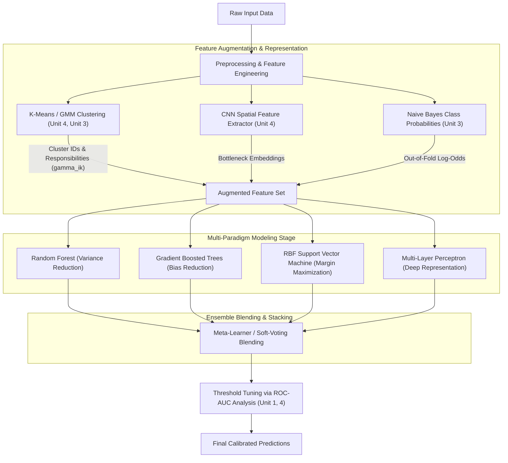

# Cross-Document Comparative Analysis

> **HACKATHON CONTEXT NOTE:**  
> This cross-document analysis synthesizes technical patterns and algorithmic trade-offs across all four reference units (`UE24CS352A`, Units 1–4). This provides an engineering decision framework for selecting, validating, and combining models once the actual hackathon challenge and dataset are unveiled.

---

## 1. Cross-Paradigm Algorithmic Comparisons

### 1.1 Supervised Classification Paradigms
Across the four units, classification is tackled through multiple distinct theoretical paradigms:
1. **Rule/Information-Theoretic (Decision Trees / ID3, Unit 1):** Orthogonal, axis-aligned recursive partitioning based on Shannon Entropy reduction. Highly interpretable; non-linear; unstable with high variance.
2. **Instance-Based / Memory-Based (k-NN, Unit 1):** Non-parametric local approximation; zero training time; lazy computation deferred to query time; bounded by the curse of dimensionality.
3. **Probabilistic / Generative (Naive Bayes, Unit 3):** Models joint distribution $P(X, Y)$ via class-conditional feature independence. Extremely fast; handles high-dimensional sparse text; poor probability calibration.
4. **Discriminative / Geometric Margin (SVM, Unit 2):** Maximizes margin $2/\|w\|$ between classes via convex quadratic programming. Robust against overfitting in high dimensions; kernel trick enables arbitrary non-linear boundaries; computationally heavy on large $N$.
5. **Connectionist / Differentiable (ANN / MLP, Unit 2):** Hierarchical feature transformations through non-linear activation functions optimized via backpropagation. High capacity; non-convex optimization; data-hungry.
6. **Ensemble Variance Reduction (Bagging & Random Forest, Unit 3):** Aggregates decorrelated deep decision trees over bootstrap samples. Superior out-of-the-box accuracy; robust to outliers and noise; built-in OOB validation.
7. **Ensemble Bias Reduction (Boosting & Gradient Boost, Unit 3):** Sequentially fits base learners to the gradient residuals of previous iterations. Often achieves state-of-the-art tabular performance; prone to overfitting if learning rate or tree depth is too large.

---

### 1.2 Unsupervised Clustering Paradigms (Unit 4 vs. Unit 3)
Clustering is explored through three foundational lenses:
1. **Agglomerative Hierarchical (AGNES, Unit 4):** Deterministic, bottom-up proximity-based tree construction. Produces an interpretable dendrogram; no need to specify $K$ upfront; computational complexity $O(N^3)$ or $O(N^2 \log N)$ limits application to small datasets ($N < 10,000$).
2. **Partitional Prototype-Based (K-Means & Bisecting K-Means, Unit 4):** Hard partition minimizing within-cluster sum of squares (WCSS / Inertia). Highly scalable ($O(t \cdot K \cdot N \cdot d)$); fast; assumes spherical, equally dispersed clusters; sensitive to centroid initialization. Bisecting K-Means substantially mitigates initialization sensitivity.
3. **Probabilistic Density Mixture (GMM via EM, Unit 3):** Soft, probabilistic clustering where each cluster is modeled as a multivariate Gaussian with its own covariance matrix $\Sigma_k$. Captures elliptical and multi-scale clusters; assigns posterior membership probabilities $\gamma_{ik}$; requires more parameters and can suffer from singularity on small sample sizes.

---

### 1.3 Optimization Paradigms (Units 1, 2, 3, 4)
The reference materials present five fundamentally different optimization mechanisms:

| Optimization Paradigm | Primary Model | Objective / Mechanism | Mathematical Formulation | Convergence Characteristics | Reference Slides |
|-----------------------|---------------|-----------------------|--------------------------|-----------------------------|------------------|
| **Greedy Search** | Decision Trees (ID3) | Maximize Information Gain at each node | $\arg\max_A \text{Gain}(S, A)$ | Fast local heuristic; no global optimality guarantee | Unit 1, pp. 201–212 |
| **First-Order Gradient Descent** | Linear / Logistic Regression, Neural Networks | Minimize differentiable empirical loss | $\theta := \theta - \alpha \nabla_\theta J(\theta)$ | Guaranteed global minimum for convex problems; local minima / saddle points for NNs | Unit 1, pp. 284–288; Unit 2, pp. 78–99 |
| **Adaptive Moment Optimizers** | Deep Neural Networks (Adam, RMSprop) | Adapt per-parameter learning rates using 1st and 2nd gradient moments | $\theta := \theta - \frac{\alpha}{\sqrt{\hat{v}_t} + \epsilon} \hat{m}_t$ | Fast escape from ravines and saddle points; robust to sparse gradients | Unit 2, pp. 141–147 |
| **Constrained Quadratic Programming** | Support Vector Machines (SVM) | Maximize margin subject to inequality constraints | $\max_\alpha \sum \alpha_i - \frac{1}{2}\sum \alpha_i \alpha_j y_i y_j K(x_i, x_j)$ | Strictly convex; unique global optimum; solved via dual Lagrange multipliers | Unit 2, pp. 171–207 |
| **Expectation-Maximization (EM)** | Gaussian Mixture Models, HMM (Baum-Welch) | Maximize marginal log-likelihood with latent variables | E-Step: $\mathbb{E}_{Z\|X}[L(\theta)]$; M-Step: $\arg\max_\theta Q(\theta, \theta^{(t)})$ | Monotonically increases likelihood; converges to local stationary point | Unit 3, pp. 229–260, 351–361 |

---

## 2. Master Algorithmic Comparison Matrix

The table below provides a unified comparison across all core machine learning algorithms presented across the four slide decks:

| Algorithm | Paradigm | Training Complexity | Inference Complexity | Memory Footprint | Interpretability | Outlier Sensitivity | Handling Non-Linearity | Optimal Data Regime | Primary Reference |
|-----------|----------|---------------------|----------------------|------------------|------------------|---------------------|------------------------|---------------------|-------------------|
| **Find-S** | Concept Learning | $O(N \cdot d)$ | $O(d)$ | Minimal $O(d)$ | Very High (Conjunctive rules) | Extreme (Cannot handle noise) | None (Conjunctive only) | Tiny, noise-free boolean | Unit 1, pp. 74–84 |
| **Decision Tree (ID3)** | Supervised Tree | $O(d \cdot N \log N)$ | $O(\text{depth}) \le O(d)$ | Low $O(\text{nodes})$ | High (Flowchart logic) | Medium (Pruning required) | High (Step-wise orthogonal) | Small to Medium tabular | Unit 1, pp. 191–266 |
| **k-NN** | Instance-Based | $O(1)$ (Lazy) | $O(N \cdot d)$ | Very High (Stores all $N$) | Moderate (Local neighbors) | High (Without weighting) | High (Arbitrary local boundaries) | Small to Medium, Low $d$ | Unit 1, pp. 299–373 |
| **Logistic Regression** | Linear Model | $O(\text{iters} \cdot N \cdot d)$ | $O(d)$ | Minimal $O(d)$ | High (Log-odds coefficients) | Moderate | None (Requires kernel / feature eng.) | Large tabular, High $d$ sparse | Unit 1, pp. 125–127, 270–290 |
| **Multilayer Perceptron (MLP)** | Deep Neural Net | $O(\text{epochs} \cdot N \cdot W)$ | $O(W)$ | Moderate $O(W)$ | Low (Black box) | Moderate (With regularization) | Universal Approximator | Medium to Massive | Unit 2, pp. 45–147 |
| **SVM (Linear)** | Kernel Method | $O(N^2 \cdot d)$ | $O(d)$ | Low $O(d)$ | Moderate (Feature weights) | Low (Soft Margin $C$) | None (Linear separator) | Medium $N$, High $d$ (Text) | Unit 2, pp. 153–208 |
| **SVM (RBF Kernel)** | Kernel Method | $O(N^2 \cdot d)$ to $O(N^3)$ | $O(N_{\text{sv}} \cdot d)$ | High (Stores support vectors) | Very Low | Low (Soft Margin $C$) | Exceptional (Infinite-dim mapping) | Small to Medium ($N < 50k$) | Unit 2, pp. 209–272 |
| **Random Forest** | Bagging Ensemble | $O(B \cdot m \cdot N \log N)$ | $O(B \cdot \text{depth})$ | Moderate to High ($B$ trees) | Moderate (Feature importance) | Very Low (Averaging dampens noise) | Exceptional | Small to Large tabular | Unit 3, pp. 37–65 |
| **Gradient Boosting** | Boosting Ensemble | $O(M \cdot d \cdot N \log N)$ | $O(M \cdot \text{depth})$ | Moderate ($M$ shallow trees) | Moderate (Feature importance) | High (Focuses on hard samples/noise) | Exceptional | Medium to Large tabular | Unit 3, pp. 21–36 |
| **Naive Bayes** | Probabilistic | $O(N \cdot d)$ | $O(c \cdot d)$ | Low $O(c \cdot d)$ | High (Log-likelihood odds) | Low (With Laplace smoothing) | Moderate (Linear in log-space) | High $d$ sparse text | Unit 3, pp. 148–228 |
| **GMM (EM)** | Probabilistic Cluster | $O(\text{iters} \cdot N \cdot K \cdot d^2)$ | $O(K \cdot d^2)$ | Moderate $O(K \cdot d^2)$ | High (Cluster means & covariances) | Moderate to High | Captures elliptical distributions | Small to Medium | Unit 3, pp. 229–260 |
| **HMM** | Sequential Model | $O(\text{iters} \cdot T \cdot N^2)$ | $O(T \cdot N^2)$ | Low $O(N^2 + N \cdot M)$ | High (State transition graph) | Low (Viterbi path optimality) | Captures temporal dynamics | Sequential / Temporal | Unit 3, pp. 261–361 |
| **K-Means** | Partitional Cluster | $O(t \cdot K \cdot N \cdot d)$ | $O(K \cdot d)$ | Low $O(K \cdot d)$ | High (Cluster centroids) | High (Centroids pulled by outliers) | Linear boundaries between centroids | Large, spherical clusters | Unit 4, pp. 37–64 |
| **Bisecting K-Means** | Hierarchical Partitional | $O(t \cdot K \cdot N \cdot d)$ | $O(K \cdot d)$ | Low $O(K \cdot d)$ | High (Hierarchical centroid splits) | Moderate | Piecewise linear | Large tabular | Unit 4, pp. 65–74 |
| **Agglomerative (AGNES)** | Hierarchical Cluster | $O(N^3)$ or $O(N^2 \log N)$ | Non-parametric | Prohibitive $O(N^2)$ | Very High (Dendrogram) | High (Single link) / Low (Average) | Linkage-dependent (Single link non-linear) | Small ($N < 5,000$) | Unit 4, pp. 14–36 |
| **CNN** | Deep Computer Vision | $O(\text{epochs} \cdot \sum F^2 C N_{\text{out}})$ | $O(\text{FLOPs})$ | Moderate to High (Model weights) | Low (Saliency / Feature maps) | Low (With data augmentation) | State-of-the-art for spatial grids | Large image / grid data | Unit 4, pp. 128–176 |

---

## 3. Synergistic and Complementary Combinations

In competitive machine learning, standalone models rarely win. The techniques covered across the reference units can be combined into highly effective hybrid pipelines:

### 3.1 Unsupervised Clustering as Supervised Feature Engineering (Unit 4 $\to$ Units 1, 2, 3)
- **Centroid Distance Features:** Fit K-Means on continuous feature subsets; append the Euclidean distance to each cluster centroid as $K$ new features. This injects non-linear spatial geometry directly into linear models (Logistic Regression, Linear SVM).
- **Soft Cluster Memberships:** Fit a Gaussian Mixture Model (Unit 3) using EM; use the posterior component probabilities $\gamma_{ik}$ as dense mixture embeddings.
- **Cluster-Specific Classifiers:** Cluster the data into distinct operational regimes (e.g., via Bisecting K-Means); train separate gradient boosted or tree models for each cluster.

### 3.2 Feature Extraction via CNNs for Tabular/Kernel Classifiers (Unit 4 $\to$ Units 2, 3)
- Use a convolutional network to extract high-level feature representations from image or grid inputs (extracting the output of the penultimate Flatten/Dense layer).
- Feed these learned spatial embeddings into a Soft-Margin SVM with an RBF kernel (Unit 2) or a Gradient Boosted Tree (Unit 3). This combines the spatial invariant representation learning of CNNs with the maximal-margin or greedy partitioning power of tabular models.

### 3.3 Naive Bayes Out-of-Fold Stacking for Text Features (Unit 3 $\to$ Units 1, 2)
- For high-cardinality text or categorical features, compute Naive Bayes log-likelihood ratios per class using out-of-fold cross-validation.
- Pass these univariate log-posterior probabilities as dense continuous features into Random Forest or Gradient Boosting, completely bypassing high-dimensional sparse matrix memory bloat.

### 3.4 Hybrid Tree + Linear Ensembles (Units 1, 2, 3)
- Tree ensembles (Random Forest, Gradient Boosting) capture complex non-linear feature interactions but cannot extrapolate linear trends outside training bounds.
- Combining a regularized linear model (Ridge / Logistic Regression) with a gradient boosted tree via weighted soft-voting provides both linear extrapolation and local non-linear interaction modeling.

---

## 4. Practical Implementation Trade-offs

### 4.1 Compute vs. Generalization Trade-off
- **k-NN:** Extremely fast to "train" (zero compute), but scales terribly with test set size ($O(N_{\text{train}} \cdot N_{\text{test}} \cdot d)$) and suffers severe memory latency. Unsuitable when real-time test inference is constrained.
- **SVM with RBF Kernel:** Quadratic to cubic training scaling ($O(N^2)$ to $O(N^3)$). Excellent for datasets under 30,000 samples with complex boundaries; computationally impractical for $N > 100,000$.
- **Random Forest:** Embarrassingly parallelizable across CPU cores during training (each tree is constructed independently on a bootstrap sample). Slower inference due to traversing hundreds of deep trees.
- **Gradient Boosting:** Inherently sequential training (tree $m$ requires residuals of tree $m-1$), but individual trees are very shallow (`max_depth` 3 to 6), leading to lightning-fast inference.

### 4.2 Interpretability vs. Expressive Power Trade-off
- **High Interpretability:** Single Decision Trees (ID3), Logistic Regression, Naive Bayes. Can be inspected directly by stakeholders, verified for regulatory compliance, and converted into IF-THEN code. Lower predictive ceiling.
- **High Expressive Power:** Multi-Layer Perceptrons, Deep CNNs, Boosted Tree Ensembles. Unrivaled predictive accuracy on complex non-linear interactions; require post-hoc explainability techniques (SHAP, permutation importance).

### 4.3 Sensitivity to Preprocessing and Missing Data
- **Tree-Based Models (ID3, Random Forest, Gradient Boost):** Completely invariant to monotonic feature transformations (scaling/normalization has zero effect on split thresholds); natively handle missing values (via surrogate splits or default assignment).
- **Distance & Gradient Models (k-NN, SVM, Logistic Regression, MLP):** Catastrophically broken if features are unscaled; cannot natively handle missing values; require rigorous imputation and scaling pipelines.
