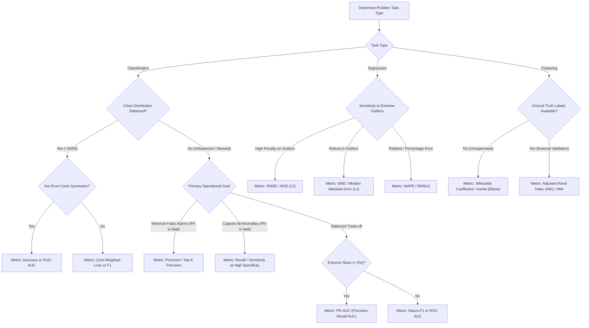

# Algorithms, Metrics, and Techniques Reference Catalog

> **HACKATHON IMPLEMENTATION GUIDE:**  
> This catalog provides the complete mathematical specifications, pseudocode routines, complexity bounds, and metric selection frameworks extracted from the reference slide decks (`UE24CS352A`, Units 1–4). It serves as a rapid reference for pipeline construction.

---

# Part 1: Comprehensive Algorithmic Catalog

---

## 1. Decision Tree Induction: ID3 Algorithm
*Slide Reference:* `2. ML unit 1 slides 2026 full.pdf`, pp. 198–239  
*Problem Class:* Supervised Classification (Categorical & Discretized Numerical)

### Mathematical Formulation
- **Entropy:**
  $$\text{Entropy}(S) = - \sum_{i=1}^{c} p_i \log_2(p_i)$$
- **Information Gain:**
  $$\text{Gain}(S, A) = \text{Entropy}(S) - \sum_{v \in \text{Values}(A)} \frac{|S_v|}{|S|} \text{Entropy}(S_v)$$

### Algorithmic Workflow & Pseudocode
```
Algorithm ID3(Examples, Target_Attribute, Attributes):
    Create a Root node for the tree
    If all Examples are positive, Return the single-node tree Root with label = '+'
    If all Examples are negative, Return the single-node tree Root with label = '-'
    If Attributes is empty, Return the single-node tree Root with label = most common value of Target_Attribute in Examples
    
    A* <- Attribute in Attributes that maximizes Gain(Examples, A)
    Root.decision_attribute <- A*
    
    For each possible value v of A*:
        Add a new tree branch below Root corresponding to test A* = v
        Examples_v <- subset of Examples with A* = v
        If Examples_v is empty:
            Below this new branch add a leaf node with label = most common Target_Attribute in Examples
        Else:
            Below this new branch add the subtree ID3(Examples_v, Target_Attribute, Attributes \ {A*})
            
    Return Root
```

### Computational Complexity
- **Training Time:** $O(d \cdot N \log N)$, where $N$ is number of samples, $d$ is number of attributes.
- **Inference Time:** $O(\text{Tree Depth}) \le O(d)$.
- **Space Complexity:** $O(\text{Number of Nodes}) \le O(2^d)$.

---

## 2. k-Nearest Neighbors (k-NN)
*Slide Reference:* `2. ML unit 1 slides 2026 full.pdf`, pp. 299–373  
*Problem Class:* Supervised Classification & Regression (Non-parametric)

### Mathematical Formulation
- **Distance Metrics:**
  - Euclidean ($L_2$): $d(x, y) = \sqrt{\sum_{i=1}^d (x_i - y_i)^2}$
  - Manhattan ($L_1$): $d(x, y) = \sum_{i=1}^d |x_i - y_i|$
  - Minkowski ($L_p$): $d(x, y) = \left(\sum_{i=1}^d |x_i - y_i|^p\right)^{1/p}$
- **Distance-Weighted Voting (pp. 348–351):**
  $$w_i = \frac{1}{d(x_q, x_i)^2}, \quad \hat{y}_{\text{class}} = \arg\max_{c \in C} \sum_{i \in N_k(x_q), y_i = c} w_i, \quad \hat{y}_{\text{reg}} = \frac{\sum_{i \in N_k(x_q)} w_i y_i}{\sum_{i \in N_k(x_q)} w_i}$$

### Algorithmic Workflow & Pseudocode
```
Algorithm kNN_Predict(TrainData D, QueryPoint x_q, k, Metric):
    Distances <- []
    For each (x_i, y_i) in D:
        dist <- Metric(x_q, x_i)
        Append (dist, y_i) to Distances
        
    Sort Distances in ascending order of dist
    Neighbors <- First k elements of sorted Distances
    
    If Task is Classification:
        Return mode(y_i for (_, y_i) in Neighbors)  [or weighted majority]
    Else If Task is Regression:
        Return mean(y_i for (_, y_i) in Neighbors)  [or weighted average]
```

### Computational Complexity
- **Training Time:** $O(1)$ (No explicit model fitting; simply caches dataset).
- **Inference Time:** $O(N \cdot d + N \log k)$ per test sample (Brute force). Reduced to $O(d \log N)$ with KD-Trees (for $d < 20$).
- **Space Complexity:** $O(N \cdot d)$ (Must store entire training dataset).

---

## 3. Artificial Neural Networks: Multi-Layer Perceptron (MLP)
*Slide Reference:* `2. ML unit 2 slides 2026 full.pdf`, pp. 45–147  
*Problem Class:* Supervised Non-linear Classification & Regression

### Mathematical Formulation
- **Forward Step:**
  $$z^{[l]} = W^{[l]} a^{[l-1]} + b^{[l]}, \quad a^{[l]} = g^{[l]}(z^{[l]})$$
- **Loss Function (MSE):**
  $$E = \frac{1}{2} \sum_{k=1}^K (t_k - a_k^{[L]})^2$$
- **Backpropagation Gradients (pp. 78–99):**
  - Output layer error: $\delta_k^{[L]} = -(t_k - a_k^{[L]}) \odot g'^{[L]}(z_k^{[L]})$
  - Hidden layer error: $\delta_j^{[l]} = \left( (W^{[l+1]})^T \delta^{[l+1]} \right) \odot g'^{[l]}(z_j^{[l]})$
  - Weight and bias gradients:
    $$\frac{\partial E}{\partial W^{[l]}} = \delta^{[l]} (a^{[l-1]})^T, \quad \frac{\partial E}{\partial b^{[l]}} = \delta^{[l]}$$
- **Adam Optimizer Updates (pp. 144–147):**
  $$m_t = \beta_1 m_{t-1} + (1 - \beta_1) g_t, \quad v_t = \beta_2 v_{t-1} + (1 - \beta_2) g_t^2$$
  $$\hat{m}_t = \frac{m_t}{1 - \beta_1^t}, \quad \hat{v}_t = \frac{v_t}{1 - \beta_2^t}$$
  $$\theta_{t} = \theta_{t-1} - \frac{\alpha}{\sqrt{\hat{v}_t} + \epsilon} \hat{m}_t$$

### Computational Complexity
- **Training Time:** $O(\text{Epochs} \cdot \frac{N}{B} \cdot \sum_{l=1}^L n_{l-1} n_l)$, where $n_l$ is number of units in layer $l$.
- **Inference Time:** $O(\sum_{l=1}^L n_{l-1} n_l)$ per sample.
- **Space Complexity:** $O(\sum_{l=1}^L n_{l-1} n_l)$ for weights, biases, and optimizer states.

---

## 4. Support Vector Machines (SVM)
*Slide Reference:* `2. ML unit 2 slides 2026 full.pdf`, pp. 153–272  
*Problem Class:* Maximum Margin Classification & Regression

### Mathematical Formulation
- **Soft Margin Dual Quadratic Program (pp. 195–207, 266–269):**
  $$\max_{\alpha} \sum_{i=1}^N \alpha_i - \frac{1}{2} \sum_{i=1}^N \sum_{j=1}^N \alpha_i \alpha_j y_i y_j K(x_i, x_j)$$
  $$\text{subject to } 0 \le \alpha_i \le C \quad \forall i, \quad \text{and} \quad \sum_{i=1}^N \alpha_i y_i = 0$$
- **Kernel Functions (pp. 222–228):**
  - Linear: $K(x_i, x_j) = x_i^T x_j$
  - Polynomial: $K(x_i, x_j) = (x_i^T x_j + c)^d$
  - RBF / Gaussian: $K(x_i, x_j) = \exp(-\gamma \|x_i - x_j\|^2)$
- **Inference Decision Rule (p. 161, 221):**
  $$\hat{y}(x^*) = \text{sign}\left( \sum_{i \in \text{Support Vectors}} \alpha_i y_i K(x_i, x^*) + b \right)$$
  Where $b = y_k - \sum_{i \in \text{SV}} \alpha_i y_i K(x_i, x_k)$ for any free support vector with $0 < \alpha_k < C$.

### Computational Complexity
- **Training Time:** $O(N^2 \cdot d)$ to $O(N^3)$ (depending on QP solver like SMO and cache size).
- **Inference Time:** $O(N_{\text{sv}} \cdot d)$ per test sample.
- **Space Complexity:** $O(N_{\text{sv}} \cdot d)$ to store support vectors.

---

## 5. Random Forest
*Slide Reference:* `2. ML unit 3 slides 2026 full.pdf`, pp. 37–65  
*Problem Class:* Supervised Ensemble Classification & Regression

### Algorithmic Workflow & Pseudocode
```
Algorithm Train_Random_Forest(Data D, B_trees, m_features, min_leaf):
    Forest <- []
    For b = 1 to B_trees:
        D_b <- Draw bootstrap sample of size N from D with replacement
        OOB_b <- D \ D_b
        Tree_b <- Build_RF_Tree(D_b, m_features, min_leaf)
        Append (Tree_b, OOB_b) to Forest
    Return Forest

Algorithm Build_RF_Tree(Data D, m, min_leaf):
    If |D| <= min_leaf or D is pure:
        Return Leaf(mode(labels in D))
        
    Randomly select m attributes out of total d attributes
    A* <- Attribute in selected m that maximizes Information Gain / Gini Reduction
    Partition D into D_left, D_right based on best split of A*
    
    Left_child <- Build_RF_Tree(D_left, m, min_leaf)
    Right_child <- Build_RF_Tree(D_right, m, min_leaf)
    Return Node(A*, Left_child, Right_child)
```

### Computational Complexity
- **Training Time:** $O(B \cdot m \cdot N \log N)$, embarrassingly parallelizable across $P$ CPU cores ($O(\frac{B}{P} m N \log N)$).
- **Inference Time:** $O(B \cdot \text{max\_depth})$.
- **Space Complexity:** $O(B \cdot \text{nodes per tree})$.

---

## 6. Gradient Boosted Decision Trees (GBDT)
*Slide Reference:* `2. ML unit 3 slides 2026 full.pdf`, pp. 21–36  
*Problem Class:* Supervised Ensemble Classification & Regression

### Mathematical Formulation
- **Initialization:** $f_0(x) = \arg\min_\gamma \sum_{i=1}^N L(y_i, \gamma)$
- **Iterative Step ($m = 1$ to $M$):**
  1. Compute pseudo-residuals:
     $$r_{im} = - \left[ \frac{\partial L(y_i, f(x_i))}{\partial f(x_i)} \right]_{f(x) = f_{m-1}(x)}$$
  2. Fit base regression tree $h_m(x)$ to residuals $r_{im}$.
  3. Compute optimal leaf step size $\gamma_{jm} = \arg\min_\gamma \sum_{x_i \in R_{jm}} L(y_i, f_{m-1}(x_i) + \gamma)$.
  4. Update ensemble model with shrinkage learning rate $\nu \in (0, 1]$:
     $$f_m(x) = f_{m-1}(x) + \nu \sum_{j} \gamma_{jm} \mathbb{I}(x \in R_{jm})$$

---

## 7. Naive Bayes Classifier
*Slide Reference:* `2. ML unit 3 slides 2026 full.pdf`, pp. 148–228  
*Problem Class:* Probabilistic Multi-Class Classification & Text Categorization

### Mathematical Formulation
- **Classification Decision Rule (Log-Space to prevent underflow, pp. 180–183):**
  $$\hat{y} = \arg\max_{c \in C} \left[ \ln P(y = c) + \sum_{j=1}^d \ln P(x_j | y = c) \right]$$
- **Laplace Smoothing (pp. 172–179):**
  $$P(x_j = v | y = c) = \frac{\text{count}(x_j = v, y = c) + 1}{\text{count}(y = c) + K_j}$$

### Computational Complexity
- **Training Time:** $O(N \cdot d)$ (Single pass frequency counting).
- **Inference Time:** $O(|C| \cdot d)$ per test instance.
- **Space Complexity:** $O(|C| \cdot \sum_j K_j)$ to store conditional probability tables.

---

## 8. Expectation-Maximization (EM) for Gaussian Mixture Models (GMM)
*Slide Reference:* `2. ML unit 3 slides 2026 full.pdf`, pp. 229–260  
*Problem Class:* Unsupervised Soft Clustering & Density Estimation

### Mathematical Formulation
- **E-Step (Responsibility Calculation, p. 240):**
  $$\gamma_{ik} = \frac{\pi_k \mathcal{N}(x_i | \mu_k, \Sigma_k)}{\sum_{j=1}^K \pi_j \mathcal{N}(x_i | \mu_j, \Sigma_j)}$$
- **M-Step (Parameter Updates, pp. 241, 250–253):**
  $$N_k = \sum_{i=1}^N \gamma_{ik}, \quad \pi_k = \frac{N_k}{N}, \quad \mu_k = \frac{1}{N_k} \sum_{i=1}^N \gamma_{ik} x_i$$
  $$\Sigma_k = \frac{1}{N_k} \sum_{i=1}^N \gamma_{ik} (x_i - \mu_k)(x_i - \mu_k)^T$$

---

## 9. Hidden Markov Models: Forward, Viterbi & Baum-Welch
*Slide Reference:* `2. ML unit 3 slides 2026 full.pdf`, pp. 261–361  
*Problem Class:* Sequential Probabilistic Modeling

### Dynamic Programming Formulations
- **Forward Algorithm (Likelihood Evaluation, pp. 303–315):**
  $$\alpha_1(i) = \pi_i b_i(O_1)$$
  $$\alpha_{t+1}(j) = \left[ \sum_{i=1}^N \alpha_t(i) a_{ij} \right] b_j(O_{t+1})$$
  $$P(O|\lambda) = \sum_{i=1}^N \alpha_T(i) \quad \left[\text{Complexity: } O(N^2 T)\right]$$
- **Viterbi Algorithm (Optimal State Decoding, pp. 334–350):**
  $$\delta_1(i) = \pi_i b_i(O_1), \quad \psi_1(i) = 0$$
  $$\delta_t(j) = \max_{1 \le i \le N} [\delta_{t-1}(i) a_{ij}] \cdot b_j(O_t)$$
  $$\psi_t(j) = \arg\max_{1 \le i \le N} [\delta_{t-1}(i) a_{ij}]$$
  $$\text{Backtrack: } q_T^* = \arg\max_i \delta_T(i), \quad q_t^* = \psi_{t+1}(q_{t+1}^*)$$

---

## 10. Partitional Clustering: K-Means & Bisecting K-Means
*Slide Reference:* `2. ML unit 4 slides 2026 full.pdf`, pp. 37–74  
*Problem Class:* Unsupervised Hard Clustering

### Mathematical Formulation
- **Objective (Inertia / WCSS):**
  $$J = \sum_{k=1}^K \sum_{x_i \in C_k} \|x_i - \mu_k\|^2$$
- **Centroid Update:**
  $$\mu_k = \frac{1}{|C_k|} \sum_{x_i \in C_k} x_i$$
- **Bisecting K-Means Workflow (pp. 65–72):**
  Iteratively splits the cluster exhibiting the largest sum of squared errors using 2-Means until $K$ total clusters are reached.

---

## 11. Convolutional Neural Networks (CNN)
*Slide Reference:* `2. ML unit 4 slides 2026 full.pdf`, pp. 128–176  
*Problem Class:* Deep Learning for 2D Grid / Computer Vision Data

### Core Dimension & Parameter Equations
- **Spatial Output Dimension (p. 156):**
  $$O = \left\lfloor \frac{N - F + 2P}{S} \right\rfloor + 1$$
- **Layer Parameter Count (p. 157):**
  $$\text{Total Params} = K \times \left[ (F \times F \times C_{\text{in}}) + 1 \right]$$
- **Padding Types:**
  - *Valid:* $P = 0$
  - *Same:* $P = \frac{F - 1}{2}$ (for odd $F$, $S=1$)

---

# Part 2: Comprehensive Evaluation Metrics Catalog

---

## 1. Classification Metrics Formulation

### Binary Confusion Matrix Anatomy
$$\begin{array}{c|cc}
& \text{Predicted Positive (1)} & \text{Predicted Negative (0)} \\
\hline
\text{Actual Positive (1)} & \text{TP (True Positive)} & \text{FN (False Negative)} \\
\text{Actual Negative (0)} & \text{FP (False Positive)} & \text{TN (True Negative)}
\end{array}$$

### Complete Formula Table

| Metric | Mathematical Formula | Optimal Value | Practical Operational Interpretation | Failure Modes / Edge Cases |
|--------|----------------------|---------------|--------------------------------------|----------------------------|
| **Accuracy** | $\frac{\text{TP} + \text{TN}}{\text{TP} + \text{TN} + \text{FP} + \text{FN}}$ | $1.0$ ($100\%$) | Ratio of correct classifications | **Accuracy Paradox:** Highly misleading on imbalanced data (predicting all negative gives $99\%$ accuracy on $1\%$ prevalence). |
| **Precision** | $\frac{\text{TP}}{\text{TP} + \text{FP}}$ | $1.0$ | Exactness: How many predicted positives are truly positive? | Undefined ($0/0$) when model predicts zero positives. Mitigated by setting precision to $0.0$ or $1.0$. |
| **Recall / Sensitivity / TPR** | $\frac{\text{TP}}{\text{TP} + \text{FN}}$ | $1.0$ | Completeness: How many actual positives did the model capture? | Fails to penalize excessive false alarms (predicting all positive yields Recall $= 1.0$). |
| **Specificity / TNR** | $\frac{\text{TN}}{\text{TN} + \text{FP}}$ | $1.0$ | True negative retention: How many negatives were correctly cleared? | Undefined if there are zero true negative instances in dataset. |
| **False Positive Rate (FPR)** | $\frac{\text{FP}}{\text{TN} + \text{FP}} = 1 - \text{Specificity}$ | $0.0$ | False alarm rate among true negatives | Plotted on $x$-axis of ROC curve. |
| **F1-Score** | $2 \cdot \frac{\text{Precision} \cdot \text{Recall}}{\text{Precision} + \text{Recall}} = \frac{2\text{TP}}{2\text{TP} + \text{FP} + \text{FN}}$ | $1.0$ | Harmonic mean balancing precision and recall | Severely penalizes extreme imbalances between precision and recall. |
| **$F_\beta$-Score** | $(1 + \beta^2) \frac{\text{Precision} \cdot \text{Recall}}{\beta^2 \text{Precision} + \text{Recall}}$ | $1.0$ | Weighted harmonic mean ($\beta > 1$ weights Recall higher; $\beta < 1$ weights Precision higher) | Requires business justification for parameter $\beta$. |
| **ROC-AUC** | $\int_0^1 \text{TPR}(\text{FPR}^{-1}(t)) dt$ | $1.0$ | Probability of ranking a random positive higher than a random negative | Invariant to class distribution; can appear deceptively high on severely skewed data ($P < 1\%$). |
| **PR-AUC** | $\int_0^1 \text{Precision}(\text{Recall}) d(\text{Recall})$ | $1.0$ | Area under Precision-Recall curve | Superior to ROC-AUC for severe class skew; focuses directly on minority class. |

---

## 2. Multi-Class Averaging Frameworks (Unit 1, pp. 115–124; Unit 4, pp. 95–104)

Given an $N \times N$ multi-class confusion matrix $M$:
- For each class $i \in \{1, \dots, C\}$:
  $$\text{TP}_i = M_{ii}, \quad \text{FP}_i = \sum_{j \ne i} M_{ji}, \quad \text{FN}_i = \sum_{j \ne i} M_{ij}$$
  $$\text{Precision}_i = \frac{\text{TP}_i}{\text{TP}_i + \text{FP}_i}, \quad \text{Recall}_i = \frac{\text{TP}_i}{\text{TP}_i + \text{FN}_i}, \quad F1_i = 2 \cdot \frac{\text{Precision}_i \cdot \text{Recall}_i}{\text{Precision}_i + \text{Recall}_i}$$

### Averaging Strategies

1. **Macro-Averaging:**
   $$\text{Macro-Precision} = \frac{1}{C} \sum_{i=1}^C \text{Precision}_i, \quad \text{Macro-}F1 = \frac{1}{C} \sum_{i=1}^C F1_i$$
   *When to use:* Treats all classes with equal importance, regardless of class frequency. Best for detecting whether the model fails on rare minority categories.
2. **Micro-Averaging:**
   $$\text{Micro-Precision} = \frac{\sum_{i=1}^C \text{TP}_i}{\sum_{i=1}^C (\text{TP}_i + \text{FP}_i)} = \text{Accuracy}$$
   *When to use:* Pools all global decisions together. Dominated by frequent majority classes.
3. **Weighted-Averaging:**
   $$\text{Weighted-}F1 = \sum_{i=1}^C \left(\frac{N_i}{N}\right) F1_i$$
   *When to use:* Scales class importance by sample support $N_i$. Reflects expected population performance under existing class proportions.

---

## 3. Metric Selection Decision Matrix


