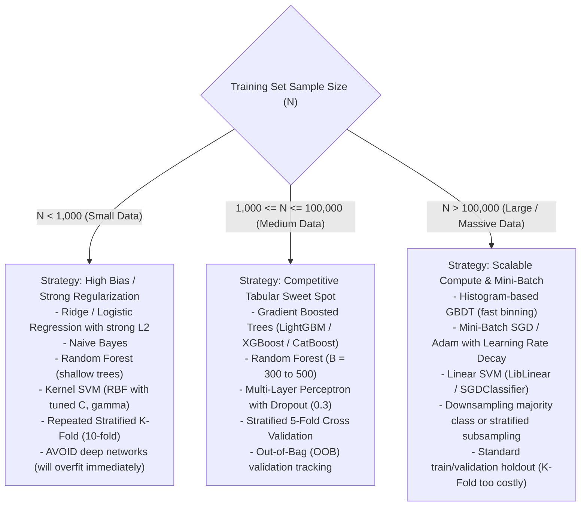
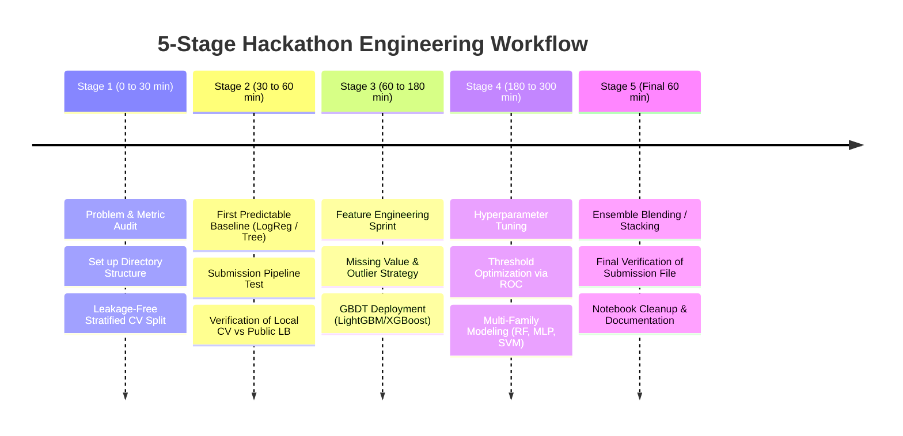

# Practical Implementation Insights & Hackathon Playbook

> **MINDSET: THINK LIKE A WINNING HACKATHON ML ENGINEER**  
> In competitive machine learning hackathons, success is governed not by raw theoretical complexity, but by **speed of iteration, leakage-free validation, smart baseline deployment, disciplined feature engineering, and robust ensemble blending**. This guide translates the academic reference material (`UE24CS352A`, Units 1–4) into tactical engineering decisions.

---

## 1. Computational Efficiency & Hardware Profiling

| Algorithm Family | Training Speed (CPU) | Inference Latency | Memory Footprint | GPU Required? | Hackathon Triage Assessment |
|------------------|----------------------|-------------------|------------------|---------------|-----------------------------|
| **Logistic Regression / Ridge** | Instant (< 1s) | Ultra-fast (< 1ms) | Minimal (< 10MB) | No | **Essential Minute-10 Baseline** |
| **Naive Bayes** | Instant (< 1s) | Ultra-fast (< 1ms) | Minimal (< 50MB) | No | **Mandatory text baseline** |
| **Single Decision Tree** | Fast (< 2s) | Ultra-fast (< 1ms) | Minimal | No | Fast inspection of feature interactions |
| **k-NN** | Instant ($O(1)$) | **Extremely Slow** ($O(N \cdot d)$) | **Heavy** (Stores full dataset) | No (GPU can accelerate distance) | **Avoid for large test sets ($N > 10,000$)** |
| **Random Forest** | Medium (Parallelizes across CPU cores) | Medium | Moderate ($B$ trees) | No | **Rock-solid robust baseline**; nearly impossible to mess up |
| **Gradient Boosting (GBDT)** | Medium-Fast (Minutes) | Fast (< 5ms) | Low | Optional (GPU accelerates histogram binning) | **The primary tabular winner** in 90% of hackathons |
| **Linear SVM** | Fast to Medium | Ultra-fast | Minimal | No | Strong on sparse high-dimensional data |
| **Kernel SVM (RBF)** | **Slow** ($O(N^2)$ to $O(N^3)$) | Slow ($O(N_{\text{sv}} \cdot d)$) | Heavy | No | **Do NOT use if $N > 50,000$**; training will timeout |
| **Multi-Layer Perceptron (MLP)** | Medium (Requires multiple epochs) | Fast | Moderate | Helpful | Good for tabular embeddings or non-linear blending |
| **Convolutional Neural Networks (CNN)** | Slow (Hours without GPU) | Medium | Heavy | **MANDATORY** | Requires CUDA / GPU acceleration for visual data |
| **K-Means / Bisecting K-Means** | Fast ($O(t \cdot K \cdot N \cdot d)$) | Fast | Low | No | Fast unsupervised feature augmentation |
| **Hierarchical Clustering (AGNES)** | **Very Slow** ($O(N^3)$) | N/A | **Prohibitive** ($O(N^2)$ matrix) | No | **Strictly avoid if $N > 10,000$** |

---

## 2. Dataset Scale Decision Rules

---

## 3. Fast Baselines (The First 60 Minutes)

### Phase A: Golden Baseline Checklist
1. **Never build a complex model first.** Begin with the simplest reasonable baseline:
   - *Tabular Classification:* Logistic Regression with Z-score standardization, followed immediately by a default Random Forest (`n_estimators=100`).
   - *Tabular Regression:* Ridge Regression, followed immediately by Random Forest Regressor.
   - *Text Classification:* Naive Bayes (Multinomial with Laplace smoothing) on TF-IDF or Bag-of-Words.
   - *Image Classification:* Pretrained lightweight backbone (e.g., MobileNetV2 or ResNet-18) with a linear classification head.
2. **Lock down the CV Pipeline before tuning:** Ensure your local validation score correlates with the leaderboard before touching a single hyperparameter.
3. **Log the baseline score:** This score is your anchor. Any subsequent model or feature engineering that fails to beat this baseline must be rejected.

---

## 4. High-Impact Performance Boosters

The reference materials detail several key techniques that consistently provide measurable leaderboard gains:

### 4.1 Feature Engineering (The Highest ROI Activity)
- **Non-Linear Interactions (Unit 1, pp. 191–212):** Decision trees search for orthogonal single-feature splits. If the target depends on a diagonal ratio or product (e.g., $\frac{\text{Debt}}{\text{Income}}$, $\text{Width} \times \text{Height}$), manually constructing these ratio and interaction features allows tree models to capture non-linear relationships in a single split rather than hundreds of staircase approximations.
- **Unsupervised Cluster Distances as Features (Unit 4, pp. 37–74):** Fit K-Means on continuous feature subsets; append the distance to each cluster centroid as new columns. This provides non-linear spatial landmarks for downstream models.
- **Log Transformation of Skewed Targets (Unit 1, p. 281; Unit 3, p. 180):** Transforming right-skewed regression targets ($y \mapsto \log(1 + y)$) prevents extreme target outliers from dominating the mean squared error loss.
- **Target Encoding with Smoothing (Unit 3, pp. 172–179):** When high-cardinality categorical features exist, replace categories with smoothed out-of-fold target averages using the $m$-estimate principle:
  $$S_i = \frac{n_i \bar{y}_i + m \cdot \bar{y}_{\text{global}}}{n_i + m}$$

### 4.2 Threshold Tuning via ROC Analysis (Unit 1, pp. 128–146; Unit 4, pp. 105–112)
- Models default to a decision threshold of $\tau = 0.5$. On imbalanced datasets or asymmetric cost metrics (e.g., F1-Score), $\tau = 0.5$ is almost never optimal!
- Generate predicted probabilities on the validation fold, sweep $\tau \in [0.01, 0.99]$ in increments of $0.01$, and select the exact threshold $\tau^*$ that maximizes the competition metric. Apply $\tau^*$ to test predictions. This frequently yields a $+0.02$ to $+0.05$ metric bump with zero retraining cost!

### 4.3 Multi-Paradigm Ensembling and Blending (Unit 3, pp. 2–18)
- Blending models from **different mathematical families** (e.g., 1 GBDT + 1 Random Forest + 1 Logistic Regression / MLP) produces superior error decorrelation compared to blending models of the same family.
- **Rank Averaging:** When optimizing ranking metrics (ROC-AUC), convert base model probability predictions to percentiles/ranks prior to averaging:
  $$\hat{y}_{\text{ensemble}} = \frac{1}{M} \sum_{m=1}^M \text{rank}\left(\hat{y}^{(m)}\right)$$
  This prevents miscalibrated probability distributions from skewing the combined ensemble.

---

## 5. Overfitting Traps and Data Leakage Anti-Patterns

### 5.1 The Cardinal Sins of Data Leakage
1. **Preprocessing Leakage:** Computing Min-Max bounds ($\min, \max$), standardization statistics ($\mu, \sigma$), or missing value imputation medians on the **entire dataset** before cross-validation splitting.
   - *Fix:* Fit scalers and imputers **strictly on the training fold**, and use those fitted statistics to transform the validation fold and test set.
2. **Target Leakage in Feature Engineering:** Creating aggregations (e.g., target encoding, out-of-fold probability features) using ground-truth target labels across the whole dataset.
   - *Fix:* Always compute target features within internal K-Fold loops (Out-of-Fold computation).
3. **Temporal Leakage:** Using future observations to predict past events in time-series data.
   - *Fix:* Use time-based rolling splits (`TimeSeriesSplit`) rather than random shuffling.

### 5.2 Classic Overfitting Failure Modes
- **Decision Trees:** Growing unpruned trees to pure leaves ($k=1$ in k-NN or depth $\to \infty$ in trees) yields 100% training accuracy but catastrophic test variance (Unit 1, pp. 240–258). Always constrain `max_depth`, `min_samples_leaf`, and apply pruning.
- **k-NN with $k=1$ (Unit 1, pp. 328–337):** Fitting to nearest single points memorizes training noise and label errors.
- **Deep Neural Networks without Regularization (Unit 2, pp. 100–108):** High parameter count networks memorize arbitrary patterns. Always incorporate Dropout ($p = 0.2 \text{ to } 0.5$), Weight Decay (L2 penalty), and Early Stopping monitored on validation loss.
- **Gradient Boosting over-iteration (Unit 3, pp. 21–36):** With high learning rate $\nu > 0.3$ and large number of trees ($M > 2,000$), GBDT begins fitting to dataset noise. Always set early stopping with a patience of 50 rounds.

---

## 6. Time-Constrained Hackathon Execution Playbook

### Stage 1: Problem & Metric Audit (First 30 Mins)
- Identify problem type: Classification (Binary/Multi-class), Regression, or Ranking.
- Identify the exact competition metric (e.g., Macro-F1, ROC-AUC, RMSE) and implement a local evaluation function matching it identically.
- Construct a leak-free Stratified K-Fold cross-validation scheme.

### Stage 2: Deploy First Baseline (Minutes 30 to 60)
- Train simple, fast models (Logistic Regression, Default Random Forest).
- Generate a submission file and verify end-to-end pipeline formatting (headers, IDs, row counts, probability vs. class label).
- Establish the baseline CV score benchmark.

### Stage 3: Feature Engineering Engine (Minutes 60 to 180)
- Domain-specific feature construction (ratios, aggregations, differences).
- Handle categorical features (One-hot, frequency, out-of-fold target encoding).
- Deploy Gradient Boosted Decision Trees (GBDT); evaluate feature importance and drop zero-gain noise columns.

### Stage 4: Multi-Model Exploration & Tuning (Minutes 180 to 300)
- Train distinct models across different families (GBDT, Random Forest, regularized MLP, Kernel SVM if $N$ allows).
- Fine-tune key hyperparameters (learning rate, tree depth, regularization $C$, dropout).
- Perform post-processing: optimize decision thresholds $\tau^*$ via ROC curve analysis on validation predictions.

### Stage 5: Ensembling & Final Submission (Final 60 Mins)
- Combine out-of-fold predictions from diverse models using rank-averaging or soft-voting.
- Check predictions for sanity (no NaNs, correct value ranges, non-trivial distributions).
- Select final submissions: (1) Best local CV model, (2) Conservative diverse ensemble blend.
